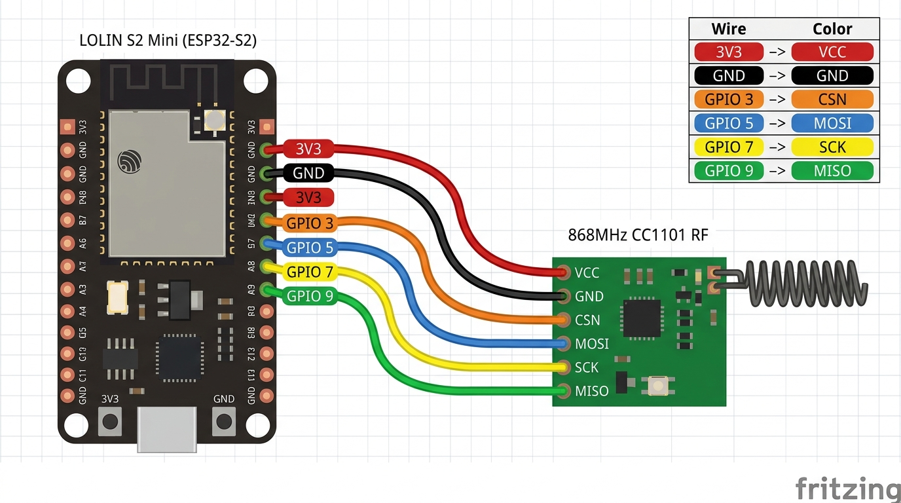

# Gateway (ESP32-S2 + CC1101)

PlatformIO firmware for a **WEMOS LOLIN S2 Mini** with a **CC1101 868 MHz** module. It receives
and decrypts the Verisure devices' packets, publishes them to Home Assistant over MQTT with
auto-discovery, answers the camera's polls with the alarm state and picture commands, and
reassembles camera pictures.

## Hardware

| ESP32-S2 pin | CC1101 pin | Signal |
| :---: | :---: | :--- |
| 3V3 | VCC | 3.3 V (shared) |
| GND | GND | Ground (shared) |
| GPIO 3 | CSN (#1) | SPI chip select, main CC1101 (868.950 MHz) |
| GPIO 2 | CSN (#2) | SPI chip select, optional CC1101 #2 (869.525 MHz RX-only, picture channel) |
| GPIO 5 | MOSI | SPI data out (shared) |
| GPIO 7 | SCK | SPI clock (shared) |
| GPIO 9 | MISO / GDO1 | SPI data in (shared) |

> [!IMPORTANT]
> Use these ADC1-domain pins. The default FSPI pins (GPIO 11/12) put SPI noise into the
> ESP32-S2's Wi-Fi receiver. Background: [gateway hardware](../documentation/hardware_gateway_esp32s2.md).



## Build and flash

```bash
cp 868Receiver/src/secrets.h.example 868Receiver/src/secrets.h   # your master key (git-ignored)
pio run -d 868Receiver -t upload --upload-port <gateway port>
```

`secrets.h` only needs `MASTER_KEY_HEX`; Wi-Fi, MQTT and the web portal password are optional
there. Without Wi-Fi the gateway opens the setup access point `Verisure-Gateway` (its password is
unique per gateway: the serial console shows it at boot, every minute and with `appass`; or
set `DEFAULT_AP_PASS` in `secrets.h`; page `http://192.168.4.1`). Settings can be changed later in the web portal (stored
in NVS).

### Update over Wi-Fi (OTA)

Once the gateway runs a firmware with OTA and is on Wi-Fi, later builds can be installed without
USB:

```bash
pio run -d 868Receiver
GATEWAY_PASS='<portal password>' python 868Receiver/ota_upload.py --host verisure-gateway.local
# or: --password-file <file> (first line), --bin <other image>, --wait-valid
```

The script checks the image, uploads `.pio/build/lolin_s2_mini/firmware.bin` with its MD5,
waits for the reboot and checks in `/api/status` that the gateway runs exactly this image. The
password is taken only from `--password-file` or `GATEWAY_PASS`, never from the command line.
The web page has the same upload (Firmware Update card).

* The 4 MB flash has two 1.25 MB app slots (`app0`, `app1`, default partition table); the image
  goes into the slot that is not running. Nothing is written before the access check (portal
  password, `X-Gateway: 1`, Host/Origin) and the image header (an ESP32-S2 application image)
  have passed. The whole image (checksum, SHA-256, the MD5 if given) is verified before the
  gateway boots it; a wrong password, a truncated or foreign file, a wrong MD5 or a dropped
  connection leave the running firmware in place.
* **Rollback:** a new firmware first runs "pending verify". It confirms itself once it has run
  30 s and is connected to Wi-Fi at that moment; if it restarts or crashes before that, or has no
  Wi-Fi within 5 minutes, the gateway goes back to the previous firmware. A firmware that hangs
  before that check stays "pending" until the next power cycle, which then rolls it back. This
  only works if the NEW firmware contains this OTA code: an older build (before OTA) marks itself
  valid at boot, so after updating to one, USB is the only way back. `/api/status` shows
  `firmware.partition`, `.state` and `.md5`.
* Refused: a new update while the running firmware is not confirmed yet, while the gateway is
  rebooting into a just-written update, and in the setup access point (there it could not be
  confirmed, and the portal may have no password yet). A refused request is answered at once and
  its connection closed, so a stalled upload cannot hold the gateway.
* The upload (~1 MB, ~10 s) blocks the main loop: the MQTT client, the CLI and the handling of
  received frames wait (the radio task keeps reading the FIFO and queues up to 256 frames; they are
  handled after a failed upload, a successful one reboots), and flash writes and erases pause every
  task (a packet can be lost then). Nothing publishes to MQTT or prints during the upload, so a
  slow broker or USB host cannot stall it. If OTA ever leaves the gateway unreachable, flash it over USB as above.
* **Loop watchdog:** `loopTask` (setup/loop) is subscribed to the 5 s task watchdog (from the end
  of `setup()`), so a hung `loop()` reboots the gateway; the reason shows as `task_wdt` at boot, in
  the CLI `status` and as `reset_reason` in `/api/status`. What keeps it from firing wrongly
  (each blocking path is bounded below 5 s or feeds the watchdog only while it makes progress):
  * **Web server** (`lib/GuardedWebServer`, a trimmed copy of the Arduino-ESP32 3.3.12 WebServer; the
    core one blocks loop() for 10+ s before any password check and is not used): request line,
    headers and body must be complete within 3 s of the first byte, else the client is dropped
    (408); plain bodies are at most 2 kB (413); multipart bodies are not read. Every response is
    written in 1.4 kB pieces, the client is dropped after 3 s without progress or 10 s in total.
  * **OTA upload** (`/api/ota`, the only route exempt from the 3 s limit): refused at once without a
    valid login; each ~1.4 kB piece must arrive complete within 3 s, else the update is aborted and
    the running firmware stays. A client that keeps sending can take as long as it likes (only after
    a valid login); the watchdog is fed per piece and around the final verification.
  * **MQTT:** the broker host name is resolved in a helper task (a DNS outage cannot stall loop());
    the last good address is cached and used for the connect. Writes to the broker are bounded: a
    broker that accepts no byte for 2 s is dropped and the reconnect back-off takes over. The connect,
    the discovery publishes and the picture publish feed the watchdog while they progress.
  * **USB serial:** a write waits at most 20 ms for a host that holds the port without reading
    (output is lost meanwhile, the gateway is not held up); the radio queue handling feeds the
    watchdog per item; the CLI `scan`/`connect` feed it and the CLI reads at most 256 bytes per pass.
  * **Left as "reboot is the recovery":** a broker that sends a message byte by byte (each byte
    within 2 s) and a `loop()` that is stuck elsewhere (a bug, a stuck flash operation).

## What it does

* **Radio:** 868.950 MHz, 38.4 kBaud 2-FSK. The CC1101 receives fixed 58-byte frames with the
  CRC checked in software: a CRC after 56 bytes is a camera picture packet (type 0x82, 40 bytes of
  JPEG), after 24 bytes a normal device packet. The FIFO is read in pieces while a frame comes in,
  and RX is not flushed between packets, so back-to-back picture packets are not lost.
* **Security:** per-device key derived from the master key, AES-128 decryption, `VS` magic and
  device ID echo, and a replay filter: the door sensor and the camera send a 32-bit counter that
  never goes back (kept in their flash), which must increase with no exception for resets or
  tamper; its last value is kept in NVS (`replay`) across gateway restarts. Details:
  [cryptography & protocol](../documentation/cryptography_and_protocol.md).
* **Home Assistant:** MQTT auto-discovery per device (door sensor entities; camera entity, motion
  and buttons "Take 640x480 picture" and "Take flash picture" for the camera), an alarm switch, and
  availability (LWT).
* **Camera downlink:** answers each camera poll within ~0.1 s with the alarm state and a queued
  picture command (one per camera); the answer echoes the poll's 32-bit counter.
* **Pictures:** chunks are placed by number; a picture ends with its last chunk, the next
  picture's first chunk or 5 s of silence. Full 320x240 pictures are the base that deltas are
  spliced into; if a delta has no base the gateway asks the camera for a full picture. Grayscale
  flash pictures and 640x480 pictures are kept apart. Every picture is published on MQTT.
* **Resend:** a full picture with missing chunks is stored and the gateway asks the camera (with
  the answer to the poll that follows the picture) for the missing chunks among the 32 from the
  first missing one (a bitmap), repeatedly, until it is complete (tested with every 7th chunk
  dropped: a 640x480 picture complete after 14 rounds in 2.2 s). A picture is published on MQTT
  (a blocking call) only after the poll answer, never before it, so the publish does not make the
  camera's next poll miss its answer deadline; with no poll, after 300 ms. A picture with holes is
  held while its resend runs: the complete picture replaces it and is published after the answer
  to the final poll (one publish); if the resend gives up, the picture with holes is published then.

## MQTT topics (base topic `verisure`)

| Topic | Direction | Payload |
| :--- | :--- | :--- |
| `verisure/<id>/state` | out | device telemetry (JSON) |
| `verisure/<id>/image` | out | latest camera picture (JPEG) |
| `verisure/<id>/picture/set` | in | `D1`..`D6` picture command for a camera; `HOLD` keeps its Blackfin on 10 min (service) |
| `verisure/alarm/set` | in | `ON` / `OFF` (or alarm_control_panel states) |
| `verisure/status` | out | `online` / `offline` (LWT) |

More: [Home Assistant & MQTT](../documentation/homeassistant_mqtt.md).

## Web portal and serial console

* **Web portal** (port 80, captive portal on first start): status, Wi-Fi/MQTT/key settings, sensor
  list, plus live tiles for **Picture Radio (#2)**, **Radio #2 RSSI**, **PCH Chunks**, **Picture Token**,
  **Band 50 Duty (1h)** and **Fallback (868.95)**. API: `/api/status`, `/api/replay?id=<ID>` (a sensor's last accepted counter), `/api/radio`, `/api/scan`, `/api/save`, `/api/reboot`, `/api/reset`,
  `/api/camera.jpg` (newest 320x240 picture, colour or flash), `/api/camera_large.jpg` (640x480; both take `?id=<camera ID>`, default the camera with the newest picture),
  `/api/camera_test?id=<ID>` (POST: publishes a small test JPEG to MQTT), `/api/picture?id=<ID>&cmd=D1`
  (POST: picture request), `/api/ota` (POST: firmware update, the image as the raw body,
  optional header `X-OTA-MD5`; see above). With a camera the page shows its last picture and picture buttons.
* **Portal password and access rules:** the page and every API call except `/api/replay` need
  the web portal password (8-64 characters; the browser asks for it, HTTP Basic auth, any user
  name). It is chosen on the first save in the setup access point (required there), set with
  the serial command `portalpass <password>`, or taken from `DEFAULT_PORTAL_PASS` in `secrets.h`
  while none is stored; only a salted hash is kept in NVS. Without one the API only answers in
  the setup access point. Five wrong passwords from one client within 10 minutes lock that client out for 30 s. `/api/save`,
  `/api/reboot`, `/api/reset`, `/api/camera_test`, `/api/picture` and `/api/ota` must be POSTs with the header
  `X-Gateway: 1` and no foreign `Origin`, and every request needs a `Host` that names the gateway
  (its IP or `verisure-gateway[.local]`). The password crosses the network as plain HTTP: see
  [SECURITY.md](../SECURITY.md).
* **Serial console** (USB, 115200): `help`, `status`, `testspi [1|2]`, `scan`,
  `connect <ssid> [password]` (join Wi-Fi and save it), `setkey <32 hex characters>` (master key),
  `setmqtt <host> <port> [user] [pass] [topic]`, `alarm [on|off]`,
  `drop <n>` (test: drop every n-th picture chunk to exercise the resend),
  `replay reset <ID> [block]` (forget a device's counter after it was flashed without the
  gateway; then only its boot packet of counter blocks 1..block, default 8, is taken; the waiting
  state survives a gateway restart),
  `freqoffset [n]` / `freqoffset2 [n]` (CC1101 #1 / #2 frequency correction in 1.587 kHz steps, default 0; see
  [hardware_gateway_esp32s2.md](../documentation/hardware_gateway_esp32s2.md)),
  `pch [on|off|cal|status]` (enable/disable the 869.525 MHz picture channel, switch module #2 to 868.950 MHz calibration mode, or inspect PCH/token/duty status),
  `duty` (show rolling 1 h band-50 / band-54 duty-cycle and 868.95 MHz fallback counters),
  `portalpass [<password>|clear]` (show, set or clear the web portal password), `reset` (erase
  all NVS settings), `reboot`. The master key is never printed, only its check value.
  `radio` shows the radio task's counters and `radio reset` clears them. Only in the
  evaluation env `lolin_s2_mini_eval` (`-D RADIO_EVAL=1`): `loopblock <ms>` (block loop() once, max 4 s: below the loop watchdog),
  `wdttest` (block loop() without feeding the watchdog: the gateway must reboot with reset reason
  `task_wdt`), `radiostall <ms>` (the radio task skips FIFO servicing once) and `polldelay <ms>` (delay the
  camera poll answers) and `sniff [on|off|all|unknown]` (print the raw bytes of frames as
  `[Sniff#<module>] ch=<ch> len=<n> crc56=<ok|bad> crc24=<ok|bad> rssi=<dBm> lqi=<n> fe=<kHz> <hex>`: `on`/`unknown` only
  frames that were rejected or had a CRC error, `all` every frame of the main/PCH channel, `off` (default at boot, not
  stored) stops; at most 20 lines per second). The CC1101 only delivers frames with sync word D3 91 and its fixed
  packet length (58 B), so a device with another sync word, bit rate or packet format never shows up there: use an SDR.
  `crc56` and `crc24` are the gateway's software CRC-16 checked after the first 56 bytes (camera image packet) and
  after the first 24 bytes (normal sensor packet) of the frame; `ok` means that CRC matches the two bytes that follow.
* **`/api/status` diagnostics & picture-channel fields:**
  * `radio_diag` / `radio_diag2` (radio task counters since boot for CC1101 #1 and #2): `frames`, `fifo_overflows`,
    `partial_drops`, `queue_drops`, `queue_high_water` (of 256), `max_gap_us` and `gap_gt_5ms/10ms/20ms`
    (time between FIFO reads), `tx_done`, `tx_late`, `tx_timeouts`, `tx_aborted_rx`,
    `max_tx_latency_us`, `slow_status_reads` (status reads > 5 ms), `status_unstable`, `rx_restarts`,
    `rx_reinits`, `stack_free` (bytes), and from loop(): `poll_answers`, `poll_late`,
    `max_poll_answer_age_us`, `max_drain_gap_ms`. `poll_answers` counts answers queued, `tx_done`
    those the radio finished sending.
  * `pch`: picture channel state (`enabled`, `online`, `mode` `"pch"`/`"cal"`, `freq_offset2`, `rssi`, `marcstate`, `pch_chunks`, `main_chunks`, and per-camera `cameras[]` with suppression state).
  * `token`: picture-burst serialization token (`state` `"idle"`/`"held"`/`"reserved"`, `holder`, `legacy`, `hold_ms`, `lease_rem_ms`, `queue`, plus `grants`, `holds`, `releases`, `expiries`, `legacy_claims`).
  * `duty`: rolling 1 h duty-cycle and fallback accounting (`gw_tx_1h_ms`, `gw_tx_pct_tenths`, `gw_tx_peak_1h_ms`, `gw_tx_over_count`, `gw_tx_over_budget`, `gw_tx_packets`, `gw_tx_total_ms`, `fallback_pictures`, `fallback_chunks`, `fallback_airtime_ms`, `cam_b50_over_count`, `any_b50_over_budget`, `cur_bucket_age_ms`, and per-camera `cameras[]` band 50/54 stats).

## Source files

| File | Content |
| :--- | :--- |
| `main.cpp` | Frame handling in loop() (software CRC, crypto, poll answers), drains the radio task's queue |
| `radio_task.h/.cpp` | CC1101 owner (minimal built-in CC1101 SPI driver, no SmartRC library): FreeRTOS task that polls the RX FIFO on #1 and optional #2, queues frames, sends the poll answers (design at the top of the header) |
| `crypto.cpp/h` | Key derivation, AES, packet parsing, replay filter |
| `downlink.cpp/h` | Alarm state and queued picture commands for the cameras |
| `picture_token.h/.cpp` | Serializes multi-camera picture bursts (`0xBB` token request / `0xB1` release) |
| `duty_cycle.h/.cpp` | Rolling 1 h band-50 / band-54 airtime and fallback accounting |
| `image_receiver.cpp/h`, `jpeg_splice.cpp/h` | Per-camera picture reassembly and delta splicing |
| `mqtt_manager.cpp/h`, `ha_discovery.cpp/h` | MQTT client, discovery, commands |
| `web_portal.cpp/h`, `serial_cli.cpp/h` | Web portal and serial console |
| `config_manager.cpp/h`, `sensor_registry.cpp/h` | NVS settings, device cache |
| `ota_update.cpp/h`, `ota_image.h` | Firmware update over Wi-Fi, image check, rollback |
| `hardware_pins.h` | CC1101 SPI pins (`CC1101_PIN_CS` + optional `CC1101_PIN_CS2`) |
