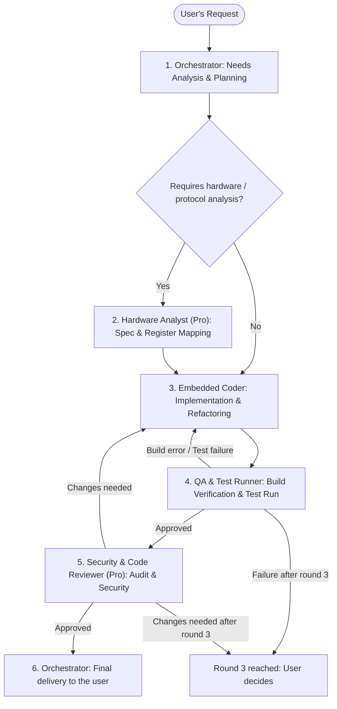

# Multi-Agent Engineering Architecture & Guidelines

This document defines the collaboration agreement, the division of responsibilities, the model choices and the quality requirements (Quality Gates) for all AI agents and developers in the **Verisure Sub-1GHz Sensor & Home Assistant Gateway** project. It is read by both supported agent tools, **Claude Code** (primary) and **Google Antigravity**; section 5 says how each one runs the workflow.

---

## 1. Agent Roles, Models and Thinking Levels

Each agent in the system is optimized for a specific role with an adapted model tier, tool permissions and thinking level (Thinking Level):

| Role | Subagent / Identity | Recommended Model | Thinking Level (Reasoning) | Tool Permissions | Main Responsibility |
| :--- | :--- | :--- | :--- | :--- | :--- |
| **Orchestrator** | Main agent (Claude Code or Antigravity session) | strong tier | High | All tools | Analyzes the user's goals, breaks down tasks, directs subagents and synthesizes final answers. |
| **Hardware & Protocol Analyst** | `hardware_analyst` | **strong tier** | **Maximum (High Thinking)** | Read-Only (Read, Search, Web) | Analyzes TI CC1110/CC1101 datasheets, ESP32-S2 pinmux/DMA, RF 868.950 MHz packets and AES-128 KDF. |
| **Embedded Coder** | `embedded_coder` | fast tier *(strong for complex logic)* | Balanced | Full (Read, Write, Edit) | Writes clean and resource-efficient C/C++ (PlatformIO, SDCC 8051) and Python automation scripts. |
| **QA & Test Runner** | `qa_tester` | fast tier | Fast / Standard | Execution (Run commands, Tests) | Compiles firmware (`pio run`), runs Python tests, verifies regressions and edge cases. |
| **Security & Code Reviewer** | `code_reviewer` | **strong tier** | **Maximum (High Thinking)** | Read-Only (Read, Review diff) | Independent audit of memory safety, ISR/interrupts, crypto hygiene, replay filter and coding standard. |

---

## 2. Workflow & Quality Gates

No code proposal is considered ready for final delivery without having passed through the project's Quality Gates:

### Phase 1: Specification & Architecture (Hardware Analyst)
- Used for changes to the RF protocol, crypto, peripherals or registers.
- Verifies that no pin conflicts arise on the ESP32-S2 (especially ADC1 vs Wi-Fi coexistence).
- Creates clear bitmasks, data structures and requirements before the Coder starts writing.

### Phase 2: Implementation (Embedded Coder)
- Writes minimal, purposeful and non-blocking code.
- Follows microcontroller-specific constraints:
  - Avoid dynamic memory allocation (`malloc` / heap fragmentation).
  - Keep ISRs (Interrupt Service Routines) extremely short and use `volatile` for shared variables.
  - Preserve existing comments and architecture.

### Phase 3: Verification (QA & Test Runner)
- Firmware must build without warnings or errors (`pio run` for ESP32, SDCC for CC1110).
- Scripts (`VerisureDoorSensor/build_and_flash.py`, `MD_CAM/build_and_flash_md_cam.py`, `derive_key.py`, `monitor.py`) are verified for syntax and runtime.
- Edge cases are tested (e.g. rolling sequence counter, packet overflow, interrupted serial communication).

### Phase 4: Security Review (Security Reviewer)
- The reviewer runs with the `pro` model for deep reasoning capability.
- Checks:
  - No hardcoded master keys or sensitive secrets in the repo.
  - Correct handling of the AES-128 KDF and protection against replay attacks.
  - Buffer bounds when receiving RF packets via SPI/DMA.

### Round limits and finding verification
- A **round** is one pass Coder → QA → Reviewer. A QA or CI failure that sends the work back to the Coder also counts as a round. Verification work (a bench test, a host test that confirms a finding) does not start a new round by itself.
- **At most 3 rounds** per change. If the reviewer still returns "Changes needed" after the third round, or QA or CI still fails, the Orchestrator stops and hands the open points to the user instead of starting a fourth round.
- **Verify a finding before acting on it** when it contradicts what the team believes (a bench result, a memory bank entry, an earlier conclusion) or when acting on it would change behaviour in sensitive code (RF protocol, crypto/replay filter, ISRs, DMA, the counter log). The Orchestrator confirms it first with evidence: a bench test, a log, a host test that fails without the fix, or a second independent reviewer given the code but not the finding's conclusion. A finding that is neither confirmed nor refuted goes to the user, not to the Coder.
- Clear-cut findings (a typo, a comment that contradicts the code) go to the Coder directly. In sensitive code the failing input is the evidence, even for a missing bound check: the Coder adds it as a host test that fails before the fix (QA runs it), then fixes the code.
- When a confirmed finding contradicts a memory bank entry, that entry is rewritten (section 4).

---

## 3. Guardrails & Security Policy (Deterministic Rules)

To save tokens and prevent mistakes, the following strict rules apply:

1. **No secrets in Git:** Master encryption keys, unique device keys or personal Wi-Fi/MQTT credentials must never be hardcoded or checked in outside of local `.env` files or interactive configurators.
2. **Read-only for reviewers:** The subagents `hardware_analyst` and `code_reviewer` do not have tool permissions to modify files. This guarantees an objective review without unintended side effects.
3. **Resource efficiency:**
   - Simple code changes and test runs are run on `flash` for minimal latency and token consumption.
   - `pro` (High Thinking) is reserved for Architecture/Hardware analysis and the final Security Review.
4. **English in the repository:** Everything committed to the repository (documentation, TODO, code comments, memory bank entries, file names) is written in English.
5. **Deterministic gates before LLM review:** CI runs these gates on every push and pull request: SDCC warning-free builds, the key guard (`check_secrets.py`), gitleaks, cppcheck and CodeQL. `qa_tester` runs cppcheck locally before review when it is installed. The reviewer does not repeat what these check, but ALWAYS reviews changes that weaken them (new `cppcheck-suppress` or `gitleaks:allow` markers, allowlist entries in `.gitleaks.toml` or `check_secrets.py`, edits to the workflows or their scripts) and still checks credentials (Wi-Fi, MQTT and portal passwords are only partly covered by the gates) and 16-bit integer arithmetic in CC1110 code. A CI failure on the PR goes back to the Coder and counts as a round.

---

## 4. Long-Term Memory & Knowledge Bank (`.agents/memory.md`)

To preserve knowledge and avoid recurring mistakes across sessions, the team uses a shared memory bank: [memory.md](.agents/memory.md).

The memory bank is grouped by topic (CC1110 general, RF link, crypto/replay/protocol, door sensor, camera CC1110, camera Blackfin, camera image pipeline, gateway, build/toolchains, bench tools); add each entry to its section and rewrite entries that a later finding supersedes.

### Rules for memory management:
1. **Read before starting:** Before a subagent starts a task involving hardware, protocols or the build system, the relevant sections of `.agents/memory.md` must be consulted.
2. **Qualify new lessons learned:** When a hard-to-solve problem, a hardware quirk (e.g. register properties, timing, pin limitations) or a build fix has been confirmed to work, it must be documented.
3. **Format & Conciseness:** New insights are saved in the format:
   `- [YYYY-MM-DD] [AREA/COMPONENT]: Concrete rule, limitation or lesson learned.`
   No long code blocks or raw logs may be dumped into the memory bank.
4. **Updating:** `embedded_coder` or `Orchestrator` updates the file after the solution has been verified by `qa_tester`.

---

## 5. Running the Workflow (Claude Code and Antigravity)

Each role's instructions live once, in `.agents/roles/<role>.md`, and are shared by both tools; the tool-specific agent files only set the model and tools and point there. Edit a role's behaviour in `.agents/roles/`, never in the agent files.

| Role | Shared instructions | Claude Code agent (model / tools) | Antigravity agent (model / tools) |
| :--- | :--- | :--- | :--- |
| Hardware & Protocol Analyst | `.agents/roles/hardware_analyst.md` | `.claude/agents/hardware_analyst.md` (`opus`, max; Read, Grep, Glob, WebFetch, WebSearch) | `.agents/agents/hardware_analyst.md` (`pro`; view_file, grep_search) |
| Embedded Coder | `.agents/roles/embedded_coder.md` | `.claude/agents/embedded_coder.md` (`sonnet`; Read, Write, Edit, Grep, Glob) | `.agents/agents/embedded_coder.md` (`flash`; view_file, grep_search, replace_file_content) |
| QA & Test Runner | `.agents/roles/qa_tester.md` | `.claude/agents/qa_tester.md` (`haiku`; Bash, Read, Grep, Glob) | `.agents/agents/qa_tester.md` (`flash`; view_file, grep_search, run_command) |
| Security & Code Reviewer | `.agents/roles/code_reviewer.md` | `.claude/agents/code_reviewer.md` (`opus`, max; Read, Grep, Glob) | `.agents/agents/code_reviewer.md` (`pro`; view_file, grep_search) |

Common to both tools:
- The main session is the Orchestrator and runs the workflow in section 2 by delegating to the roles. Subagents start without the conversation: pass the task, the files, the diff path and the round number explicitly.
- `code_reviewer` has no shell, so the Orchestrator saves the diff under `scratch/` (ignored by git) and passes its path.
- Only the Orchestrator commits, pushes and opens PRs; `main` is protected, so every change goes through a PR with green CI. Prefer CI (push the branch, open a draft PR) over long local test runs.
- Session hand-over: if `.agents/handover.md` exists (local and git-ignored), the Orchestrator reads it at the start of a session. It holds the current work state and the user's working preferences that must not be committed; update it before ending a session that leaves work in progress.

Claude Code:
- `.claude/agents/` is loaded at session start; start a new session after changing these files.
- `qa_tester`'s limits are enforced, not only prompted: `.claude/settings.json` runs `.claude/hooks/qa_bash_guard.py` before every Bash call, and when the caller is `qa_tester` it blocks git commands other than read-only ones, `pio` upload targets, `build_and_flash*.py` without `--compile-only`, OTA, esptool, the bench flashers and nested shells. Other agents and the main session are not affected. Tests: `tests/test_qa_bash_guard.py`.

Antigravity:
- AGENTS.md is read as an always-on rule; the agents in `.agents/agents/` are its custom subagents (the `model` field accepts only `pro`, `flash` or `inherit`).
- Read-only roles get no `run_command` and no write tool. Nothing enforces `qa_tester`'s command limits (there is no hook), so its role file states them as strict rules and the Orchestrator checks its commands.
- Tool names: `view_file`, `grep_search`, `replace_file_content` and `run_command` are the documented ones; verify them in the installed version (a misspelled tool name can make a subagent hang) and add the file-creation and web tools if the coder must create files or the analyst must read datasheets online.
- For a review from another model family, the Orchestrator may run the review step in a Claude Code session (`code_reviewer`) on the same diff.
