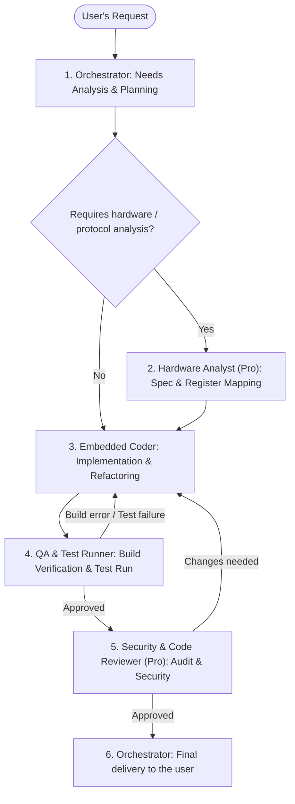

# Multi-Agent Engineering Architecture & Guidelines

This document defines the collaboration agreement, the division of responsibilities, the model choices and the quality requirements (Quality Gates) for all AI agents and developers in the **Verisure Sub-1GHz Sensor & Home Assistant Gateway** project.

---

## 1. Agent Roles, Models and Thinking Levels

Each agent in the system is optimized for a specific role with an adapted model tier, tool permissions and thinking level (Thinking Level):

| Role | Subagent / Identity | Recommended Model | Thinking Level (Reasoning) | Tool Permissions | Main Responsibility |
| :--- | :--- | :--- | :--- | :--- | :--- |
| **Orchestrator** | Main agent (Antigravity) | `Gemini Flash / Pro` | High | All tools | Analyzes the user's goals, breaks down tasks, directs subagents and synthesizes final answers. |
| **Hardware & Protocol Analyst** | `hardware_analyst` | **`pro`** | **Maximum (High Thinking)** | Read-Only (Read, Search, Web) | Analyzes TI CC1110/CC1101 datasheets, ESP32-S2 pinmux/DMA, RF 868.950 MHz packets and AES-128 KDF. |
| **Embedded Coder** | `embedded_coder` | `flash` *(alt. `pro` for complex logic)* | Balanced | Full (Read, Write, Edit) | Writes clean and resource-efficient C/C++ (PlatformIO, SDCC 8051) and Python automation scripts. |
| **QA & Test Runner** | `qa_tester` | `flash` | Fast / Standard | Execution (Run commands, Tests) | Compiles firmware (`pio run`), runs Python tests, verifies regressions and edge cases. |
| **Security & Code Reviewer** | `code_reviewer` | **`pro`** | **Maximum (High Thinking)** | Read-Only (Read, Review diff) | Independent audit of memory safety, ISR/interrupts, crypto hygiene, replay filter and coding standard. |

---

## 2. Workflow & Quality Gates

No code proposal is considered ready for final delivery without having passed through the project's Quality Gates:

### Phase 1: Specification & Architecture (Hardware Analyst)
- Used for changes to the RF protocol, crypto, peripherals or registers.
- Verifies that no pin conflicts arise on the ESP32-S2 (especially ADC1 vs Wi-Fi coexistence).
- Creates clear bitmasks, data structures and requirements before the Coder starts writing.

### Phase 2: Implementation (Embedded Coder)
- Writes minimal, purposeful and non-blocking code.
- Follows microcontroller-specific constraints:
  - Avoid dynamic memory allocation (`malloc` / heap fragmentation).
  - Keep ISRs (Interrupt Service Routines) extremely short and use `volatile` for shared variables.
  - Preserve existing comments and architecture.

### Phase 3: Verification (QA & Test Runner)
- Firmware must build without warnings or errors (`pio run` for ESP32, SDCC for CC1110).
- Scripts (`VerisureDoorSensor/build_and_flash.py`, `MD_CAM/build_and_flash_md_cam.py`, `derive_key.py`, `monitor.py`) are verified for syntax and runtime.
- Edge cases are tested (e.g. rolling sequence counter, packet overflow, interrupted serial communication).

### Phase 4: Security Review (Security Reviewer)
- The reviewer runs with the `pro` model for deep reasoning capability.
- Checks:
  - No hardcoded master keys or sensitive secrets in the repo.
  - Correct handling of the AES-128 KDF and protection against replay attacks.
  - Buffer bounds when receiving RF packets via SPI/DMA.

---

## 3. Guardrails & Security Policy (Deterministic Rules)

To save tokens and prevent mistakes, the following strict rules apply:

1. **No secrets in Git:** Master encryption keys, unique device keys or personal Wi-Fi/MQTT credentials must never be hardcoded or checked in outside of local `.env` files or interactive configurators.
2. **Read-only for reviewers:** The subagents `hardware_analyst` and `code_reviewer` do not have tool permissions to modify files. This guarantees an objective review without unintended side effects.
3. **Resource efficiency:**
   - Simple code changes and test runs are run on `flash` for minimal latency and token consumption.
   - `pro` (High Thinking) is reserved for Architecture/Hardware analysis and the final Security Review.
4. **English in the repository:** Everything committed to the repository (documentation, TODO, code comments, memory bank entries, file names) is written in English.

---

## 4. Long-Term Memory & Knowledge Bank (`.agents/memory.md`)

To preserve knowledge and avoid recurring mistakes across sessions, the team uses a shared memory bank: [memory.md](.agents/memory.md).

The memory bank is grouped by topic (CC1110 general, RF link, crypto/replay/protocol, door sensor, camera CC1110, camera Blackfin, camera image pipeline, gateway, build/toolchains, bench tools); add each entry to its section and rewrite entries that a later finding supersedes.

### Rules for memory management:
1. **Read before starting:** Before a subagent starts a task involving hardware, protocols or the build system, the relevant sections of `.agents/memory.md` must be consulted.
2. **Qualify new lessons learned:** When a hard-to-solve problem, a hardware quirk (e.g. register properties, timing, pin limitations) or a build fix has been confirmed to work, it must be documented.
3. **Format & Conciseness:** New insights are saved in the format:
   `- [YYYY-MM-DD] [AREA/COMPONENT]: Concrete rule, limitation or lesson learned.`
   No long code blocks or raw logs may be dumped into the memory bank.
4. **Updating:** `embedded_coder` or `Orchestrator` updates the file after the solution has been verified by `qa_tester`.

---

## 5. Running the Workflow in Claude Code

The four roles are defined as Claude Code subagents in `.claude/agents/`. The main Claude Code session is the Orchestrator and runs the workflow in section 2 by delegating to them:

| Role | Claude Code agent | Model / effort | Tools |
| :--- | :--- | :--- | :--- |
| Hardware & Protocol Analyst | `hardware_analyst` | `opus`, max | Read, Grep, Glob, WebFetch, WebSearch |
| Embedded Coder | `embedded_coder` | `sonnet` | Read, Write, Edit, Grep, Glob |
| QA & Test Runner | `qa_tester` | `haiku` | Bash, Read, Grep, Glob |
| Security & Code Reviewer | `code_reviewer` | `opus`, max | Read, Grep, Glob |

- `opus` replaces `pro` and `sonnet`/`haiku` replace `flash` from section 1.
- `code_reviewer` has no shell, so the Orchestrator saves the diff under `scratch/` (ignored by git) and passes its path.
- `qa_tester`'s limits are enforced, not only prompted: `.claude/settings.json` runs `.claude/hooks/qa_bash_guard.py` before every Bash call, and when the caller is `qa_tester` it blocks git commands other than read-only ones, `pio` upload targets, `build_and_flash*.py` without `--compile-only`, OTA, esptool, the bench flashers and nested shells. Other agents and the main session are not affected. Tests: `tests/test_qa_bash_guard.py`.
- Only the Orchestrator commits, pushes and opens PRs; `main` is protected, so every change goes through a PR with green CI.
- Claude Code loads `.claude/agents/` at session start; start a new session after changing these files.
