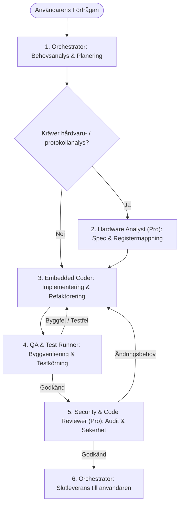

# Multi-Agent Engineering Architecture & Guidelines

Detta dokument definierar samarbetsavtalet, ansvarsfördelningen, modellvalen och kvalitetskraven (Quality Gates) för alla AI-agenter och utvecklare i **Verisure Sub-1GHz Sensor & Home Assistant Gateway**-projektet.

---

## 1. Agentroller, Modeller och Tankenivåer

Varje agent i systemet är optimerad för en specifik roll med anpassad modellnivå, verktygsbehörighet och tankenivå (Thinking Level):

| Roll | Subagent / Identitet | Rekommenderad Modell | Tankenivå (Reasoning) | Verktygsbehörighet | Huvudansvar |
| :--- | :--- | :--- | :--- | :--- | :--- |
| **Orchestrator** | Huvudagent (Antigravity) | `Gemini Flash / Pro` | Hög | Samtliga verktyg | Analyserar användarens mål, delar upp uppgifter, dirigerar subagenter och syntetiserar slutsvar. |
| **Hardware & Protocol Analyst** | `hardware_analyst` | **`pro`** | **Maximal (High Thinking)** | Read-Only (Läs, Sök, Webb) | Analyserar TI CC1110/CC1101 datablad, ESP32-S2 pinmux/DMA, RF 868.950 MHz-paket och AES-128 KDF. |
| **Embedded Coder** | `embedded_coder` | `flash` *(alt. `pro` vid komplex logik)* | Balanserad | Full (Läs, Skriv, Edit) | Skriver ren och resurssnål C/C++ (PlatformIO, SDCC 8051) och Python-automationsskript. |
| **QA & Test Runner** | `qa_tester` | `flash` | Snabb / Standard | Exekvering (Kör kommandon, Tester) | Kompilerar firmware (`pio run`), kör Python-tester, verifierar regressioner och edge cases. |
| **Security & Code Reviewer** | `code_reviewer` | **`pro`** | **Maximal (High Thinking)** | Read-Only (Läs, Granska diff) | Oberoende audit av minnessäkerhet, ISR/interrupts, kryptohygien, replay-filter och kodstandard. |

---

## 2. Arbetsflöde & Quality Gates

Inget kodförslag anses färdigt för slutleverans utan att ha passerat genom projektets Quality Gates:

### Fas 1: Specifikation & Arkitektur (Hardware Analyst)
- Används vid ändringar i RF-protokoll, krypto, periferienheter eller register.
- Verifierar att inga pin-konflikter uppstår på ESP32-S2 (särskilt ADC1 vs Wi-Fi-koexistens).
- Skapar tydliga bitmasker, datastrukturer och krav innan Coder börjar skriva.

### Fas 2: Implementering (Embedded Coder)
- Skriver minimal, ändamålsenlig och icke-blockerande kod.
- Följer mikrocontrollerspecifika begränsningar:
  - Undvik dynamisk minnesallokering (`malloc` / heap-fragmentering).
  - Håll ISR (Interrupt Service Routines) extremt korta och använd `volatile` för delade variabler.
  - Bevara existerande kommentarer och arkitektur.

### Fas 3: Verifiering (QA & Test Runner)
- Firmware måste bygga utan varningar eller fel (`pio run` för ESP32, SDCC för CC1110).
- Skript (`build_and_flash.py`, `derive_key.py`, `monitor.py`) verifieras mot syntax och körtid.
- Edge cases testas (t.ex. rullande sekvensräknare, paketspill, avbruten seriekommunikation).

### Fas 4: Säkerhetsgranskning (Security Reviewer)
- Granskaren körs med `pro`-modellen för djup resonemangsförmåga.
- Kontrollerar:
  - Inga hårdkodade master-nycklar eller känsliga hemligheter i repot.
  - Korrekt hantering av AES-128 KDF och skydd mot replay-attacker.
  - Buffertgränser vid mottagning av RF-paket via SPI/DMA.

---

## 3. Guardrails & Säkerhetspolicy (Deterministiska regler)

För att spara tokens och förhindra misstag tillämpas följande strikta regler:

1. **Inga hemligheter i Git:** Master-krypteringsnycklar, unika enhetsnycklar eller personliga Wi-Fi/MQTT-uppgifter får aldrig hårdkodas eller checkas in utanför lokala `.env` eller interaktiva konfiguratorer.
2. **Read-only för granskare:** Subagenterna `hardware_analyst` och `code_reviewer` har inte verktygsbehörighet att ändra filer. Detta garanterar en objektiv granskning utan oavsiktliga sidoeffekter.
3. **Resurseffektivitet:**
   - Enkla kodändringar och testkörningar körs på `flash` för minimal latens och token-förbrukning.
   - `pro` (High Thinking) reserveras för Arkitektur/Hardware-analys och slutgiltig Security Review.

---

## 4. Långtidsminne & Kunskapsbank (`.agents/memory.md`)

För att bevara kunskap och undvika återkommande misstag över sessioner använder teamet en gemensam minnesbank: [memory.md](file:///.agents/memory.md).

### Regler för minneshantering:
1. **Läs före start:** Innan en subagent påbörjar ett moment inom hårdvara, protokoll eller byggsystem ska relevanta sektioner i `.agents/memory.md` konsulteras.
2. **Kvalificera nya lärdomar:** När ett svårlöst problem, en hårdvaruquirk (t.ex. registeregenskaper, timing, pin-begränsningar) eller byggfix har bekräftats fungera, ska det dokumenteras.
3. **Format & Koncision:** Nya insikter sparas i formatet:
   `- [ÅÅÅÅ-MM-DD] [OMRÅDE/KOMPONENT]: Konkret regel, begränsning eller lärdom.`
   Inga långa kodblock eller råa loggar får dumpas i minnesbanken.
4. **Uppdatering:** `embedded_coder` eller `Orchestrator` uppdaterar filen efter att lösningen verifierats av `qa_tester`.

