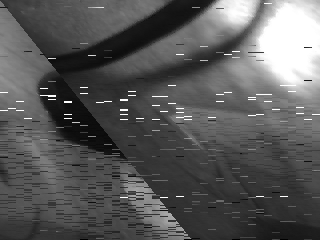

# Blackfin (U5, ADSP-BF512) – boot, JTAG and plan for our own program

> Historical log (status as of 2026-11-14); the current state is in [MD_CAM/README.md](../README.md).

Status 2026-11-01, Board #1 (2NCEKS3T, unlocked, SW3 still fitted). The continuity tracing of J5 and of the balls under SW3 (BMODE, HWAIT, JTAG) was done on Board #2 (locked reference) after SW3 had been desoldered there; the boards are built identically. JTAG and the supply measurements were done on Board #1.

## Background

- U5 is the **ADSP-BF512 KBCZ-4**, the variant without internal flash memory. The program has to come from outside.
- U3 (EN25F40, 512 KB) contains **no** Blackfin image on either board, only three configuration pages (0x07E000, 0x07E200, 0x07F000).
- Reference board #2 never starts the Blackfin unless a Verisure hub requests an image, so the original program cannot be captured from there.
- Decision: we write **our own Blackfin program** and load it ourselves.

## Ball map and orientation

- 168-ball CSP_BGA, 14×14, 0.8 mm pitch. The via field on the underside is a dog-bone fanout with an empty center line, so each via corresponds to one ball.
- In `images/blackfin_bottom.jpeg`, **A1 is at the top right**, rows A..P run from top to bottom and columns 14..1 from left to right. Confirmed in three ways: G14 = GND, the dot marking, and the numbers 1/3/5/7/8/12 in the silkscreen along row A.
- Maps: `images/blackfin_bottom_annotated.png` (the whole field) and `images/blackfin_bottom_under_sw3_annotated.png` (the area under SW3).

## Boot mode (BMODE)

| Ball | Signal | Measured | Value |
|---|---|---|---|
| M3 | BMODE0 | 10 kΩ to 3.3 V | 1 |
| N1 | BMODE1 | 10 kΩ to 3.3 V | 1 |
| M2 | BMODE2 | GND | 0 |
| M4 | HWAIT | not connected | – |

**BMODE = 011: SPI0 master boot** from an SPI memory with /CS on PG15 (G1). The Blackfin therefore cannot receive its program from the CC1110 via SPI0 slave (100) or UART0 (111) without re-soldering. That explains why our attempts at SPI slave boot only returned 0x00.

## J5 = Blackfin JTAG

8-pin connector on the underside, pin 1 = the square pad.

| J5 | Ball | Signal | Connection to FT232H (CJMCU) |
|---|---|---|---|
| 1 | – | 3.3 V via 10 kΩ (reference, 3.26 V measured) | – |
| 2 | N4 | TRST (no pull-down on the board, 0 V when the Blackfin is on) | 1 kΩ to J5-1 |
| 3 | P2 | TDI | AD1 |
| 4 | N5 | TMS | AD3 |
| 5 | P3 | TCK | AD0 |
| 6 | – | GND | GND |
| 7 | N3 | TDO | AD2 |
| 8 | M5 | EMU | – |

TRST must be high for JTAG to work, hence 1 kΩ between J5-1 and J5-2.

## Tools

- ADI GNU toolchain 2014R1 in `<ADI toolchain>/elf/bin`: `bfin-elf-gcc`, `bfin-elf-ldr`, `bfin-elf-gdb`, `bfin-jtag` (urJTAG with BF51x support, part `bf518`) and `bfin-gdbproxy`.
- Adapter: **CJMCU FT232H** (FT232HQ, MPSSE) with the **WinUSB** driver installed via Zadig (the device is named "Single RS232-HS", 0403:6014). It then provides no COM port.
- **ADI's `bfin-jtag`/`bfin-gdbproxy` cannot reach the FT232H on Windows 11.** They have an old statically linked libusb (1.0.6) and no working ftd2xx support. We therefore talked JTAG directly with `blackfin/ft232h_jtag.py` (pyusb + libusb-package; removed). The current setup runs `bfin-gdbproxy` in WSL with the FT232H attached through `usbipd` (`blackfin/jtag/jtag_common.sh`).
- Blackfin JTAG registers (IR 5 bits): IDCODE 00010, DBGCTL 00100, DBGSTAT 01100, EMUIR 01000, EMUDAT 10100, EMUPC 11110, BYPASS 11111. Source: `<ADI toolchain>/elf/share/urjtag/analog/bfin/bfin`.
- **Verified 2026-11-08:** IDCODE **0x227E80CB** (version 2, part 0x27E8 = BF51x, ADI).
- FT232R boards and the ST-Link V2 do **not** work: the FT232R lacks MPSSE and the ST-Link is not supported by urJTAG.

## Programs and scripts (`MD_CAM/blackfin/`)

Current files (see [MD_CAM/README.md](../README.md) for how they are used):

| File | Purpose |
|---|---|
| `bf512_l1.ld` | Linker script: everything in L1 instruction memory (0xFFA00000). |
| `build_ldr.py` | Builds the ELF and, without `--elf-only`, the LDR boot stream. |
| `snap_link.c`, `jpeg_enc.c` | The camera program: capture, image processing, JPEG, deltas, flash. |
| `boot_select.S`, `flash_sector0.c` | Boot selector in flash sector 0 and the tool that writes it. |
| `flash_read.c`, `flash_write.c` | Read and write the boot flash by bit-banging. |
| `jtag/` | JTAG helper scripts (`bf_flash.sh`, `bf_read.sh`, `bf_read_flash.sh`, `bf_set.sh`, `gdbproxy.sh`, `jtag_common.sh`). |

Early test programs used in this log, all removed since: `jtag_test.S` (first JTAG test: wrote 0xB1A5C0DE to 0xFF800000 and counted in 0xFF800004), `ft232h_jtag.py` (own JTAG via FT232H MPSSE), `jtag_run.py` (for ADI's gdbproxy), `spi_probe.S` (SPI0 slave boot test), `ph_sniff.S` (PH0..PH3 logger), `twi_scan.S` and `twi_read.S` (TWI scan and register read), `sw_spi_slave.S` (software SPI slave on PH0..PH3), `rom_spiboot.S` (`bfrom_SpiBoot` test), `firmware/bf_ldr.h` (LDR as a C array) and the scratchpad script `pinwalk3.py`.

## The CC1110 mode BF_JTAG_HOLD (`firmware/main.c`, removed)

`BF_JTAG_HOLD` and the other `BF_*` test modes in this log no longer exist. The current equivalent is MQTT `HOLD` on `verisure/<id>/picture/set`: the CC1110 powers the Blackfin and keeps it on for 10 min without taking a picture.

The old mode turned on the supplies (P0_2, P0_7), sets P0_0 and sends the RF heartbeat `B0, counter` every 10 seconds (seq from 48000). With `BF_P1_0_RELEASE`, P1_0 is released after 10 s, and the Blackfin then comes out of reset.

**/RESET is controlled by Q7 (verified 2026-11-11):** Q7 (SOT-89, marked "N06") is an N-MOSFET. Gate = P1_0 (CC1110 pin 4), drain = B10 /RESET, source = GND. B10 has a 10 kΩ pull-up. P1_0 = 1 holds the Blackfin in reset and P1_0 = 0 releases it. When the CC1110 is in debug halt, P1_0 ends up high via the pull-up, so the Blackfin is then also in reset. Images: `images/q7_reset_area.jpg` and `images/q7_reset_area_annotated.png`.

## Pitfalls

- An **unpowered** ESP32 flasher on J6 holds the CC1110 in reset via GPIO33 (RESET_N). Give it USB power before connecting it.
- The flasher's verification can report "Verify failed" even though the program is running. Check with the gateway's `/api/status` (seq and p0).
- The gateway's replay filter requires a higher seq than earlier builds.

## Next steps

1. Solder 1 kΩ between J5-1 and J5-2 and check that J5-2 shows about 3.2 V with the Blackfin powered on.
2. ~~Connect the FT232H and read IDCODE~~: done 2026-11-08, `python MD_CAM/blackfin/ft232h_jtag.py idcode` (removed) gave 0x227E80CB.
3. ~~Load and run `jtag_test.S` (removed) via JTAG~~: done 2026-11-10 with ADI's `bfin-gdbproxy` in WSL and Windows `bfin-elf-gdb` (`target remote localhost:2000`, `load build/jtag_test.elf`, break on `_done`). Result: 0xB1A5C0DE and the counter 0x100000 in 0xFF800000. Prerequisite: B10 (/RESET) must be high. After flashing, the CC1110 is in debug halt and B10 is then low. Send `/cc_exit_dbg` and wait until P1_0 = 0 (Q7).
4. ~~Map CC1110 ↔ Blackfin~~: done 2026-11-11 with `BF_PIN_WALK`/`BF_SPI_WALK` in `firmware/main.c`. The CC1110 reaches Blackfin **SPI1** on port H via the P1_2 enable: P1_4 -> PH1 (SCK), P1_3 -> PH2 (MISO), P1_5 -> PH3 (MOSI), PH0 (SSEL) = 0. The UART pins P0_4 and P0_5 do not show up on PF, PG or PH. P0_3 must be high, and P0_0 appears to turn on the Blackfin's supply. Details are in `Hardware_pinout_and_measurements.md`.
5. ~~SPI between CC1110 and Blackfin~~: two-way SPI works as of 2026-11-11 with software SPI on both sides. The Blackfin ran `sw_spi_slave.S` (removed; PH0 SS, PH1 SCK, PH2 MISO, PH3 MOSI as GPIO) and the CC1110 runs `BF_SPI1_TEST` (bit-banged master in mode 0). The Blackfin's SPI1 controller does not receive anything as a slave (tried with PORTH_MUX 0–3, CPHA 0/1 and TIMOD 00/01). The cause has not been investigated, see `.agents/memory.md` (BF_SPI1_SLAVE_FAIL).
6. ~~The camera sensor~~: found. The module is "8811GA SUNNY" on J1 and the sensor is an **OmniVision OV7955** at TWI address 0x40 (0x5C is another device). See [Camera_J1_measurement_plan.md](Camera_J1_measurement_plan.md).
7. After that: a proper protocol over the CC1110 link (commands, length, checksum).

## Mapping method

The Blackfin runs out of reset with `jtag_test` loaded (drives no pins). Via gdbproxy, PORTF/G/H_FER = 0, DIR = 0 and INEN = 0xFFFF are set. The CC1110 drives one pin high at a time, and the ports are read via JTAG (the scratchpad script `pinwalk3.py`, removed). If IDCODE reads 0xFFFFFFFF or garbage, a JTAG wire is loose, usually TDO (AD2).

## Boot flash (backed up 2026-11-14)

- The Blackfin boots from an **EON EN25F20** (JEDEC 0x1C3112, 256 KB) on SPI0: PG12 SCK, PG13 MISO, PG14 MOSI, PG15 CS. It is not U3.
- `blackfin/flash_read.c` reads it by bit-banging and sends only read commands (0x9F and 0x03). Mode 0 reads the ID and walks through the boot stream's block headers, mode 1 reads a region into L1 and mode 2 counts used bytes and the sum per 4 KB page.
- The original program's boot stream is 0x7FD4 bytes (23 blocks). The rest of the flash (0x8000–0x3FFFF) is empty.
- The backup is in `blackfin/build/fw_dump/bootflash_0000_8000.bin` (not in git). SHA-256: `25d0dc4000e2ee21ad0363ec1ee22c04ecaf30567baa848d58b2264c696fa2b2`.
- At the time of the backup nothing had been written to the flash (the later writes are described below). Before anything was written: decide whether the original program should stay and our program be placed after it, or whether it should be replaced.

## Plan for standalone boot with the original kept (2026-11-14)

1. ~~Test the ROM function `bfrom_SpiBoot` via JTAG~~: done. `blackfin/rom_spiboot.S` (removed) with the flags 0x03A00000 starts the original program from flash address 0.
2. ~~Write our boot stream at 0x8000 and start it with the ROM call~~: done 2026-11-14. `blackfin/flash_write.c` wrote `snap_link.ldr` (1 272 bytes) to 0x8000–0x84F7. The original's pages are unchanged (same page sums), and `rom_spiboot` with address 0x8000 starts `snap_link` from the flash. Build the stream with `bfin-elf-ldr -T BF518 -c build/snap_link.ldr build/snap_link.elf`.
3. Last: a small selector at the start of the flash that calls `bfrom_SpiBoot` with 0x8000 or the original's address. That requires page 0 to be erased and rewritten, so the original is first copied unchanged to a free location.

## Standalone boot (2026-11-14)

- Flash layout: 0x0000 selector (`boot_select.ldr`), 0x1000–0x7FFF remnants of the original (unused), 0x8000 `snap_link.ldr` (4 196 bytes), 0x10000 the original (0x7FD4 bytes); the factory firmware at 0x10000 was erased on 2026-11-16.
- The selector reads PH0: low (the CC1110 has P1_2 = 1 before the reset release, as `BF_JTAG_HOLD` does) starts 0x8000, otherwise the original at 0x10000 was started (erased since 2026-11-16).
- `snap_link` initializes the camera itself using the original's own sequence (soft reset 0x0103 and 108 register writes), logged via JTAG. Without it the sensor's outputs stay disabled.
- Tools: `flash_sector0.c` (sector 0 only, requires a confirmation word), `flash_write.c` (only 0x8000 and up, erasing only within 0x8000–0xFFFF on request). Restore the original's sector 0 with `build/fw_dump/orig_sector0.bin`.
