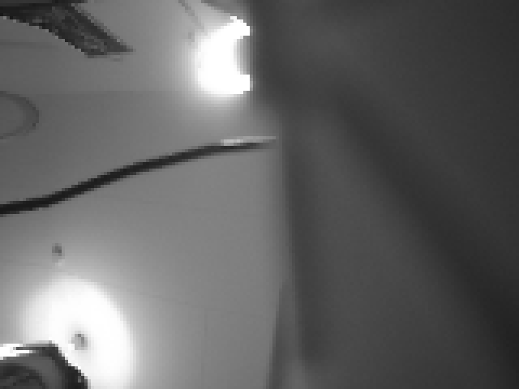
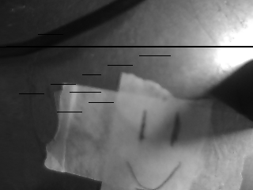

# Camera module (J1) – status and measurement plan

> Historical log (status as of 2026-11-14); the current state is in [MD_CAM/README.md](../README.md).

The test programs `twi_scan.S`, `twi_read.S` and `ppi_snap.c` used below no longer exist.

Board #1 (2NCEKS3T). Compiled 2026-11-11. Measured 2026-11-12 (CC1110 in BF_JTAG_HOLD, Blackfin out of reset, 99 mA).

## What we know

- The camera is a Sunny module marked **"8811GA SUNNY"** on a 24-pin FPC connector, **J1**. Pin 1 is at the top next to SW1 and pin 24 at the bottom next to C23/C21.
- The board is marked "SECUR.PCAM.BLACKFIN".
- **U4 = ISSI IS42S16800F** (SDRAM, 16 MB). It can be used as an image buffer via the Blackfin's EBIU.
- The sensor type is not confirmed. A similar 24-pin Sunny module (8806Z) is sold with an OmniVision OV7725, so it is probably OmniVision.
- A TWI scan from the Blackfin (`blackfin/twi_scan.S`, removed) finds only **0x40** (unknown) and **0x5C** (probably a BH1750-type light sensor). No OmniVision address (0x21 or 0x30) responds. So the sensor probably lacks supply or XCLK, or is held in PWDN.
- PF0..PF9 (probably PPI data from the camera) are floating.
- Never write "register pointers" to unknown TWI devices. Command-driven chips interpret them as commands.

## Preparation

1. Power the board with 3.0 V (PSU). The CC1110 should run a BF_JTAG_HOLD build with P1_0 = 0 (Blackfin out of reset).
2. Check the current: about 95–100 mA means the Blackfin is running.

## Measurement 1: voltages on J1 (multimeter to GND)

The "Usual function" column applies if the module follows the usual 24-pin OmniVision layout. This is not confirmed.

| J1 | Usual function | Expected if the sensor is on | Measured |
|---|---|---|---|
| 1 | NC | – | 0 V |
| 2 | AGND | 0 V | 0 V |
| 3 | SIO_D (I²C data) | ~2.8–3.3 V | 3.27 V |
| 4 | AVDD | ~2.8 V | 3.27 V |
| 5 | SIO_C (I²C clock) | ~2.8–3.3 V | 3.27 V |
| 6 | RESET | high | 3.27 V |
| 7 | VSYNC | – | 0 V |
| 8 | PWDN | **low** (high = standby) | not measured |
| 9 | HREF | – | 2.44 V (average) |
| 10 | DVDD | ~1.5–1.8 V | 1.515 V |
| 11 | DOVDD | ~1.8–3.3 V | 3.27 V |
| 12 | D9 | – | ~1.1 V, varies with light |
| 13 | **XCLK** | clock (see measurement 2) | 1.66 V (average), clock |
| 14 | D8 | – | not measured |
| 15 | DGND | 0 V | 0 V |
| 16 | D7 | – | 1–2.3 V, varies with scene |
| 17 | PCLK | clocks only when the sensor is running | 1.4–1.9 V, clock |
| 18 | D6 | – | ~1.6 V, varies |
| 19 | D2 | – | ~1.5 V, varies |
| 20 | D5 | – | ~1.5 V, varies |
| 21 | D3 | – | 1.7 V |
| 22 | D4 | – | 1.7 V |
| 23 | D1 | – | 0.09–0.25 V |
| 24 | D0 | – | 0.09–0.25 V |

## Measurement 2: clock on J1-13 (Saleae)

- Put a Saleae channel on J1-13 and the board's GND.
- Note whether there is a clock and roughly what frequency (6–27 MHz is common).

## Interpretation

- **Supply and XCLK present, PWDN low:** the sensor should respond on TWI. Run `twi_scan.S` again and look for 0x21 or 0x30.
- **PWDN high:** find which CC1110 or Blackfin pin controls PWDN.
- **Supply missing:** one of the transistors Q8, Q9, Q10 or Q11 probably controls it. Find which pin turns it on. P0_1 (+7 mA) and P0_7 (aux) are candidates.
- **XCLK missing:** the clock must come from the Blackfin (a timer, TMRx) or from an oscillator on the board. It needs to be started.
- **The pins do not follow the table** (for example supply on pins 2 and 15): the module has a different layout. Map it with a multimeter (continuity check against GND and supply rails) before driving anything.

## Results 2026-11-12

- The pattern matches the usual 24-pin OmniVision layout. The supply is present (AVDD 3.27 V, DVDD 1.515 V, DOVDD 3.27 V), RESET is high, and XCLK (pin 13) and PCLK (pin 17) are clocking.
- HREF and VSYNC are active, and the data bits D9..D2 vary with the scene. D1/D0 are almost always at 0, which is typical of a 10-bit sensor used as an 8-bit one. **The sensor is running and sending images.**
- Even so, no image sensor address responded to the Blackfin's TWI scan. Next step: Saleae on J1-5 (SIO_C) and J1-3 (SIO_D) during a new `twi_scan`, to see whether the Blackfin's TWI reaches the camera's SCCB.
- **Saleae on J1-5 (SIO_C), J1-3 (SIO_D) and J1-7 (VSYNC) during `twi_scan`:** all 112 address attempts are visible on the camera's SCCB, so the camera is on the Blackfin's TWI bus. Only 0x40 (read 0xFF) and 0x5C (now reads 0x04) respond with ACK. 0x21 and 0x30 respond with NAK. The camera is therefore probably 0x40.
- The VSYNC period is 16.4 ms (about 61 frames per second).
- Next step: read ID registers at 0x40 (OmniVision: PID 0x0A/0x0B and MIDH/MIDL 0x1C/0x1D; Aptina: 0x00, 16 bit). Requires a pointer write, see the warning above.
- **ID read 2026-11-12** (`twi_read.S` with a 16-bit pointer, confirmed with Saleae on SCCB): device **0x40** has 16-bit register addresses, 0x300A = 0x79 and 0x300B = 0x55, i.e. chip ID **0x7955**. That points to the **OmniVision OV7955** (VGA 672×492, up to 60 frames/s, parallel DV output). This matches 61 frames/s and 8 active data bits. 0x3000 = 0x07FF. Reads with an 8-bit pointer return 0x00.
- So 0x5C is not the camera. The assumption that it is a light sensor (BH1750 type) stands but is not confirmed.
- Next step: capture an image with the Blackfin's PPI (the PF port) into SDRAM (U4) or L1, without changing the sensor's settings.

## Image capture, status 2026-11-12

- PPI pins (confirmed): PCLK = PG5, HREF = PG6, VSYNC = PG7, data D2..D9 = PF2..PF9.
- The Blackfin's original program itself captures an image into SDRAM (0x00100000, 640×480 16-bit words, 1280 samples per line, 480 lines) after every boot.
- Obstacle: DMA does not start under JTAG control, and reading SDRAM via gdbproxy hangs. See `.agents/memory.md` (BF_DMA_SDRAM_FAIL).

## First image (2026-11-12)

- Taken with `blackfin/ppi_snap.c` (removed; 160x120 grayscale, loaded via JTAG). A piece of card covered half the lens.
- The PPI configuration is copied from the original program (disassembled from L1): PPI_CONTROL 0x3E0D, PPI_COUNT 1279, PORTG_FER 0x0460, PORTG_MUX 0x0480. VSYNC is waited for in software on PG7.
- The stream after VSYNC is contiguous, with a line length of 335 stored samples. Pixel = (sample >> 2) & 0xFF.
- DMA: with MDMA the source must be enabled before the destination. DMA_DONE requires DI_EN.

## Image via RF to the gateway (2026-11-13)

**Obsolete:** this first chain is gone. `BF_IMG_LINK`, the 0x81 packets, `/api/camera.bmp` and `image_collect.py` no longer exist; pictures are now JPEG, see [Camera_protocol.md](Camera_protocol.md).

- Chain: camera -> Blackfin (`blackfin/snap_link.c`, loaded via JTAG) -> software SPI -> CC1110 (`BF_IMG_LINK`, obsolete) -> RF 868 MHz -> gateway -> `/api/camera.bmp` (obsolete) and MQTT.
- RF packets of type 0x81 (obsolete): chunk number + 8 pixels. The gateway placed the chunks by number, so a lost packet only became a gap that was filled on the next pass.
- ~150 bytes/s, one pass (320x240, 9600 chunks) ~8.5 min. Fetched with `python MD_CAM/blackfin/image_collect.py` (obsolete).
- Close gdbproxy immediately after loading `snap_link`, otherwise gdbproxy may reset the Blackfin on an intermittent JTAG connection.

## Next steps (status 2026-11-13)

1. ~~**Restart the chain:** PSU 3.0 V, the CC1110 runs `BF_IMG_LINK`. Load `snap_link.elf` via JTAG after the reset release (~70 s after start, before ~125 s), then close gdbproxy. Fetch the image with `python MD_CAM/blackfin/image_collect.py`.~~ Obsolete (`BF_IMG_LINK` and `image_collect.py` no longer exist).
2. **Standalone Blackfin:** the program is still loaded via JTAG. Back up the original program from the Blackfin's SPI0 boot flash (probably U7, PG11..PG15, CS PG15) before anything is written there.
3. **Better image:** full horizontal resolution (without SKIP_EN ~670 samples per line), exposure and sensor settings via TWI (OV7955, address 0x40, 16-bit registers).
4. **Faster/more reliable RF:** measure the loss, let the CC1110 resend only missing chunks (the gateway knows which ones), possibly compression.
5. ~~**Security:** the gateway's `/api/status` shows the master key in plain text.~~ Fixed: `/api/status` now returns only `master_key_set`.

## Solved: the pixel clock ran 1.5 times too fast with our init (2026-11-14)

**Cause:** not the sensor but the Blackfin's clocks. The original's boot stream has an init block (0x110 bytes) that the boot ROM runs first: `PLL_CTL = 0x1400` (MSEL 10, VCO 240 MHz with CLKIN 24 MHz), `PLL_DIV = 2` (CCLK 240 MHz, SCLK 120 MHz) and SDRAM settings. Our LDR had no init block, so the ROM left `PLL_CTL 0x0C00` / `PLL_DIV 4` (SCLK 36 MHz). The PPI handles at most SCLK/2 = 18 MHz and sampled the sensor's pixel clock (24 MHz) at the wrong rate, which caused the duplicates, 1170 instead of 780 per line, and the broken color. The earlier comparison of the PLL registers was made after the original had already booted and was therefore misleading.

**Fix:** `snap_link` sets the PLL like the original in `pll_init()`. The stream then becomes clean YUYV at full resolution: 1560 samples per line, 640 active pixels (samples 0..1279), 480 lines. Color JPEG (4:2:0) works, see `camera_color_320x240.jpg`. No Saleae measurement was needed.

**Remaining:** 640×480 on request (requires SDRAM setup like the original's init block and a downlink for requests from Home Assistant), image on motion, white balance (slight blue cast).

## Status and next steps (2026-11-14 evening)

**Works from cold start without JTAG:** the selector in sector 0 starts `snap_link` (0x8000), which sets up the PLL and SDRAM like the original, initializes the sensor and takes images on request from the CC1110:
- `0xD1`/`0xD3`: 320×240 color JPEG, full image (~8 KB) or delta with only changed 16×16 blocks (7 bytes when nothing has changed). The gateway patches in the deltas (`868Receiver/src/jpeg_splice.cpp`) and shows `/api/camera.jpg`.
- `0xD2`: 640×480 color (~17–20 KB, ~2.5 min via RF at the time; now ~12 s), shown at `/api/camera_large.jpg`.
- The CC1110 sets the pace using the PIR (P1_7): motion ON/OFF to Home Assistant; on motion a delta + 640×480 + deltas every ~5 s, at rest a delta every 5 minutes and a full image about once an hour (obsolete: now one picture per 30 min while armed).

**Next steps:**
1. **The flash board:** map the pins (measure first, drive nothing unknown) and control the flash on motion/image.
2. **640×480 on request from Home Assistant:** requires the CC1110 to listen for commands from the gateway (RF downlink).
3. **White balance:** the image is slightly bluish (the sensor's AWB registers or correction in software).
4. **Camera placement:** currently the camera only sees objects right in front of the lens.
5. ~~**Security (separate):** the gateway's `/api/status` shows the master key in plain text.~~ Fixed: `/api/status` now returns only `master_key_set`.

**Practical:** the bench power supply's OVP often trips when the CC1110 is flashed (the programmer probably back-feeds ~3.3 V); if so, switch it back on. JTAG reading 0xFFFFFFFF even though the board draws current is fixed by power cycling.
