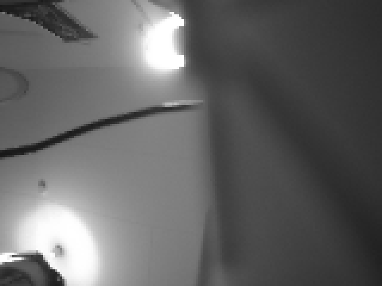
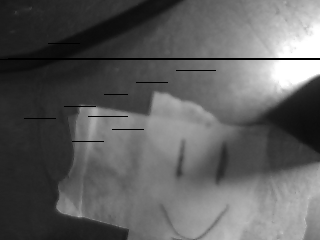

# Kameramodul (J1) – läge och mätplan

Kort #1 (2NCEKS3T). Sammanställt 2026-11-11. Mätt 2026-11-12 (CC1110 i BF_JTAG_HOLD, Blackfin ur reset, 99 mA).

## Vad vi vet

- Kameran är en Sunny-modul märkt **"8811GA SUNNY"** på en 24-polig FPC-kontakt, **J1**. Stift 1 sitter överst vid SW1 och stift 24 nederst vid C23/C21.
- Kortet är märkt "SECUR.PCAM.BLACKFIN".
- **U4 = ISSI IS42S16800F** (SDRAM, 16 MB). Den kan användas som bildbuffert via Blackfins EBIU.
- Sensortypen är inte bekräftad. En liknande 24-polig Sunny-modul (8806Z) säljs med OmniVision OV7725, så det är troligen OmniVision.
- TWI-skanning från Blackfin (`blackfin/twi_scan.S`) hittar bara **0x40** (okänd) och **0x5C** (troligen en ljussensor av BH1750-typ). Ingen OmniVision-adress (0x21 eller 0x30) svarar. Sensorn saknar alltså troligen matning, XCLK eller hålls i PWDN.
- PF0..PF9 (troligen PPI-data från kameran) flyter.
- Skriv aldrig "registerpekare" till okända TWI-enheter. Kommandostyrda kretsar tolkar dem som kommandon.

## Förberedelse

1. Strömförsörj kortet med 3,0 V (PSU). CC1110 ska köra ett BF_JTAG_HOLD-bygge med P1_0 = 0 (Blackfin ur reset).
2. Kontrollera strömmen: cirka 95–100 mA betyder att Blackfin går.

## Mätning 1: spänningar på J1 (multimeter mot GND)

Kolumnen "Vanlig funktion" gäller om modulen följer den vanliga 24-poliga OmniVision-layouten. Det är inte bekräftat.

| J1 | Vanlig funktion | Förväntat om sensorn är på | Uppmätt |
|---|---|---|---|
| 1 | NC | – | 0 V |
| 2 | AGND | 0 V | 0 V |
| 3 | SIO_D (I²C-data) | ~2,8–3,3 V | 3,27 V |
| 4 | AVDD | ~2,8 V | 3,27 V |
| 5 | SIO_C (I²C-klocka) | ~2,8–3,3 V | 3,27 V |
| 6 | RESET | hög | 3,27 V |
| 7 | VSYNC | – | 0 V |
| 8 | PWDN | **låg** (hög = viloläge) | ej mätt |
| 9 | HREF | – | 2,44 V (medel) |
| 10 | DVDD | ~1,5–1,8 V | 1,515 V |
| 11 | DOVDD | ~1,8–3,3 V | 3,27 V |
| 12 | D9 | – | ~1,1 V, varierar med ljus |
| 13 | **XCLK** | klocka (se mätning 2) | 1,66 V (medel), klocka |
| 14 | D8 | – | ej mätt |
| 15 | DGND | 0 V | 0 V |
| 16 | D7 | – | 1–2,3 V, varierar med motiv |
| 17 | PCLK | klockar bara när sensorn är igång | 1,4–1,9 V, klocka |
| 18 | D6 | – | ~1,6 V, varierar |
| 19 | D2 | – | ~1,5 V, varierar |
| 20 | D5 | – | ~1,5 V, varierar |
| 21 | D3 | – | 1,7 V |
| 22 | D4 | – | 1,7 V |
| 23 | D1 | – | 0,09–0,25 V |
| 24 | D0 | – | 0,09–0,25 V |

## Mätning 2: klocka på J1-13 (Saleae)

- Sätt en Saleae-kanal på J1-13 och kortets GND.
- Notera om det finns en klocka och ungefär vilken frekvens (vanligt är 6–27 MHz).

## Tolkning

- **Matning och XCLK finns, PWDN låg:** sensorn borde svara på TWI. Kör `twi_scan.S` igen och leta efter 0x21 eller 0x30.
- **PWDN hög:** hitta vilket CC1110- eller Blackfin-stift som styr PWDN.
- **Matning saknas:** någon av transistorerna Q8, Q9, Q10 eller Q11 styr den troligen. Hitta vilket stift som slår på den. P0_1 (+7 mA) och P0_7 (aux) är kandidater.
- **XCLK saknas:** klockan måste komma från Blackfin (en timer, TMRx) eller från en oscillator på kortet. Den behöver startas.
- **Stiften följer inte tabellen** (till exempel matning på stift 2 och 15): modulen har en annan layout. Kartlägg den med multimeter (genomgång mot GND och matningsskenor) innan något drivs.

## Resultat 2026-11-12

- Mönstret stämmer med den vanliga 24-poliga OmniVision-layouten. Matningen finns (AVDD 3,27 V, DVDD 1,515 V, DOVDD 3,27 V), RESET är hög och XCLK (stift 13) och PCLK (stift 17) klockar.
- HREF och VSYNC är aktiva, och databitarna D9..D2 varierar med motivet. D1/D0 ligger nästan alltid på 0, vilket är typiskt för en 10-bitars sensor som används som 8-bitars. **Sensorn är igång och skickar bild.**
- Ändå svarade ingen bildsensoradress på Blackfins TWI-skanning. Nästa steg: Saleae på J1-5 (SIO_C) och J1-3 (SIO_D) under en ny `twi_scan`, för att se om Blackfins TWI når kamerans SCCB.
- **Saleae på J1-5 (SIO_C), J1-3 (SIO_D) och J1-7 (VSYNC) under `twi_scan`:** alla 112 adressförsök syns på kamerans SCCB, så kameran sitter på Blackfins TWI-buss. Bara 0x40 (läsning 0xFF) och 0x5C (läsning nu 0x04) svarar med ACK. 0x21 och 0x30 svarar NAK. Kameran är därför troligen 0x40.
- VSYNC-perioden är 16,4 ms (cirka 61 bilder per sekund).
- Nästa steg: läs ID-register på 0x40 (OmniVision: PID 0x0A/0x0B och MIDH/MIDL 0x1C/0x1D; Aptina: 0x00, 16 bit). Kräver en pekarskrivning, se varningen ovan.
- **ID läst 2026-11-12** (`twi_read.S` med 16-bitars pekare, bekräftat med Saleae på SCCB): enhet **0x40** har 16-bitars registeradresser, 0x300A = 0x79 och 0x300B = 0x55, alltså chip-ID **0x7955**. Det pekar på **OmniVision OV7955** (VGA 672×492, upp till 60 bilder/s, parallell DV-utgång). Det stämmer med 61 bilder/s och 8 aktiva databitar. 0x3000 = 0x07FF. Läsningar med 8-bitars pekare ger 0x00.
- 0x5C är alltså inte kameran. Antagandet att det är en ljussensor (BH1750-typ) kvarstår men är inte bekräftat.
- Nästa steg: fånga en bild med Blackfins PPI (PF-porten) till SDRAM (U4) eller L1, utan att ändra sensorns inställningar.

## Bildfångst, läge 2026-11-12

- PPI-stift (bekräftat): PCLK = PG5, HREF = PG6, VSYNC = PG7, data D2..D9 = PF2..PF9.
- Blackfins originalprogram tar själv en bild till SDRAM (0x00100000, 640×480 ord på 16 bit, 1280 sampel per rad, 480 rader) efter varje start.
- Hinder: DMA startar inte under JTAG-kontroll, och läsning av SDRAM via gdbproxy hänger. Se `.agents/memory.md` (BF_DMA_SDRAM_FAIL).

## Första bilden (2026-11-12)

- Tagen med `blackfin/ppi_snap.c` (160x120 gråskala, laddat via JTAG). Kortet täckte halva linsen.
- PPI-inställningen är kopierad från originalprogrammet (disassemblerat ur L1): PPI_CONTROL 0x3E0D, PPI_COUNT 1279, PORTG_FER 0x0460, PORTG_MUX 0x0480. VSYNC väntas in i mjukvara på PG7.
- Strömmen efter VSYNC är sammanhängande, med radlängd 335 sparade sampel. Pixel = (sampel >> 2) & 0xFF.
- DMA: källan måste slås på före målet vid MDMA. DMA_DONE kräver DI_EN.

## Bild via RF till gatewayen (2026-11-13)

- Kedja: kamera -> Blackfin (`blackfin/snap_link.c`, laddad via JTAG) -> mjukvaru-SPI -> CC1110 (`BF_IMG_LINK`) -> RF 868 MHz -> gateway -> `/api/camera.bmp` och MQTT.
- RF-paket av typ 0x81: bitnummer + 8 pixlar. Gatewayen placerar bitarna efter nummer, så ett förlorat paket bara blir en lucka som fylls nästa varv.
- ~150 byte/s, ett varv (320x240, 9600 bitar) ~8,5 min. Hämta med `python MD_CAM/blackfin/image_collect.py`.
- Stäng gdbproxy direkt efter laddning av `snap_link`, annars kan gdbproxy återställa Blackfin vid JTAG-glapp.
