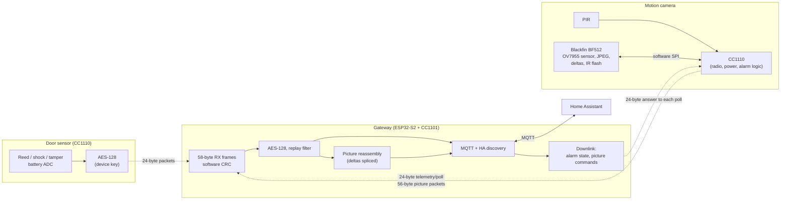

# Verisure Sub-1GHz Sensors & Home Assistant Gateway

[](LICENSE)
[](https://platformio.org/)
[](https://sdcc.sourceforge.net/)
[](https://www.home-assistant.io/)
[](https://www.ti.com/product/CC1101)

Repurpose **Verisure Sub-1GHz (868.950 MHz) alarm hardware** with open-source firmware and bridge
it into **Home Assistant** through an **ESP32-S2 + CC1101 gateway**: local, no cloud, no subscription.

> [!NOTE]
> **Reducing e-waste:** the project started as a way to give leftover alarm
> hardware a second life instead of throwing it away. The devices become reliable, local and
> subscription-free parts of the smart home.

---

## Components

| Component | Folder | Hardware | Status |
| :--- | :--- | :--- | :--- |
| **Gateway** | [`868Receiver/`](868Receiver/README.md) | LOLIN S2 Mini (ESP32-S2) + CC1101 868 MHz | ✅ Working: decrypts sensors, MQTT auto-discovery, camera downlink, picture reassembly |
| **Door / window sensor** | [`VerisureDoorSensor/`](VerisureDoorSensor/README.md) | Verisure `GW-MC-SHOCK`, TI CC1110F32 | ✅ Working: contact, shock, tamper, battery; PM2 sleep (~17 µA idle), event tests pending |
| **Motion camera** | [`MD_CAM/`](MD_CAM/README.md) | Verisure `GW MD CAM2`: CC1110F32 + Blackfin BF512 + OV7955 + IR flash + PIR | ✅ Working: alarm pictures, deltas, IR flash in the dark, PM2 sleep; bench tests pending |
| Siren | [`SIREN/`](SIREN/README.md) | Verisure siren | 🔍 Research photos only |

---

## System architecture



All devices send on **868.950 MHz, 38.4 kBaud 2-FSK**. Every packet starts with the device ID in
plain text, followed by AES-128 with a per-device key derived from one master key.

---

## Repository structure

```text
├── 868Receiver/          Gateway firmware (PlatformIO, ESP32-S2)          → 868Receiver/README.md
├── VerisureDoorSensor/   Door/window sensor firmware (SDCC, CC1110),
│                         build_and_flash.py, docs                         → VerisureDoorSensor/README.md
├── MD_CAM/               Motion camera: CC1110 firmware, Blackfin program,
│                         JTAG tools, e2e test, docs                       → MD_CAM/README.md
├── SIREN/                Siren research photos                            → SIREN/README.md
├── documentation/        Shared docs: protocol & crypto, CC flasher, gateway hardware, HA/MQTT
├── derive_key.py         Master key generation and per-device key derivation (KDF)
├── monitor.py            Gateway serial monitor
├── port_selector.py      COM-port discovery used by the scripts
├── TODO.md               Open work: what can be done unattended and what needs someone at the bench
└── AGENTS.md             Roles and quality gates for the AI agents working on the project
```

---

## Quick start

1. **Toolchains:** Python 3.8+ (`pip install pyserial requests cryptography paho-mqtt`),
   [SDCC](https://sdcc.sourceforge.net/) for the CC1110 devices, [PlatformIO](https://platformio.org/)
   for the gateway, and an ESP32 running [ESP_CC_Flasher](https://github.com/atc1441/ESP_CC_Flasher)
   to program the CC1110 boards.
2. **Master key and secrets:**
   ```bash
   python derive_key.py --generate-master
   cp 868Receiver/src/secrets.h.example 868Receiver/src/secrets.h
   ```
   Put the master key, Wi-Fi and MQTT settings in `868Receiver/src/secrets.h` (git-ignored).
   Every device key is derived from the master key, so generate it before building any device.
3. **Gateway:** `pio run -d 868Receiver -t upload`, then open `http://<gateway-ip>`.
   Details: [868Receiver/README.md](868Receiver/README.md).
4. **Devices:** follow [VerisureDoorSensor/README.md](VerisureDoorSensor/README.md) and
   [MD_CAM/README.md](MD_CAM/README.md).
5. **Home Assistant:** devices appear under *Settings → Devices & services → MQTT* on their first
   packet (MQTT auto-discovery, no YAML).

---

## Security

* **AES-128** on every packet, hardware AES on the CC1110 and mbedTLS on the gateway.
* **Per-device keys:** `DeviceKey = AES(MasterKey, Pad16(DeviceID))`; one compromised device does
  not expose the others.
* **Authentication:** decrypted packets must contain the magic bytes `VS` and echo the device ID;
  camera picture packets are chained (CBC) so blocks cannot be swapped between packets.
* **Replay protection:** the door sensor sends a 32-bit packet counter that survives resets (its
  upper part is logged in flash; the gateway keeps the last value in NVS), so the gateway accepts
  only newer packets. The camera still uses a 16-bit sequence (porting the counter is on the TODO
  list); camera downlink answers carry the poll's sequence and a random challenge.
* **No secrets in git:** `secrets.h` and `config.h` are git-ignored. See [SECURITY.md](SECURITY.md).

---

## Documentation

* [Protocol, RF & cryptography](documentation/cryptography_and_protocol.md)
* [Gateway hardware & wiring](documentation/hardware_gateway_esp32s2.md)
* [CC-Flasher wiring (J2 header)](documentation/hardware_cc_flasher.md)
* [Home Assistant & MQTT](documentation/homeassistant_mqtt.md)
* [Door sensor hardware](documentation/verisure_sensor_hardware.md)
* [Camera protocol as implemented](MD_CAM/docs/Camera_protocol.md)

---

## Contributing

Contributions are welcome, especially support for more Verisure Sub-1GHz devices (smoke
detectors, keypads, sirens, water leak sensors). See [CONTRIBUTING.md](CONTRIBUTING.md).

## License & disclaimer

[MIT License](LICENSE). Independent research and reverse-engineering project, not affiliated with,
authorised or endorsed by Verisure, Securitas Direct or their affiliates. Product names and
trademarks belong to their owners.
