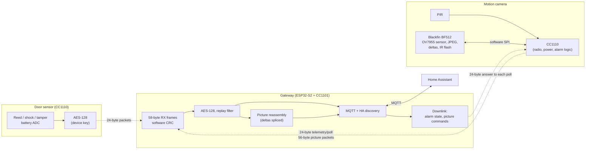

# Verisure Sub-1GHz Sensors & Home Assistant Gateway

[](LICENSE)
[](https://platformio.org/)
[](https://sdcc.sourceforge.net/)
[](https://www.home-assistant.io/)
[](https://www.ti.com/product/CC1101)

Repurpose **Verisure Sub-1GHz (868.950 MHz) alarm hardware** with open-source firmware and bridge
it into **Home Assistant** through an **ESP32-S2 + CC1101 gateway**: local, no cloud, no subscription.

> [!NOTE]
> **Reducing e-waste:** the project started as a way to give leftover alarm
> hardware a second life instead of throwing it away. The devices become reliable, local and
> subscription-free parts of the smart home.

---

## Components

| Component | Folder | Hardware | Status |
| :--- | :--- | :--- | :--- |
| **Gateway** | [`868Receiver/`](868Receiver/README.md) | LOLIN S2 Mini (ESP32-S2) + CC1101 868 MHz | ✅ Working: decrypts sensors, MQTT auto-discovery, camera downlink, picture reassembly |
| **Door / window sensor** | [`VerisureDoorSensor/`](VerisureDoorSensor/README.md) | Verisure `GW-MC-SHOCK`, TI CC1110F32 | ✅ Working: contact, shock, tamper, battery; PM2 sleep (~17 µA idle), event tests pending |
| **Motion camera** | [`MD_CAM/`](MD_CAM/README.md) | Verisure `GW MD CAM2`: CC1110F32 + Blackfin BF512 + OV7955 + IR flash + PIR | ✅ Working: alarm pictures, deltas, IR flash in the dark, PM2 sleep; bench tests pending |
| Siren | [`SIREN/`](SIREN/README.md) | Verisure siren | 🔍 Research photos only |

---

## System architecture



All devices send on **868.950 MHz, 38.4 kBaud 2-FSK**. Every packet starts with the device ID in
plain text, followed by AES-128 with a per-device key derived from one master key.

---

## Repository structure

```text
├── 868Receiver/          Gateway firmware (PlatformIO, ESP32-S2)          → 868Receiver/README.md
├── VerisureDoorSensor/   Door/window sensor firmware (SDCC, CC1110),
│                         build_and_flash.py, docs                         → VerisureDoorSensor/README.md
├── MD_CAM/               Motion camera: CC1110 firmware, Blackfin program,
│                         JTAG tools, e2e test, docs                       → MD_CAM/README.md
├── SIREN/                Siren research photos                            → SIREN/README.md
├── documentation/        Shared docs: protocol & crypto, CC flasher, gateway hardware, HA/MQTT
├── derive_key.py         Master key generation and per-device key derivation (KDF)
├── monitor.py            Gateway serial monitor
├── port_selector.py      Serial port discovery used by the scripts (COMx / /dev/tty*)
├── requirements.txt      Python packages for the scripts
├── TODO.md               Open work: what can be done unattended and what needs someone at the bench
└── AGENTS.md             Roles and quality gates for the AI agents working on the project
```

---

## Quick start

1. **Toolchains:** Python 3.8+ (`pip install -r requirements.txt`, which includes
   [PlatformIO](https://platformio.org/) for the gateway), [SDCC](https://sdcc.sourceforge.net/) for
   the CC1110 devices, and an ESP32 running [ESP_CC_Flasher](https://github.com/atc1441/ESP_CC_Flasher)
   to program the CC1110 boards. The scripts run on Windows and Linux; see
   [Linux setup](#linux-setup).
2. **Master key and secrets:**
   ```bash
   python derive_key.py --generate-master
   cp 868Receiver/src/secrets.h.example 868Receiver/src/secrets.h
   ```
   Put the master key, Wi-Fi and MQTT settings in `868Receiver/src/secrets.h` (git-ignored).
   Every device key is derived from the master key, so generate it before building any device.
3. **Gateway:** `pio run -d 868Receiver -t upload`, then open `http://<gateway-ip>`.
   Details: [868Receiver/README.md](868Receiver/README.md).
4. **Devices:** follow [VerisureDoorSensor/README.md](VerisureDoorSensor/README.md) and
   [MD_CAM/README.md](MD_CAM/README.md).
5. **Home Assistant:** devices appear under *Settings → Devices & services → MQTT* on their first
   packet (MQTT auto-discovery, no YAML).

---

## Linux setup

The scripts and builds work on Linux as well as Windows (verified in WSL2 Ubuntu 26.04 with SDCC
4.5 and PlatformIO 6.2 on 2026-11-18; a native Linux laptop is TODO B9):

```bash
sudo apt install sdcc python3-venv
python3 -m venv ~/vs-venv && ~/vs-venv/bin/pip install -r requirements.txt
source ~/vs-venv/bin/activate
sudo usermod -aG dialout $USER     # serial port access; log out and in again
```

* Serial ports are `/dev/ttyACM0` (the gateway, ESP32-S2 native USB) and `/dev/ttyUSB0` (the
  CP210x on the flasher) instead of `COM9`/`COM12`. The camera tests find the gateway by its USB
  ID; the other scripts take `--port`/`--serial` or show a port list.
* In WSL2, attach the boards from Windows with
  [usbipd-win](https://github.com/dorssel/usbipd-win): `usbipd attach --wsl --busid <id> --auto-attach`.
  An attached board is not available to Windows at the same time.
* The Blackfin tools (`MD_CAM/blackfin/`) are needed once to convert a factory camera and then
  only to change the camera's image program.
  `build_ldr.py` finds `bfin-elf-gcc` through `BFIN_TOOLCHAIN` or `PATH`; the JTAG scripts are
  written for Git Bash on Windows with the JTAG proxy in WSL.

---

## Flasher wiring

Both CC1110 boards use TI's 2-wire debug interface (`DD`, `DC`, `RESET_N`). The GPIOs are those
set in `ESP_CC_Flasher/src/main.h` for an ESP32 DevKit (ESP32-C3: DC = GPIO 3, DD = GPIO 4,
RESET = GPIO 1).

| ESP32 flasher | Door sensor `J2` | Camera `J6` | Signal |
| :--- | :--- | :--- | :--- |
| GND | `J2-7` | `J6-5` | Ground |
| GPIO 23 | `J2-4` | `J6-2` | `DD` (debug data, `P2_1`) |
| GPIO 19 | `J2-5` | `J6-3` | `DC` (debug clock, `P2_2`) |
| GPIO 33 | `J2-6` | `J6-4` | `RESET_N` |
| 3V3 | `J2-3` (only if no battery) | **do not connect** | Target power |

Pin 1 of `J2` is the square pad with a white dot. Rules:

* **Camera power:** use its batteries or a bench supply/Otii at 3.0 V on the `VBAT` pad, never the
  flasher's 3V3. The camera's inrush (~0.9 A for ~1 ms) drops the flasher's USB connection, and the
  Blackfin draws 170-190 mA with peaks above 0.5 A. `J6-1` sits behind 1 kOhm and is not a supply pin.
* **Power the flasher over USB first,** then connect it: an unpowered flasher holds `RESET_N` low.
* One target at a time. Details:
  [documentation/hardware_cc_flasher.md](documentation/hardware_cc_flasher.md).

---

## Security

* **AES-128** on every packet, hardware AES on the CC1110 and mbedTLS on the gateway.
* **Per-device keys:** `DeviceKey = AES(MasterKey, Pad16(DeviceID))`; one compromised device does
  not expose the others.
* **Authentication:** decrypted packets must contain the magic bytes `VS` and echo the device ID;
  camera picture packets are chained (CBC) so blocks cannot be swapped between packets.
* **Replay protection:** the door sensor and the camera send a 32-bit packet counter that
  survives resets (its upper part is logged in flash; the gateway keeps the last value in NVS),
  so the gateway accepts only newer packets. Camera downlink answers echo the poll's counter, so
  a recorded answer never fits again.
* **No secrets in git:** `secrets.h` and `config.h` are git-ignored. See [SECURITY.md](SECURITY.md).

---

## Documentation

* [Protocol, RF & cryptography](documentation/cryptography_and_protocol.md)
* [Gateway hardware & wiring](documentation/hardware_gateway_esp32s2.md)
* [CC-Flasher wiring (door sensor J2, camera J6)](documentation/hardware_cc_flasher.md)
* [Home Assistant & MQTT](documentation/homeassistant_mqtt.md)
* [Door sensor hardware](documentation/verisure_sensor_hardware.md)
* [Camera protocol as implemented](MD_CAM/docs/Camera_protocol.md)

---

## Contributing

Contributions are welcome, especially support for more Verisure Sub-1GHz devices (smoke
detectors, keypads, sirens, water leak sensors). See [CONTRIBUTING.md](CONTRIBUTING.md).

## License & disclaimer

[MIT License](LICENSE). Independent research and reverse-engineering project, not affiliated with,
authorised or endorsed by Verisure, Securitas Direct or their affiliates. Product names and
trademarks belong to their owners.
