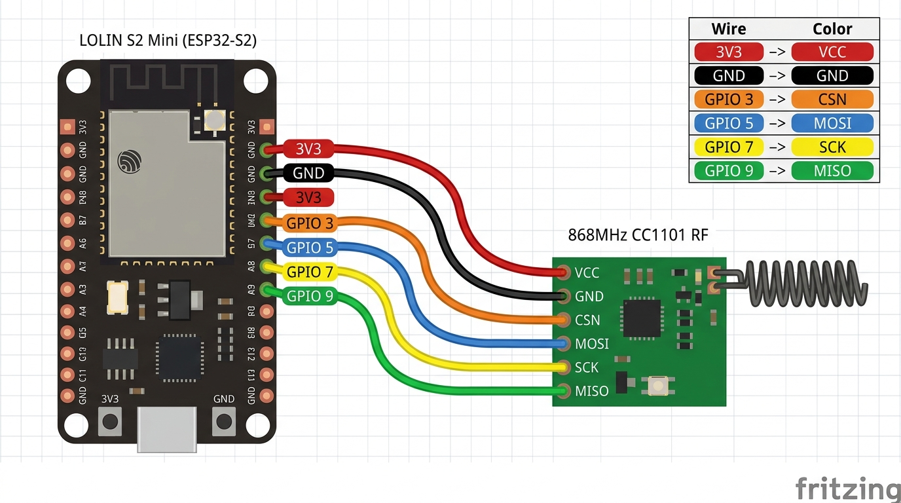
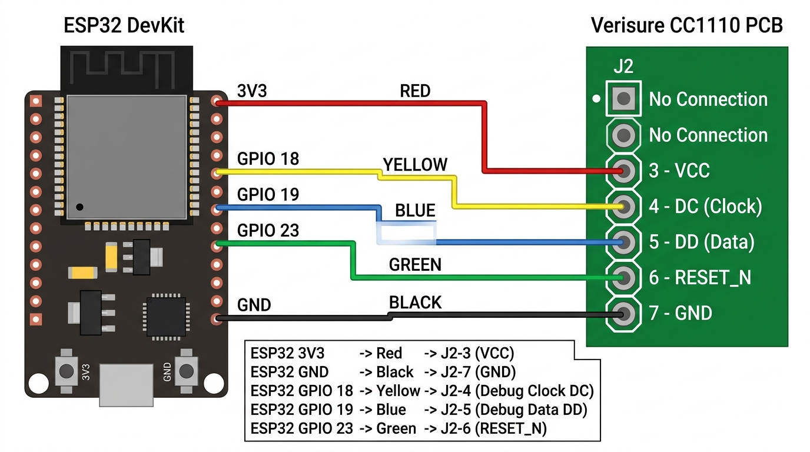

# Verisure Sub-1GHz Sensor & Home Assistant Gateway

[](LICENSE)
[](https://platformio.org/)
[](https://sdcc.sourceforge.net/)
[](https://www.home-assistant.io/)
[](https://www.ti.com/product/CC1101)

Repurpose and liberate your **Verisure Sub-1GHz (868.950 MHz) Door & Window Sensors** with custom, high-performance open-source firmware and bridge them directly into **Home Assistant** via an **ESP32-S2 + CC1101 Gateway** with zero cloud dependencies and zero subscriptions.

---

## 🌟 Key Features

* **100% Local & Cloud-Free:** Complete privacy and independence from proprietary alarm vendor clouds and monthly subscriptions.
* **Instantaneous Response (< 2 ms):** Near zero-latency interrupt response on Door Open/Close, Shock/Vibration, and Tamper.
* **Home Assistant MQTT Auto-Discovery:** Automatic discovery for all entities upon power-on. No manual YAML configuration required!
* **Robust Hardware AES-128 Encryption:** Hardware-accelerated AES-128-ECB encryption on the CC1110 SoC with per-device Key Derivation (KDF), anti-spoofing header verification, and 16-bit rolling sequence replay protection.
* **Multi-Sensor Telemetry:**
  * 🚪 **Door / Window Contact** (`binary_sensor`, `device_class: door`)
  * 💥 **Vibration / Shock Sensor** (`binary_sensor`, `device_class: vibration`)
  * 🛡️ **Tamper / Sabotage Switch** (`binary_sensor`, `device_class: tamper`, diagnostic)
  * 🔋 **Battery Level** (`sensor`, `device_class: battery`, `%`)
  * ⚡ **Battery Voltage** (`sensor`, `device_class: voltage`, `mV`)
  * 📶 **Signal Strength** (`sensor`, `device_class: signal_strength`, `dBm`)
* **Interference-Free Wi-Fi & SPI Coexistence:** Custom ADC1-domain pin mapping on the ESP32-S2 that eliminates SPI switching noise leakage into the Wi-Fi receiver, guaranteeing 100% reliable 2.4 GHz connectivity.
* **Embedded Web Management Portal:** Built-in web dashboard on Port 80 with Captive Portal DNS for easy Wi-Fi, MQTT, and AES key configuration.
* **Smart Tooling:** Python automation scripts with auto-discovery and interactive selection of USB COM ports.

---

## 🏗️ System Architecture

```mermaid
flowchart LR
    subgraph SENSOR["Verisure Sensor (TI CC1110)"]
        Reed["Reed Switch\n(P1_7)"]
        Shock["Shock Sensor\n(P1_2)"]
        Tamper["Tamper Switch\n(P0_1)"]
        ADC["Battery ADC\n(VDD/3)"]
        
        Reed & Shock & Tamper & ADC --> Payload["Telemetry Assembler\n(24 Bytes)"]
        Payload --> Crypto["AES-128 Coprocessor\n(Device Key via KDF)"]
        Crypto --> DMA["DMA Trigger 19\n(RFD FIFO)"]
        DMA --> CC1110_RF["CC1100 Core\n868.950 MHz (27 MHz X1)"]
    end

    subgraph GW["ESP32-S2 Gateway"]
        CC1101_RF["CC1101 Module\n(868.950 MHz SPI)"] --> ESP_CORE["ESP32-S2 Mini\n(ADC1 Domain)"]
        ESP_CORE --> Decrypt["mbedTLS AES-128\n& Replay Filter"]
        Decrypt --> Discovery["HA Auto-Discovery\n& Telemetry Builder"]
        Discovery --> WebPortal["Web Portal (Port 80)\n& Serial CLI"]
        Discovery --> MQTTClient["MQTT Client (PubSubClient)"]
    end

    subgraph HA["Smart Home Ecosystem"]
        Broker["Mosquitto MQTT Broker\n(Port 1883)"] --> HACore["Home Assistant Core"]
        HACore --> Dashboard["Lovelace UI\n(Door, Shock, Tamper, Batt)"]
    end

    CC1110_RF -.->|Sub-1GHz RF (2-FSK)| CC1101_RF
    MQTTClient -->|TCP / MQTTS| Broker
```

---

## 📁 Repository Structure

```text
├── VerisureDoorSensor/          # MCS-51 8051 firmware for the CC1110 sensor
│   ├── main.c                   # Main sensor application, RF engine & AES
│   ├── config.h.example         # Template for Device ID & derived AES key
│   └── build/                   # SDCC build output directory (git-ignored)
├── 868Receiver/                 # PlatformIO project for the ESP32-S2 Gateway
│   ├── platformio.ini           # Build environment for WEMOS LOLIN S2 Mini
│   └── src/
│       ├── main.cpp             # Gateway core, CC1101 driver & main loop
│       ├── hardware_pins.h      # Isolated ADC1 SPI pin definitions
│       ├── crypto.h / .cpp      # AES-128 decryption, KDF & replay protection
│       ├── ha_discovery.h/.cpp  # Home Assistant MQTT discovery payloads
│       ├── mqtt_manager.h/.cpp  # MQTT client, LWT & state publisher
│       ├── sensor_registry.h/.cpp # RAM sensor cache & packet statistics
│       ├── config_manager.h/.cpp# NVS persistent configuration storage
│       ├── serial_cli.h/.cpp    # USB Serial interactive CLI diagnostics
│       ├── web_portal.h/.cpp    # Web management portal & Captive DNS
│       └── secrets.h.example    # Template for local Wi-Fi & MQTT secrets
├── documentation/               # Comprehensive technical guides & schematics
│   ├── images/                  # Illustrated wiring diagrams
│   ├── hardware_gateway_esp32s2.md # Gateway hardware & ADC1 analysis
│   ├── hardware_cc_flasher.md   # CC Flasher wiring & J2 debug pinout
│   ├── verisure_sensor_hardware.md # Reverse-engineered sensor schematic
│   ├── cryptography_and_protocol.md # RF packet framing, registers & KDF
│   ├── homeassistant_mqtt.md    # Home Assistant integration & MQTT topics
│   └── README.md                # Documentation index
├── build_and_flash.py           # All-in-one compile, HTTP flash & verify script
├── derive_key.py                # AES-128 Key Derivation Tool (KDF)
├── flash_cc1110.py              # Standalone HTTP flasher for ESP_CC_Flasher
├── monitor.py                   # Real-time USB Serial monitor for gateway
├── port_selector.py             # Smart COM-port discovery & interactive menu
├── LICENSE                      # MIT Open-Source License
├── CONTRIBUTING.md              # Contribution guidelines
└── SECURITY.md                  # Security policy and credential protection
```

---

## 🛠️ Hardware Requirements & Bill of Materials

| Component | Description | Approximate Cost |
| :--- | :--- | :--- |
| **Verisure Sensor** | Verisure Door/Window Sensor (Model with CC1110F32, reed, shock, and tamper). | Repurposed / Existing |
| **ESP32-S2 Board** | **WEMOS LOLIN S2 Mini** (ESP32-S2FN4R2, 4MB Flash, Type-C). | ~$3 - $5 |
| **Sub-1GHz Module**| **CC1101 868 MHz SPI Transceiver** (Red or green PCB with SMA antenna). | ~$3 - $5 |
| **CC Programmer**   | **ESP32 running ESP_CC_Flasher** (or TI CC-Debugger) connected to sensor J2 header. | ~$4 |
| **Jumper Wires**   | Female-to-Female & Jumper probe pins for sensor flashing header J2. | ~$1 |

---

## 🔌 Hardware Wiring & Pinouts

### 1. Gateway Wiring: LOLIN S2 Mini $\rightarrow$ CC1101 SPI

> [!IMPORTANT]
> The CC1101 SPI bus **must** be connected to **ADC1 pins** (GPIO 3, 5, 7, 9). Do **not** use default FSPI pins on GPIO 11/12 as high-speed SPI noise will disrupt the ESP32-S2 Wi-Fi receiver.

| ESP32-S2 Pin | Domain | CC1101 Pin | Wire Color | Description |
| :---: | :---: | :---: | :---: | :--- |
| **3V3** | Power | **VCC** | 🔴 Red | 3.3V Power Supply |
| **GND** | Power | **GND** | ⚫ Black | Ground Reference |
| **GPIO 3** | ADC1_CH2 | **CSN / SS** | 🟠 Orange | SPI Chip Select (Active LOW) |
| **GPIO 5** | ADC1_CH4 | **MOSI** | 🔵 Blue | SPI Master Out Slave In |
| **GPIO 7** | ADC1_CH6 | **SCK** | 🟡 Yellow | SPI Clock (up to 10 MHz) |
| **GPIO 9** | ADC1_CH8 | **MISO** | 🟢 Green | SPI Master In Slave Out / GDO1 |



---

### 2. Sensor Flashing: ESP_CC_Flasher $\rightarrow$ Verisure J2 Header

The Verisure sensor features a 7-pad unpopulated programming header labeled **`J2`**. Pin 1 has a square pad.

| ESP32 Flasher Pin | Verisure J2 Pad | Signal Name | Wire Color |
| :---: | :---: | :---: | :---: |
| **3V3** | **Pad 3** | VCC (Target Power) | 🔴 Red |
| **GPIO 18** | **Pad 4** | DC (Debug Clock) | 🟡 Yellow |
| **GPIO 19** | **Pad 5** | DD (Debug Data) | 🔵 Blue |
| **GPIO 23** | **Pad 6** | RESET_N | 🟢 Green |
| **GND** | **Pad 7** | Ground | ⚫ Black |



---

## 🚀 Quick Start Guide

### Step 1: Clone the Repository & Install Toolchains

```bash
git clone https://github.com/your-username/verisure-sub1ghz.git
cd verisure-sub1ghz
```

**Prerequisites:**
* [Python 3.8+](https://www.python.org/) with dependencies:
  ```bash
  pip install pyserial requests cryptography
  ```
* [Small Device C Compiler (SDCC)](https://sdcc.sourceforge.net/) for CC1110 8051 compilation:
  * Windows: Download installer from SourceForge or install via Chocolatey (`choco install sdcc`).
  * Linux: `sudo apt install sdcc`
* [PlatformIO](https://platformio.org/) for ESP32-S2 gateway compilation:
  ```bash
  pip install platformio
  ```

---

### Step 2: Configure Keys & Secrets

1. **Derive Device Key:**
   Find the 8-character ID printed on your sensor's casing (e.g. `2JHL 2MVN`):
   ```bash
   python derive_key.py --id "2JHL 2MVN" --write-config
   ```
   This generates `VerisureDoorSensor/config.h` (which is git-ignored and never committed).

2. **Configure Gateway Secrets:**
   Copy the example template:
   ```bash
   cp 868Receiver/src/secrets.h.example 868Receiver/src/secrets.h
   ```
   Edit `868Receiver/src/secrets.h` with your local Wi-Fi SSID/password and MQTT broker IP. (Settings can also be modified later via the web portal).

---

### Step 3: Build & Flash the Sensor

With the ESP32 CC-Flasher connected to your network (`http://192.168.0.80`), run:

```bash
python build_and_flash.py
```

The script will:
1. Compile `VerisureDoorSensor/main.c` with SDCC.
2. Upload and flash the binary to the sensor over HTTP.
3. Automatically prompt for the gateway COM port (or auto-select).
4. Monitor live incoming RF packets to verify the sensor immediately!

---

### Step 4: Build & Flash the Gateway

Connect the LOLIN S2 Mini via USB and flash the gateway:

```bash
cd 868Receiver
pio run -t upload
```

---

### Step 5: Home Assistant Integration

Once the gateway is powered on and connected to your Wi-Fi/MQTT broker:
1. Open **Home Assistant** $\rightarrow$ **Settings** $\rightarrow$ **Devices & Services** $\rightarrow$ **MQTT**.
2. You will see a newly discovered device: **`Verisure 868 Gateway`**.
3. As soon as a sensor transmits, it automatically registers as a dedicated device (e.g. **`Verisure Sensor 2JHL2MVN`**) with all 6 entities configured and ready for dashboards and automations!

---

## 🔒 Security Architecture

The communication link employs a defense-in-depth security model:
* **AES-128 Encryption:** Payload is encrypted using hardware-accelerated AES-128.
* **Key Derivation (KDF):** Every physical sensor node uses a unique derived key ($DeviceKey = AES(MasterKey, Pad16(DeviceID))$). Compromising one sensor node does not expose any other sensors.
* **Anti-Spoofing Verification:** Decrypted payloads require magic bytes (`VS`) and must echo the plaintext Device ID.
* **Replay Protection:** A 16-bit rolling sequence counter rejecting duplicate or older frames protects against RF capture and replay attacks.
* **Zero Leaked Secrets:** All encryption keys, Wi-Fi credentials, and passwords are separated into `.gitignore` files (`secrets.h`, `config.h`).

---

## 📖 Deep-Dive Documentation

For advanced hardware schematics, register details, and RF analysis:
* 📄 [Gateway Hardware & ADC1 Interference Guide](documentation/hardware_gateway_esp32s2.md)
* 📄 [CC-Flasher Wiring & Pinout Guide](documentation/hardware_cc_flasher.md)
* 📄 [Verisure Sensor Reverse-Engineering & Schematics](documentation/verisure_sensor_hardware.md)
* 📄 [RF Protocol, CC1101 Register Map & Cryptography](documentation/cryptography_and_protocol.md)
* 📄 [Home Assistant & MQTT Integration Guide](documentation/homeassistant_mqtt.md)

---

## 🤝 Contributing

Contributions are warmly welcomed! We are actively looking to reverse-engineer and support more Verisure Sub-1GHz hardware variants, including:
* Smoke & Heat Detectors
* PIR Motion Detectors (with/without camera)
* Alarm Keypads & Sirens
* Water Leak Detectors

Please see [CONTRIBUTING.md](CONTRIBUTING.md) for details on submitting pull requests and hardware dumps.

---

## ⚖️ License & Disclaimer

This project is open-source software licensed under the **[MIT License](LICENSE)**.

**Disclaimer:** This is an independent open-source research and reverse-engineering project. It is not affiliated with, authorized, maintained, sponsored, or endorsed by Verisure, Securitas Direct, or any of their affiliates. All product names, trademarks, and registered trademarks are property of their respective owners.
