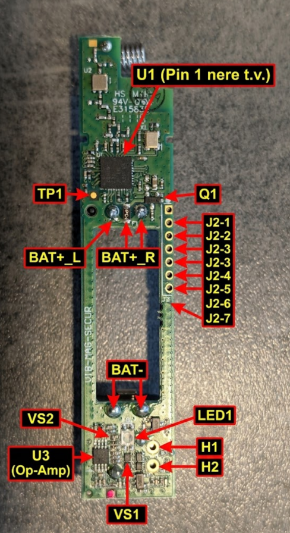
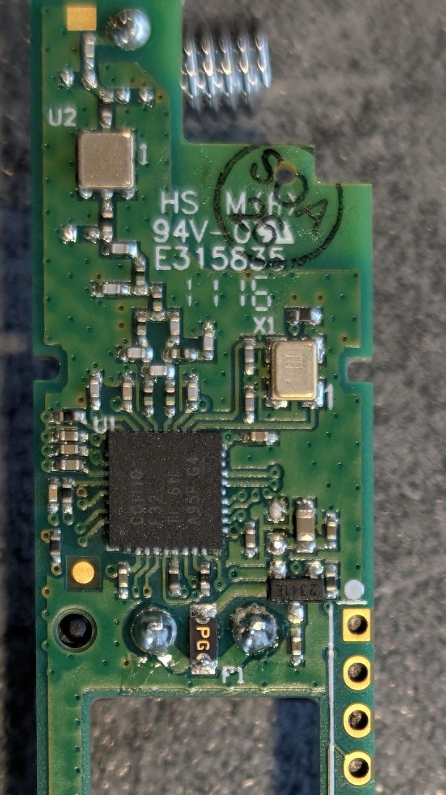
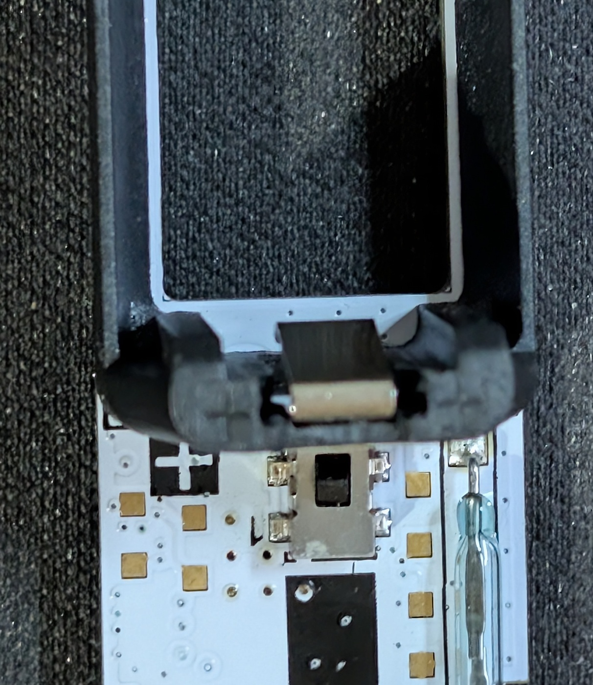

# Verisure Door/Window Sensor (TI CC1110F32): Complete Reverse Engineering & RF Guide

This document provides a comprehensive technical breakdown of the **Verisure Door/Window Sensor** based on the Texas Instruments **CC1110F32** Sub-1 GHz SoC. It details the board architecture, reverse-engineered pinouts, sensor interfacing, the flashing header (`J2`) and the quirks met while getting the 868.950 MHz radio working. The pin and register reference is [verisure_sensor_hardware.md](../../documentation/verisure_sensor_hardware.md); the packet format is in [cryptography_and_protocol.md](../../documentation/cryptography_and_protocol.md).

---

## 1. Board Overview & Architecture

The sensor board is labeled on the silkscreen as **`VIB-MAG-SECUR`** (Securitas / Verisure P/N `N3302409`). It is designed as a dual-purpose security perimeter node that detects:
1. **Door/Window Opening**: Via an integrated glass magnetic reed switch.
2. **Vibration / Forced Entry / Glass Break**: Via an analog piezo shock sensor and vibration elements conditioned through an operational amplifier circuit.
3. **Tamper (cover removed)**: Via the tamper switch on `P0_1`, pressed by the closed cover.
4. **Reset**: Via a miniature tactile push button (`SW1`) on `RESET_N`, adjacent to the battery compartment.
5. **Visual Status**: Via a high-brightness dual-color LED indicator (Red `LED1` and Green).



### Key On-Board Components

| Component ID | Silkscreen Marking | Part / Description | Function |
| :--- | :--- | :--- | :--- |
| **U1** | `CC1110 F32 TI` | TI CC1110F32 (36-pin QFN) | Single-chip 8051 MCU + Sub-1 GHz RF transceiver |
| **X1** | `27.000` | 27.000 MHz SMD Crystal | High-speed system & radio oscillator |
| **U2** | `3716` | EPCOS / TDK B3716 SAW Filter | 868–870 MHz bandpass filter (Center: 869.00 MHz) |
| **U3** | `4542I` / `602853` | Low-Power Operational Amplifier | Signal conditioning for shock/piezo sensor |
| **VS1, VS2** | Passives / Sensors | Piezo / Spring Vibration Elements | Mechanical shock transducers |
| **SW1** | Tactile Switch | Surface Mount Push Button | Hardware reset button on `RESET_N` (under battery clip); not the tamper switch |
| **Reed** | Glass Capsule | Magnetic Reed Contact Switch | Detects magnet presence on door/window frame |
| **LED1 / LED2** | `LD1` / Dual SMD | Red (`P0_2`) & Green (`P0_4`) LEDs | Alarm status and RF transmission indicators |
| **J2** | `J2` (7-pin header) | 1x7 Plated Through-Hole Header | In-circuit programming and debug interface |
| **Antenna** | Helical Coil | 868 MHz Spring Monopole | RF radiation element |

---

## 2. Reverse-Engineered Hardware Pinout

The CC1110F32 is packaged in a 36-pin QFN (`RSP`). Pin 1 is located at the bottom-left corner of the IC when viewing the chip with text upright (adjacent to test point `TP1`).



### CC1110 Pin Mapping Table

| Pin # | CC1110 Pin | Direction | Connected Peripheral | Circuit & Electrical Description |
| :---: | :--- | :---: | :--- | :--- |
| **1** | **`P1_2`** | Input | **Shock / Vibration Sensor** | Digital pulse input from `U3` op-amp circuit. High (`1`) in quiescent state; toggles low on physical impact or vibration. Configured with internal pull-up. |
| **2** | `DVDD` | Power | Digital Core Power | Decoupled to digital 3.0V–3.3V rail. |
| **6** | **`P0_1`** | Input | **Tamper Switch** | Internal pull-up. `0` = cover on (switch to GND via 100 $\Omega$), `1` = cover removed (tamper). |
| **7** | **`P0_2`** | Output | **Red LED (`LED1`)** | Active high (`1` = ON, `0` = OFF). Lit when an alert (door open, shock, tamper) starts. |
| **9** | **`P0_4`** | Output | **Green LED** | Active high (`1` = ON, `0` = OFF). Lit on a heartbeat and on the return to the safe state. |
| **15** | **`P2_1`** | Bidirectional | **Debug Data (`DD`)** | TI 2-wire debug data line. `J2-4`. |
| **16** | **`P2_2`** | Input | **Debug Clock (`DC`)** | TI 2-wire debug clock input. `J2-5`. |
| **20** | `XOSC_Q2` | Input | **27.000 MHz Crystal** | High-speed crystal terminal 2. |
| **21** | `XOSC_Q1` | Input | **27.000 MHz Crystal** | High-speed crystal terminal 1. |
| **23** | `RF_P` | RF Out | Transceiver Differential RF+ | Connected via LC balun matching network to `U2`. |
| **24** | `RF_N` | RF Out | Transceiver Differential RF- | Connected via LC balun matching network to `U2`. |
| **31** | **`RESET_N`** | Input | **Button `SW1` & Debug Reset** | Active-low hardware reset. Connected to push button `SW1` via a **100 $\Omega$ series resistor to GND**. Also routed to `J2-6`. |
| **32** | **`P1_7`** | Input | **Magnetic Reed Switch** | Glass reed switch input with internal pull-up. **`0` = Magnet near** (closed/secured), **`1` = Magnet removed** (open/alarm). |
| **PAD** | `GND` | Ground | Ground Plane (EPAD) | Soldered directly to the PCB ground plane. |

---

## 3. Top-Side Peripherals: Button `SW1` & Magnetic Reed Switch

Looking at the top side of the PCB under the battery compartment:



### 3.1 The Push Button (`SW1`) Discovery
* **Physical Location**: Located immediately below the positive battery contact clip.
* **Electrical Connection**: One side is connected to GND; the other side connects through a **100 $\Omega$ resistor directly to Pin 31 (`RESET_N`)**.
* **Operational Behavior**: Pressing `SW1` pulls the hardware reset line low and places the CC1110 in reset. Upon release, the CC1110 boots afresh.
* **Software Detection**: Because the button triggers a hardware reset rather than a standard GPIO interrupt, firmware detects button events by inspecting the reset cause in the **`SLEEP` SFR (0xBE)** at startup:
  ```c
  uint8_t boot_sleep = SLEEP;
  uint8_t rst_cause = (boot_sleep >> 3) & 0x03; // SLEEP.RST[1:0]
  // 00 = Power-On Reset (battery inserted)
  // 01 = External Reset (RESET_N pulled low -> button SW1 or J2-6)
  // 10 = Watchdog reset, 11 = Clock loss reset
  ```
  When `rst_cause == 0x01`, the firmware flashes both LEDs twice. Every packet carries the reset cause in flag bits 7:6, and the first packet after boot is sent at once.

### 3.2 The Magnetic Reed Switch
* **Physical Location**: Sealed glass envelope mounted along the right edge of the PCB.
* **Operation**: When an external magnet (mounted on the door/window frame) is within ~15 mm, the internal contacts close, grounding CC1110 Pin 32 (`P1_7`). When the door opens and the magnet moves away, internal pull-ups bring `P1_7` high (`1`).

---

## 4. In-Circuit Flashing Connector (`J2`)

Flashing and debugging the CC1110 is performed via the 7-pin header footprint **`J2`** along the edge of the battery cutout on the bottom side of the PCB.


### 4.1 J2 Pinout Identification (Measured & Verified)

The J2 connector consists of 7 plated through-holes. **Pin 1 is distinguished by its square copper pad and an adjacent white silkscreen dot**.

Direct multimeter continuity measurements between the J2 header and the CC1110 / power rails yield the following verified pinout:

| J2 Pin # | Pad Geometry | Measured Signal / Node | Function / Role in Flashing | Notes & Description |
| :---: | :--- | :--- | :--- | :--- |
| **J2-1** | **Square Pad** (White dot) | **Pin 3** | Auxiliary / UART / GPIO | Trace to CC1110 pin 3 (top hole) |
| **J2-2** | Round Pad | **Pin 2** | Auxiliary / UART / GPIO | Trace to CC1110 pin 2 |
| **J2-3** | Round Pad | **VCC (3.3V)** | **Target Power (VDD)** | Connected directly to positive battery rail via fuse `F1` and `BAT+_R` |
| **J2-4** | Round Pad | **Pin 15 (`P2_1`)** | **`DD` (Debug Data)** | 2-wire CC Debugger bidirectional data line |
| **J2-5** | Round Pad | **Pin 16 (`P2_2`)** | **`DC` (Debug Clock)** | 2-wire CC Debugger clock line |
| **J2-6** | Round Pad | **Pin 31 (`RESET_N`)** | **Reset** | Debug reset; shared with button `SW1` |
| **J2-7** | Round Pad (near "J2" text) | **GND** | **System Ground** | Direct connection to the solid copper ground plane |

> [!NOTE]
> For programming via the **ESP32 CC-Flasher**, the essential lines are:
> * **Power & Ground**: `J2-3` (**VCC**) and `J2-7` (**GND**).
> * **Data & Clock**: `J2-4` (**`DD` / Pin 15**) and `J2-5` (**`DC` / Pin 16**).
> * **Reset Control**: `J2-6` (**`RESET_N` / Pin 31**) to force debug mode.

### 4.2 Flashing via ESP32 CC-Flasher
The target is flashed using an ESP32 running CC-Debugger firmware ([ESP_CC_Flasher](https://github.com/atc1441/ESP_CC_Flasher)), reachable over Wi-Fi at `http://cc.local` (or over its USB serial port with `--serial`).

`python VerisureDoorSensor/build_and_flash.py` handles the workflow:
1. Reads the gateway's last accepted counter for the sensor (`GET <gateway>/api/replay?id=<ID>`) and builds with `-DCTR_SEED`, so a reflashed sensor's packet counter continues.
2. Compiles the C source with **SDCC** (`sdcc -mmcs51 --model-small --code-size 0x7800`; flash pages 30-31 hold the counter log).
3. Converts the Intel Hex output to binary using `makebin -p`.
4. `POST /cc_init`, uploads the binary with `POST /edit` and programs it with `POST /flash_cc?file=main.bin`.
5. Polls `GET /get_status` until the verify result is logged.
6. Invokes `POST /cc_exit_dbg` to release the debug interface and run the firmware.

Options and the fallback without a gateway are in the [README](../README.md#build-and-flash); details in [cc1110_quirks_dma_toolchain.md](cc1110_quirks_dma_toolchain.md#2-toolchain--automation-in-antigravity).

---

## 5. Getting RF Working: Critical Gotchas & Register Math

Achieving clean RF transmission from the CC1110 to an external CC1101 receiver required solving three major hardware and compiler hurdles.

### 5.1 The 27.000 MHz Crystal (Not 26 MHz!)
Crystal `X1` is engraved **`27.000`**, not the 26 MHz of TI's reference designs; 26 MHz math moves the carrier by ~33 MHz. At 27 MHz the radio uses `FREQ = 0x202EEF` (868.950 MHz), `MDMCFG4/3 = 0x8A/0x75` (38.4 kBaud) and `DEVIATN = 0x35` (~21.4 kHz).

### 5.2 Radio Register Addresses (`FSCAL0` vs `PA_TABLE0`)
CC1101 SPI addresses do not map onto the CC1110's XDATA registers by adding `0xDF00`: `FSCAL0` is at `0xDF1F` (`0xDF26` is reserved) and `PA_TABLE0` at `0xDF2E`. Writing the PA value into the synthesizer calibration breaks PLL lock.

The math, the full register table and this trap are kept in one place: [verisure_sensor_hardware.md](../../documentation/verisure_sensor_hardware.md#-rf-hardware-saw-filter-and-crystal-calculations).

---

### 5.3 Solving FIFO Underflow via DMA Channel 0 (Trigger 19)

Unlike the standalone CC1101, the CC1110 **does not have a 64-byte hardware FIFO**. The radio data register `RFD` (`0xDFD9`) is only **1 byte deep**. When the radio enters `STX` mode, the CPU or DMA must write every byte before the internal serializer empties, or the radio immediately faults with `MARCSTATE = 0x16` (`TXFIFO_UNDERFLOW`).

To ensure zero packet loss and rock-solid timing, transmissions are offloaded to **DMA Channel 0** using **Radio Trigger 19**:

```c
typedef struct {
    uint8_t src_h;
    uint8_t src_l;
    uint8_t dst_h;
    uint8_t dst_l;
    uint8_t len_h;   // VLEN=000, LEN[12:8]=0
    uint8_t len_l;   // Length = 24 bytes (PACKET_LEN)
    uint8_t cfg0;    // Trigger 19: DMA_TRIG_RADIO (0x13)
    uint8_t cfg1;    // SRCINC=1, DESTINC=0, PRIORITY=High (0x4A)
} dma_desc_t;

// Transmission sequence:
RFST = 0x04;         // Enter IDLE
DMA0CFGH = ((uint16_t)&dma_desc) >> 8;
DMA0CFGL = ((uint16_t)&dma_desc) & 0xFF;
DMAARM = 0x01;       // Arm DMA Channel 0
__asm nop; nop; nop; nop; nop; nop; nop; nop; nop; __endasm; // 9 NOPs required by TI
RFST = 0x03;         // Command STX (DMA automatically feeds RFD)
while (!(RFIF & 0x10)); // Wait for IRQ_DONE (Bit 4)
```

---

## 6. Packet Format & Sensor Behavior

Each packet is 24 bytes (8-byte plaintext device ID + 16-byte AES-128-ECB block) plus the 2-byte hardware CRC; the layout, flags and replay protection are in [cryptography_and_protocol.md](../../documentation/cryptography_and_protocol.md). The firmware sleeps in PM2 (~17 uA idle) and wakes on port interrupts from the reed switch, shock sensor and tamper switch or on a 0.5 s sleep-timer tick; see the [README](../README.md#features).
