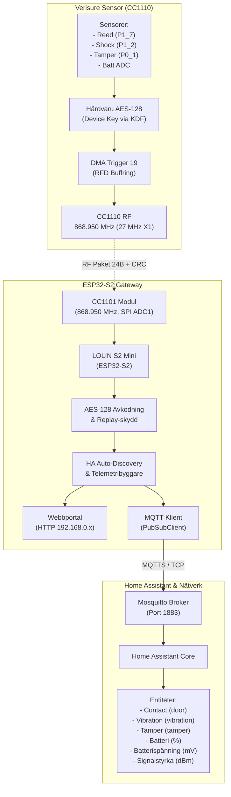

# Verisure Sub-1GHz & Home Assistant Gateway – Projektdokumentation

Välkommen till den officiella tekniska dokumentationen för reverse-engineering och integration av **Verisure CC1110 dörr- och fönstersensorer (868.950 MHz)** till **Home Assistant** via en specialbyggd **ESP32-S2 Gateway** med MQTT Auto-Discovery.

---

## 📁 Dokumentationsöversikt

| Dokument | Beskrivning |
| :--- | :--- |
| [**1. Gateway Hårdvara & Kabeldragning**](hardware_gateway_esp32s2.md) | LOLIN S2 Mini (ESP32-S2) till CC1101 SPI, pinout, ADC1 vs ADC2 interferensanalys och kopplingsdiagram. |
| [**2. CC-Flasher & Programmering**](hardware_cc_flasher.md) | ESP32 CC-Flasher till Verisure J2-header, pinout, felsökning och automatiserad flashning via HTTP API. |
| [**3. Verisure Sensorkort (CC1110F32)**](verisure_sensor_hardware.md) | Komplett hårdvarukartläggning: Reed-kontakt, skaksensor, sabotagekontakt (P0_1), LED:ar, 27 MHz kristall och SAW-filter. |
| [**4. Protokoll, RF & Kryptografi**](cryptography_and_protocol.md) | 868.950 MHz 2-FSK, registervärden (FSCAL0/PA_TABLE0), AES-128 KDF nyckelhärledning, paketstruktur och replay-skydd. |
| [**5. Home Assistant & MQTT Integration**](homeassistant_mqtt.md) | MQTT Auto-Discovery arkitektur, entiteter (Contact, Vibration, Tamper, Batterispänning i mV), LWT och Gateway Web Dashboard. |

---

## 🏗️ Systemarkitektur



---

## ⚡ Snabbstart

1. **Gateway IP:** [http://192.168.0.142](http://192.168.0.142) (Webbgränssnitt för Wi-Fi, MQTT och sensortelemetri).
2. **Kompilera & Flasha CC1110:**
   ```powershell
   python build_and_flash.py
   ```
3. **Bygg & Flasha Gateway:**
   ```powershell
   & "$env:USERPROFILE\.platformio\penv\Scripts\platformio.exe" run -d 868Receiver -t upload --upload-port COM9
   ```
