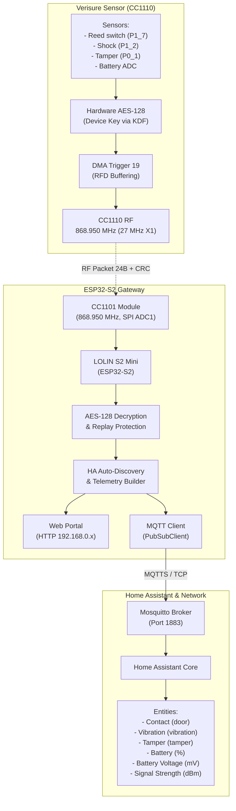

# Verisure Sub-1GHz & Home Assistant Gateway – Documentation

Welcome to the technical documentation for reverse-engineering and integrating **Verisure CC1110 door/window sensors (868.950 MHz)** into **Home Assistant** via a custom-built **ESP32-S2 Gateway** with MQTT Auto-Discovery.

---

## 📁 Documentation Overview

| Document | Description |
| :--- | :--- |
| [**1. Gateway Hardware & Wiring**](hardware_gateway_esp32s2.md) | LOLIN S2 Mini (ESP32-S2) to CC1101 SPI, pinout, ADC1 vs ADC2 Wi-Fi interference analysis, and wiring diagram. |
| [**2. CC-Flasher & Programming**](hardware_cc_flasher.md) | ESP32 CC-Flasher to Verisure J2 debug header, pinout, troubleshooting, and automated flashing via HTTP API. |
| [**3. Verisure Sensor Hardware (CC1110F32)**](verisure_sensor_hardware.md) | Complete PCB mapping: Reed switch, shock sensor, tamper button (P0_1), LEDs, 27 MHz crystal, and SAW filter. |
| [**4. Protocol, RF & Cryptography**](cryptography_and_protocol.md) | 868.950 MHz 2-FSK, register configuration (FSCAL0/PA_TABLE0), AES-128 KDF key derivation, packet format, and replay protection. |
| [**5. Home Assistant & MQTT Integration**](homeassistant_mqtt.md) | MQTT Auto-Discovery architecture, entity definitions (Contact, Vibration, Tamper, Battery Voltage in mV), LWT, and Gateway Web Dashboard. |

---

## 🏗️ System Architecture



---

## ⚡ Quick Start

1. **Gateway IP:** [http://192.168.0.142](http://192.168.0.142) (Web management dashboard for Wi-Fi, MQTT, and live sensor telemetry).
2. **Compile & Flash CC1110:**
   ```powershell
   python build_and_flash.py
   ```
3. **Build & Flash Gateway:**
   ```powershell
   pio run -d 868Receiver -t upload --upload-port COM9
   ```
