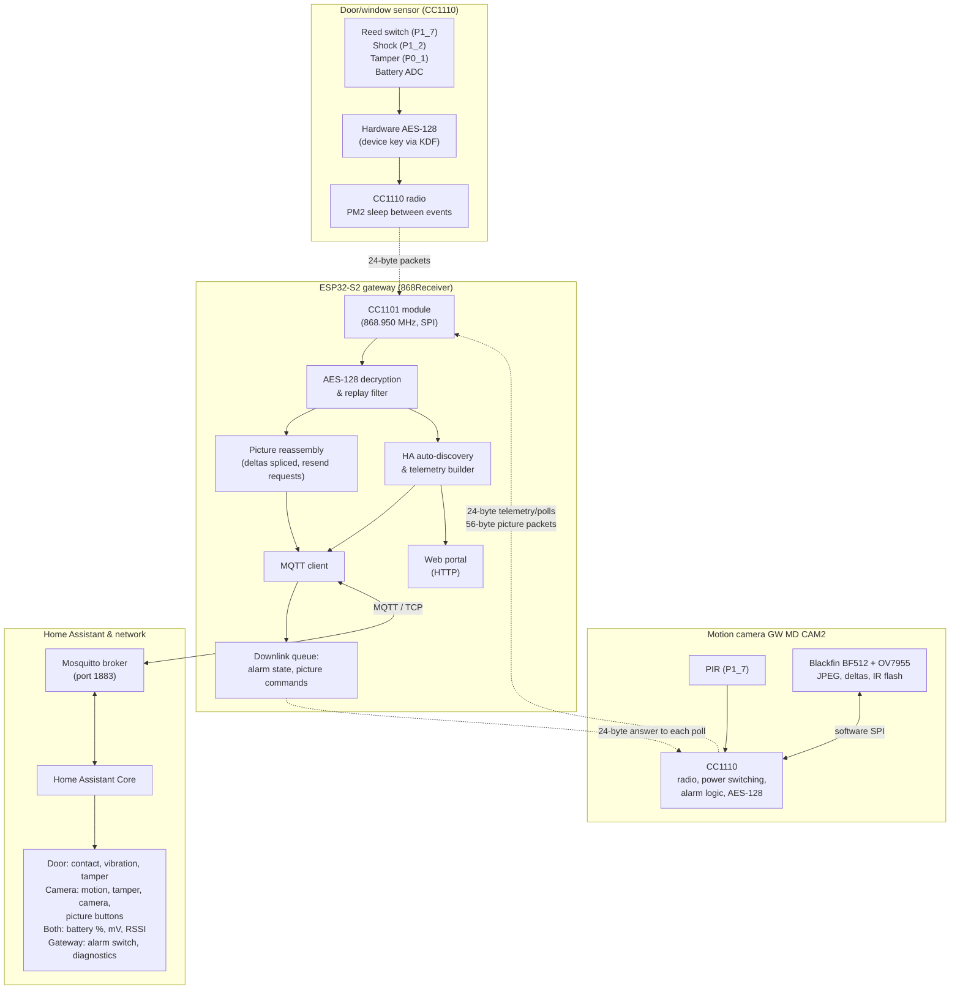

# Verisure Sub-1GHz & Home Assistant Gateway – Documentation

Welcome to the technical documentation for reverse-engineering and integrating **Verisure CC1110 devices (868.950 MHz): the door/window sensor and the GW MD CAM2 motion camera** into **Home Assistant** via a custom-built **ESP32-S2 Gateway** with MQTT Auto-Discovery.

---

## 📁 Documentation Overview

| Document | Description |
| :--- | :--- |
| [**1. Gateway Hardware & Wiring**](hardware_gateway_esp32s2.md) | LOLIN S2 Mini (ESP32-S2) to CC1101 SPI, pinout, ADC1 vs ADC2 Wi-Fi interference analysis, and wiring diagram. |
| [**2. CC-Flasher & Programming**](hardware_cc_flasher.md) | ESP32 CC-Flasher to the CC1110 debug header of the door sensor (J2) and the camera, pinout, troubleshooting, and automated flashing. |
| [**3. Verisure Sensor Hardware (CC1110F32)**](verisure_sensor_hardware.md) | Door sensor PCB mapping: Reed switch, shock sensor, tamper button (P0_1), LEDs, 27 MHz crystal, and SAW filter. The camera hardware is described in [MD_CAM/README.md](../MD_CAM/README.md). |
| [**4. Protocol, RF & Cryptography**](cryptography_and_protocol.md) | 868.950 MHz 2-FSK, register configuration (FSCAL0/PA_TABLE0), AES-128 KDF key derivation, packet format, and replay protection. |
| [**5. Home Assistant & MQTT Integration**](homeassistant_mqtt.md) | MQTT Auto-Discovery architecture, entity definitions for the door sensor, the camera and the gateway, picture and alarm topics, LWT, and Gateway Web Dashboard. |

---

## 🏗️ System Architecture



All devices send on 868.950 MHz, 38.4 kBaud 2-FSK. Each packet starts with the device ID in plain
text, followed by AES-128 with a per-device key. The door sensor only sends. The camera polls the
gateway, and the gateway's answer carries the alarm state and picture commands.

---

## ⚡ Quick Start Workflow

1. **Generate Master Key & Configure Secrets:**
   ```powershell
   python derive_key.py --generate-master
   cp 868Receiver/src/secrets.h.example 868Receiver/src/secrets.h
   # Edit secrets.h with your MASTER_KEY_HEX, Wi-Fi and MQTT credentials
   ```

2. **Derive Sensor Key:**
   ```powershell
   python derive_key.py --id "2JHL 2MVN" --write-config
   ```

3. **Build & Flash Gateway (ESP32-S2):**
   ```powershell
   pio run -d 868Receiver -t upload
   ```
   Web management dashboard: [http://192.168.0.142](http://192.168.0.142) (or your local IP).

4. **Build, Flash & Verify the Devices:**
   ```powershell
   python VerisureDoorSensor/build_and_flash.py            # door sensor
   python MD_CAM/build_and_flash_md_cam.py --serial COM12   # motion camera
   ```
