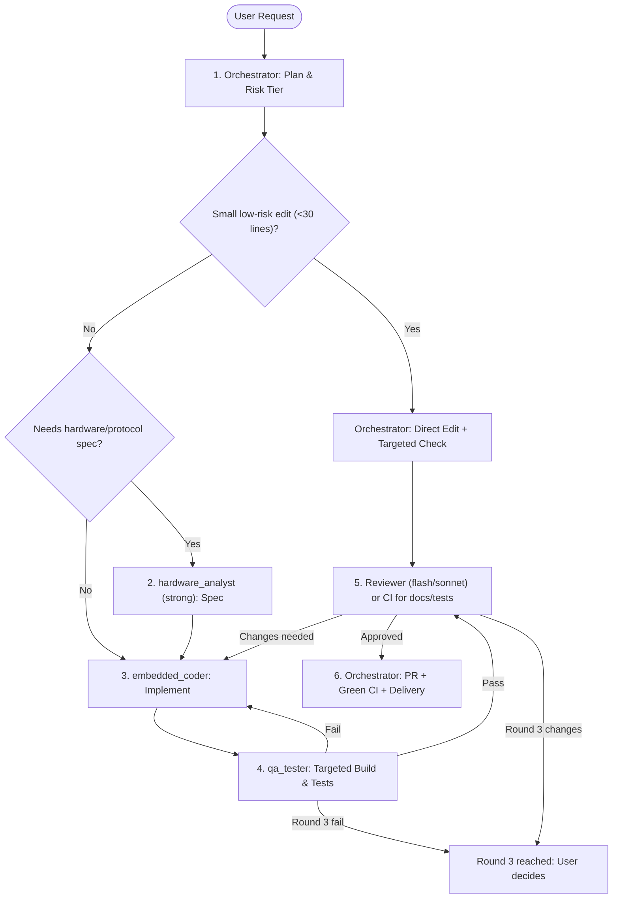

# Multi-Agent Workflow Reference (Claude Code & Antigravity)

This reference complements [AGENTS.md](../AGENTS.md) with tool-specific configuration details for **Claude Code** (primary) and **Google Antigravity**.

## Shared Role Instructions

Each role's instructions live once in `.agents/roles/<role>.md` and are shared by both tools. Tool-specific agent files only set model/tools and point to `.agents/roles/`. **Edit role behaviour in `.agents/roles/`, never in the tool-specific wrapper files.**

| Role | Shared instructions | Claude Code wrapper (model / tools) | Antigravity wrapper (model / tools) |
| :--- | :--- | :--- | :--- |
| Hardware & Protocol Analyst | `.agents/roles/hardware_analyst.md` | `.claude/agents/hardware_analyst.md` (`opus`, max; Read, Grep, Glob, WebFetch, WebSearch) | `.agents/agents/hardware_analyst.md` (`pro`; `view_file`, `grep_search`) |
| Embedded Coder | `.agents/roles/embedded_coder.md` | `.claude/agents/embedded_coder.md` (`sonnet`; Read, Write, Edit, Grep, Glob) | `.agents/agents/embedded_coder.md` (`flash`; `view_file`, `grep_search`, `replace_file_content`) |
| QA & Test Runner | `.agents/roles/qa_tester.md` | `.claude/agents/qa_tester.md` (`haiku`; Bash, Read, Grep, Glob) | `.agents/agents/qa_tester.md` (`flash`; `view_file`, `grep_search`, `run_command`) |
| Security & Code Reviewer | `.agents/roles/code_reviewer.md` | `.claude/agents/code_reviewer.md` (`opus`, max; Read, Grep, Glob) | `.agents/agents/code_reviewer.md` (`pro`; `view_file`, `grep_search`) |

## Workflow Diagram

## Tool-Specific Notes

### Claude Code
- `.claude/agents/` is loaded at session start; start a new session after editing those files.
- `qa_tester`'s command limits are enforced by `.claude/settings.json` running `.claude/hooks/qa_bash_guard.py` before every Bash call. When the caller is `qa_tester`, it blocks non-read-only git commands, `pio` upload targets, `build_and_flash*.py` without `--compile-only`, OTA, esptool, bench flashers, and nested shells. Other agents and the main session are unaffected. Tests: `tests/test_qa_bash_guard.py`.
- For low-risk reviews, invoke `code_reviewer` with `model="sonnet"` (or `haiku` for trivial checks) instead of `opus`.

### Google Antigravity
- `AGENTS.md` is loaded as an always-on rule; `.agents/agents/` defines custom subagents (`model` accepts only `pro`, `flash`, or `inherit`).
- Read-only roles get no `run_command` and no write tool. Because there is no pre-command hook for `qa_tester`, its role file states the forbidden commands strictly and the Orchestrator verifies them.
- Documented tool names in `.agents/agents/`: `view_file`, `grep_search`, `replace_file_content`, `run_command` (a misspelled tool name can make a subagent hang).
- For low-risk reviews, invoke `code_reviewer` with `model="flash"` instead of `pro`/`inherit`.
- For cross-family second opinions, the Orchestrator may run `code_reviewer` in a Claude Code session on the same diff under `scratch/`.
