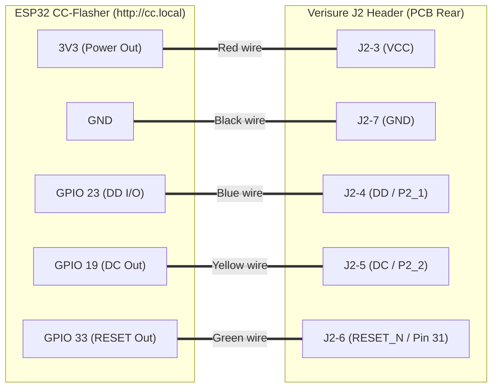
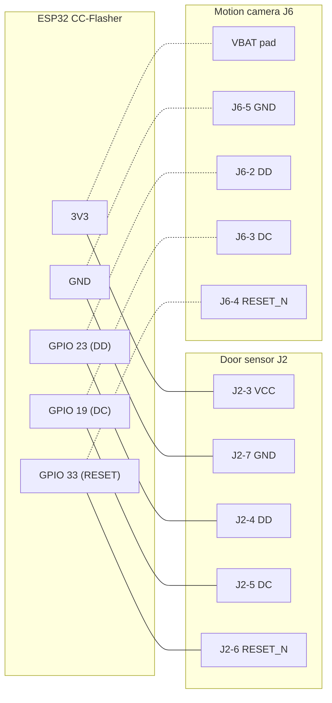

# CC-Flasher & Programming: ESP32 to the Verisure CC1110 Debug Headers

This document details the wiring, pinout, and flashing routine for programming the **Texas Instruments CC1110F32** microcontroller on the Verisure door sensor (header **J2**) and the GW MD CAM2 motion camera (header **J6**) using an **ESP32 running [ESP_CC_Flasher](https://github.com/atc1441/ESP_CC_Flasher)** (Aaron Christophel's open-source CC-Debugger implementation).

---

## 📌 J2 Header Pinout (Door Sensor PCB)

The flashing and debug interface consists of 7 through-hole/test pads situated alongside the battery compartment on the rear side of the PCB, marked **`J2`**.

> [!NOTE]
> **Pin 1 is identified by a square copper pad and a white silkscreen dot.** The remaining pads (2 through 7) are circular.

| J2 Pin | Shape & Marking | Measured Node on CC1110 | Signal Name | Description & Function |
| :---: | :--- | :---: | :---: | :--- |
| **`J2-1`** | Square pad (white dot) | `P1_0` or `P1_1` (not verified) | Aux / UART | Factory test point / Aux GPIO |
| **`J2-2`** | Round pad | `P1_0` or `P1_1` (not verified) | Aux / UART | Factory test point / Aux GPIO |
| **`J2-3`** | Round pad | **VCC (3.3V)** | **VDD (Target Power)** | Direct supply from battery positive terminal via fuse `F1` |
| **`J2-4`** | Round pad | **`P2_1`** | **`DD` (Debug Data)** | CC-Debugger bidirectional data line (verified 2026-11-17: DD is J2-4, not J2-5) |
| **`J2-5`** | Round pad | **`P2_2`** | **`DC` (Debug Clock)** | CC-Debugger clock line (2-wire debug interface) |
| **`J2-6`** | Round pad | **Pin 31 (`RESET_N`)**| **`RESET` (Debug Reset)**| Active-low reset line forcing chip into debug mode |
| **`J2-7`** | Round pad (near text "J2")| **GND** | **System Ground (GND)** | Connected directly to the solid ground plane |

---

## 🔌 Wiring: ESP32 Flasher to Door Sensor J2

| ESP32 Flasher Pin | Default Flasher GPIO | Verisure J2 Pin | Function |
| :---: | :---: | :---: | :---: |
| **3V3** | 3.3V Power Out | **`J2-3` (VCC)** | 3.3V Target Power |
| **GND** | Ground | **`J2-7` (GND)** | Ground |
| **GPIO 19** | Debug Clock (`CC_DC`)| **`J2-5` (DC)** | Debug Clock |
| **GPIO 23** | Debug Data (`CC_DD`) | **`J2-4` (DD)** | Bidirectional Debug Data |
| **GPIO 33** | Debug Reset (`CC_RST`)| **`J2-6` (RESET)** | Active-Low Debug Reset |



The pins are set in the flasher firmware (`ESP_CC_Flasher/src/main.h`: ESP32 DevKit DC = GPIO 19, DD = GPIO 23, RESET = GPIO 33; ESP32-C3 DC = GPIO 3, DD = GPIO 4, RESET = GPIO 1). An older wiring picture showed GPIO 18/19/23 and was wrong; it was removed. Connect the flasher's GND to J2-7 in any case; its 3V3 to J2-3 only if the board is not powered otherwise.

---

## 📷 Wiring: ESP32 Flasher to Motion Camera J6

The camera's CC1110 has the same 2-wire debug interface on header **J6** (details in
[MD_CAM/docs/Hardware_pinout_and_measurements.md](../MD_CAM/docs/Hardware_pinout_and_measurements.md)).
J6-1 goes through 1 kOhm to DVDD, so power the camera on its `VBAT` pad (batteries removed) and
not through J6-1. Do not feed it from the flasher's 3V3: the inrush into the camera's tantalum
capacitors can drop the flasher's USB connection.

| ESP32 Flasher Pin | Camera | Function |
| :---: | :---: | :---: |
| Bench supply or Otii (3.0 V), not the flasher's 3V3 | **`VBAT`** pad | Target power |
| **GND** | **`J6-5`** | Ground |
| **GPIO 23** | **`J6-2`** (`P2_1`) | Debug Data (`DD`) |
| **GPIO 19** | **`J6-3`** (`P2_2`) | Debug Clock (`DC`) |
| **GPIO 33** | **`J6-4`** (`RESET_N`, 2.7 kOhm in series) | Debug Reset |



Solid lines: door sensor, dashed lines: camera (one target at a time). An unpowered flasher holds
RESET_N low, so give the flasher USB power before connecting it to a running device.


---

## 💻 Automated Build and Flashing Process

Compilation and flashing are automated by [`VerisureDoorSensor/build_and_flash.py`](../VerisureDoorSensor/build_and_flash.py) for the door sensor and [`MD_CAM/build_and_flash_md_cam.py`](../MD_CAM/build_and_flash_md_cam.py) for the camera. Both can flash over Wi-Fi (HTTP API, below) or over the flasher's USB serial port (`--serial <flasher port>`, faster). The door sensor's script first reads the gateway's `GET <gateway>/api/replay?id=<ID>` and builds with `-DCTR_SEED` so a reflashed sensor's packet counter continues (see [cryptography_and_protocol.md](cryptography_and_protocol.md)).

### Step-by-Step Flow (HTTP API, door sensor):
1. **Compilation with SDCC:**
   Compiles `VerisureDoorSensor/main.c` into an optimized MCS-51 8051 binary:
   ```powershell
   sdcc -mmcs51 --model-small --code-size 0x7800 --xram-loc 0xF000 --xram-size 0x0E00 -DCTR_SEED=<block> -c main.c -o build/
   sdcc -mmcs51 --model-small --code-size 0x7800 --xram-loc 0xF000 --xram-size 0x0E00 build/main.rel -o build/main.ihx
   packihx build/main.ihx > build/main.hex
   makebin -p build/main.ihx build/main.bin
   ```
   `--code-size 0x7800` keeps code out of flash pages 30-31 (0x7800-0x7FFF), which hold the packet counter log.
2. **Chip Detection:**
   Sends `POST http://cc.local/cc_init`. The ESP32 generates debug initialization waveforms on `DC` and `RESET_N`.
   The CC1110 responds with `Device id: 0104 Status: B2` (0104 = CC1110F32, 32 kB Flash).
3. **Upload & Flash:**
   Uploads `main.bin` via `POST /edit`, programs and erases flash via `POST /flash_cc?file=main.bin`, and verifies every sector.
4. **Resuming Execution:**
   Sends `POST /cc_exit_dbg`. The ESP32 releases `RESET_N` and allows the CC1110 to boot normal execution.

---

## ⚠️ Important Precautions
* **Never flash gateway firmware to the CC Flasher port:**
  The ESP32 CC-Flasher is a Silicon Labs CP210x serial port; the gateway is the LOLIN S2 Mini's native USB port. Always verify target ports prior to running `pio run -t upload`.
* **Reliable Power Connection on 3V3 / GND:**
  If `cc_init` returns `Device id: 0000` or `Status: 00`, inspect the 3V3 and GND jumper wires for loose contact on J2-3 and J2-7.
