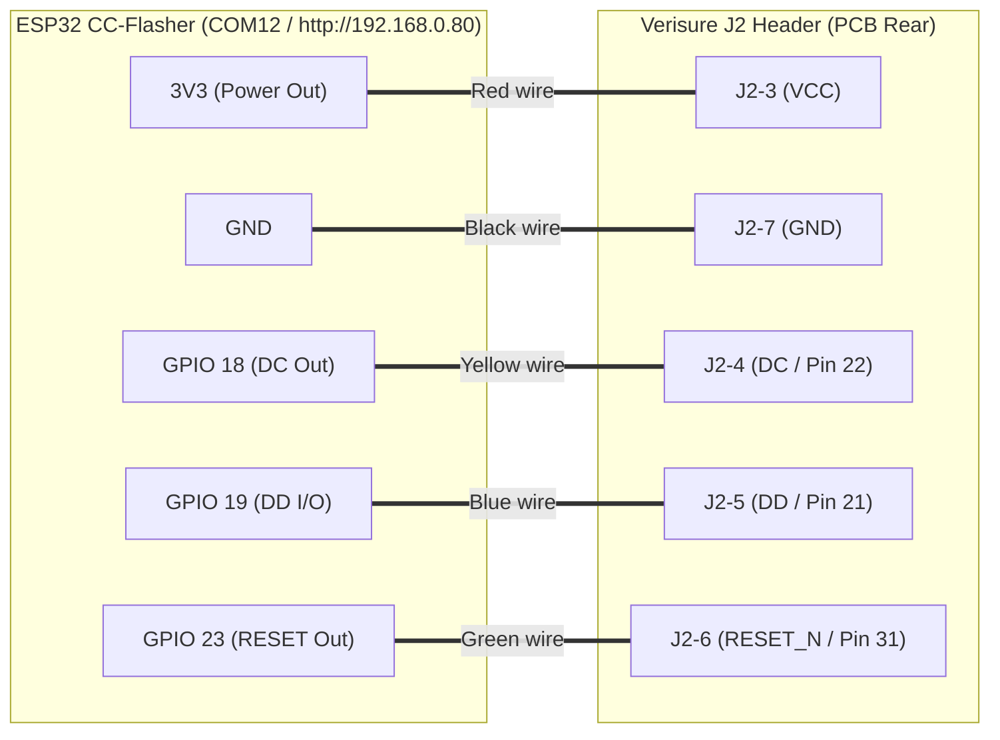
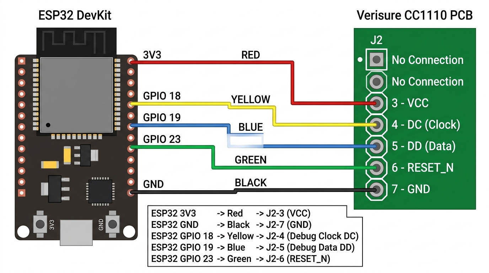

# CC-Flasher & Programming: ESP32 to Verisure J2 Header

This document details the wiring, pinout, and flashing routine for programming the **Texas Instruments CC1110F32** microcontroller on the Verisure sensor PCB using an **ESP32 running ESP_CC_Flasher** (Aaron Christophel's open-source CC-Debugger implementation).

---

## 📌 J2 Header Pinout (Verisure Sensor PCB)

The flashing and debug interface consists of 7 through-hole/test pads situated alongside the battery compartment on the rear side of the PCB, marked **`J2`**.

> [!NOTE]
> **Pin 1 is identified by a square copper pad and a white silkscreen dot.** The remaining pads (2 through 7) are circular.

| J2 Pin | Shape & Marking | Measured Node on CC1110 | Signal Name | Description & Function |
| :---: | :--- | :---: | :---: | :--- |
| **`J2-1`** | Square pad (white dot) | Pin 3 (`P1_0`) | Aux / UART | Factory test point / Aux GPIO |
| **`J2-2`** | Round pad | Pin 2 (`P1_1`) | Aux / UART | Factory test point / Aux GPIO |
| **`J2-3`** | Round pad | **VCC (3.3V)** | **VDD (Target Power)** | Direct supply from battery positive terminal via fuse `F1` |
| **`J2-4`** | Round pad | **Pin 22 (`P2_2`)** | **`DC` (Debug Clock)** | CC-Debugger clock line (2-wire debug interface) |
| **`J2-5`** | Round pad | **Pin 21 (`P2_1`)** | **`DD` (Debug Data)** | CC-Debugger bidirectional data line |
| **`J2-6`** | Round pad | **Pin 31 (`RESET_N`)**| **`RESET` (Debug Reset)**| Active-low reset line forcing chip into debug mode |
| **`J2-7`** | Round pad (near text "J2")| **GND** | **System Ground (GND)** | Connected directly to the solid ground plane |

---

## 🔌 Wiring: ESP32 Flasher to Verisure J2

| ESP32 Flasher Pin | Default Flasher GPIO | Verisure J2 Pin | Recommended Wire Color |
| :---: | :---: | :---: | :---: |
| **3V3** | 3.3V Power Out | **`J2-3` (VCC)** | Red |
| **GND** | Ground | **`J2-7` (GND)** | Black |
| **GPIO 18** | Debug Clock (`DC`) | **`J2-4` (DC)** | Yellow |
| **GPIO 19** | Debug Data (`DD`) | **`J2-5` (DD)** | Blue |
| **GPIO 23** | Debug Reset (`RESET`)| **`J2-6` (RESET)** | Green |



### 🖼️ Illustrated Wiring Diagram


---

## 💻 Automated Build and Flashing Process

All compilation and flashing steps are fully automated via the Python script [`build_and_flash.py`](file:///c:/repo/Antigravity/build_and_flash.py).

### Step-by-Step Flow:
1. **Compilation with SDCC:**
   Compiles `VerisureDoorSensor/main.c` into an optimized MCS-51 8051 binary:
   ```powershell
   sdcc -mmcs51 --model-small --code-size 0x8000 --xram-loc 0xF000 --xram-size 0x0E00 -c main.c -o build/
   sdcc -mmcs51 --model-small --code-size 0x8000 --xram-loc 0xF000 --xram-size 0x0E00 build/main.rel -o build/main.ihx
   packihx build/main.ihx > build/main.hex
   makebin -p build/main.ihx build/main.bin
   ```
2. **Chip Detection:**
   Sends `POST http://192.168.0.80/cc_init`. The ESP32 generates debug initialization waveforms on `DC` and `RESET_N`.
   The CC1110 responds with `Device id: 0104 Status: B2` (0104 = CC1110F32, 32 kB Flash).
3. **Upload & Flash:**
   Uploads `main.bin` via `POST /edit`, programs and erases flash via `POST /flash_cc?file=main.bin`, and verifies every sector.
4. **Resuming Execution:**
   Sends `POST /cc_exit_dbg`. The ESP32 releases `RESET_N` and allows the CC1110 to boot normal execution.

---

## ⚠️ Important Precautions
* **Never flash gateway firmware to the CC Flasher port:**
  The ESP32 CC-Flasher runs on e.g. `COM12` (Silicon Labs CP210x). The Gateway runs on `COM9` (LOLIN S2 Mini). Always verify target ports prior to running `pio run -t upload`.
* **Reliable Power Connection on 3V3 / GND:**
  If `cc_init` returns `Device id: 0000` or `Status: 00`, inspect the 3V3 and GND jumper wires for loose contact on J2-3 and J2-7.
