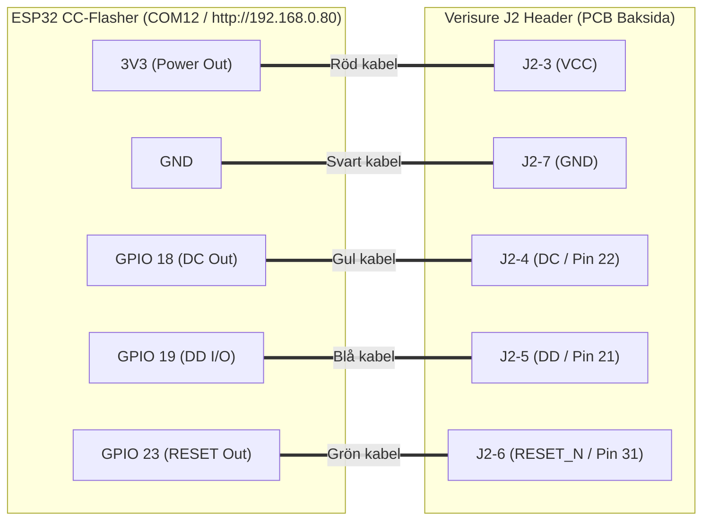

# CC-Flasher & Programmering: ESP32 till Verisure J2-kontakt

Detta dokument beskriver kabeldragningen, pinout och flashningsrutinen för att programmera **Texas Instruments CC1110F32**-mikrokontrollern på Verisure-sensorkortet via en **ESP32 med ESP_CC_Flasher** (Aaron Christophels CC-Debugger-implementation).

---

## 📌 J2-kontakt Pinout (Verisure Sensorkort)

Flashing- och debug-gränssnittet sitter som 7 genompläterade paddar längs batteriurtaget på baksidan av kretskortet, märkt **`J2`**.

> [!NOTE]
> **Pin 1 identifieras av en kvadratisk kopparpadd och en vit silkscreen-prick.** Resterande paddar (2 till 7) är runda.

| J2 Pin | Form & Märkning | Mätt nod på CC1110 | Signalnamn | Beskrivning & Funktion |
| :---: | :--- | :---: | :---: | :--- |
| **`J2-1`** | Kvadratisk padd (vit prick) | Pin 3 (`P1_0`) | Aux / UART | Fabrikstestpunkt / Aux GPIO |
| **`J2-2`** | Rund padd | Pin 2 (`P1_1`) | Aux / UART | Fabrikstestpunkt / Aux GPIO |
| **`J2-3`** | Rund padd | **VCC (3.3V)** | **VDD (Target Power)** | Matning direkt till batteriets pluspol via säkring `F1` |
| **`J2-4`** | Rund padd | **Pin 22 (`P2_2`)** | **`DC` (Debug Clock)** | CC-Debugger klocklinje (2-wire debug interface) |
| **`J2-5`** | Rund padd | **Pin 21 (`P2_1`)** | **`DD` (Debug Data)** | CC-Debugger dubbelriktad datalinje |
| **`J2-6`** | Rund padd | **Pin 31 (`RESET_N`)**| **`RESET` (Debug Reset)**| Aktiv låg reset för att tvinga chippet i debug-läge |
| **`J2-7`** | Rund padd (vid text "J2")| **GND** | **Systemjord (GND)** | Direkt ansluten till kretskortets solida jordplan |

---

## 🔌 Koppling: ESP32 Flasher till Verisure J2

| ESP32 Flasher Pin | Standard Flasher GPIO | Verisure J2 Pin | Kabelfärg (rekommenderad) |
| :---: | :---: | :---: | :---: |
| **3V3** | 3.3V Utgång | **`J2-3` (VCC)** | Röd |
| **GND** | Jord | **`J2-7` (GND)** | Svart |
| **GPIO 18** | Debug Clock (`DC`) | **`J2-4` (DC)** | Gul |
| **GPIO 19** | Debug Data (`DD`) | **`J2-5` (DD)** | Blå |
| **GPIO 23** | Debug Reset (`RESET`)| **`J2-6` (RESET)** | Grön |



### 🖼️ Illustrerat Kopplingsdiagram


---

## 💻 Automatiserad Bygg- och Flashningsprocess

All kompilering och flashning är helt automatiserad via Python-skriptet [`build_and_flash.py`](file:///c:/repo/Antigravity/build_and_flash.py).

### Steg-för-steg Flöde:
1. **Kompilering med SDCC:**
   Kompilerar `VerisureDoorSensor/main.c` till en optimerad MCS-51 8051-binär:
   ```powershell
   sdcc -mmcs51 --model-small --code-size 0x8000 --xram-loc 0xF000 --xram-size 0x0E00 -c main.c -o build/
   sdcc -mmcs51 --model-small --code-size 0x8000 --xram-loc 0xF000 --xram-size 0x0E00 build/main.rel -o build/main.ihx
   packihx build/main.ihx > build/main.hex
   makebin -p build/main.ihx build/main.bin
   ```
2. **Chip-detektering:**
   Anropar `POST http://192.168.0.80/cc_init`. ESP32:an genererar debug-initieringspulserna på `DC` och `RESET_N`.
   CC1110 svarar med `Device id: 0104 Status: B2` (0104 = CC1110F32, 32 kB Flash).
3. **Uppladdning & Skrivning:**
   Laddar upp `main.bin` via `POST /edit`, raderar chippets flash med `POST /flash_cc?file=main.bin` och verifierar varje block.
4. **Exekveringsstart:**
   Anropar `POST /cc_exit_dbg`. ESP32:an släpper `RESET_N` och låter CC1110 starta sin applikation.

---

## ⚠️ Viktiga Försiktighetsåtgärder
* **Ladda ALDRIG upp gateway-firmware till Flasher-porten:**
  ESP32 CC-Flashern ligger på t.ex. `COM12` (Silicon Labs CP210x). Gatewayen ligger på `COM9` (LOLIN S2 Mini). Rensa eller verifiera alltid serieporten innan `pio run -t upload`.
* **Kabelglapp på 3V3 / GND:**
  Om `cc_init` svarar med `Device id: 0000` eller `Status: 00`, kontrollera omedelbart att 3V3 och GND har god kontakt med J2-3 och J2-7.
