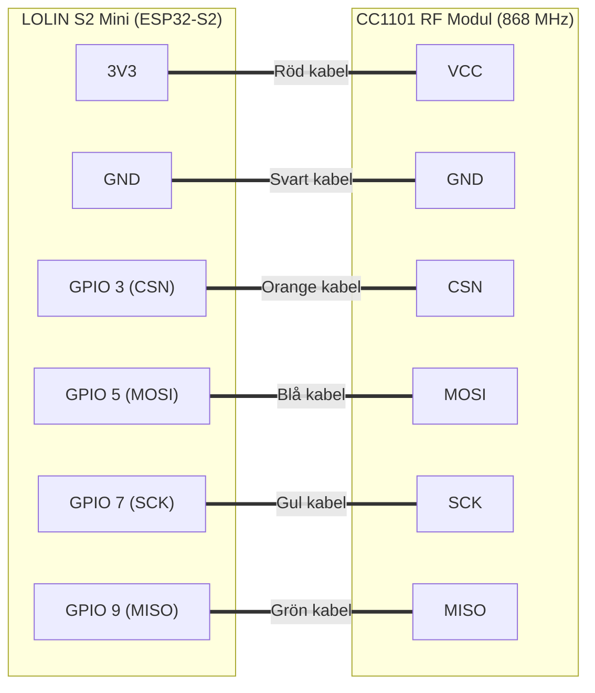

# Gateway Hårdvara & Kabeldragning: LOLIN S2 Mini till CC1101

Detta dokument beskriver den fullständiga hårdvarukopplingen mellan mikrokontrollern **WEMOS LOLIN S2 Mini (ESP32-S2)** och **CC1101 Sub-1GHz RF-modulen (868 MHz)**, inklusive den kritiska kiselanalysen av ADC1 vs ADC2 och Wi-Fi-stabilitet.

---

## 📌 Kopplingsschema & Pinout-tabell

| CC1101 Pin | LOLIN S2 Mini Pin | ESP32-S2 GPIO | Typ / Funktion | Beskrivning |
| :---: | :---: | :---: | :---: | :--- |
| **VCC** | **3V3** | 3.3V Rail | Strömförsörjning | Stabil 3.3V matning från ESP32-S2 LDO |
| **GND** | **GND** | Jord | Systemjord | Gemensam referensjord |
| **CSN (SS)** | **GPIO 3** | `GPIO 3` (ADC1_CH2) | Utgång | Chip Select (aktiv låg) |
| **SCK** | **GPIO 7** | `GPIO 7` (ADC1_CH6) | Utgång | SPI Klocka |
| **MOSI** | **GPIO 5** | `GPIO 5` (ADC1_CH4) | Utgång | SPI Master Out Slave In |
| **MISO (GDO1)**| **GPIO 9** | `GPIO 9` (ADC1_CH8) | Ingång | SPI Master In Slave Out |
| **GDO0** | *(Ej ansluten)* | – | – | Valfri hårdvaru-interrupt (körs via SPI polling) |
| **GDO2** | *(Ej ansluten)* | – | – | Valfri interrupt (körs via SPI statuspolling) |



### 🖼️ Illustrerat Kopplingsdiagram


---

## 🔬 Kiselanalys: ADC1 vs ADC2 och Wi-Fi-stabilitet på ESP32-S2

Ett av de viktigaste tekniska genombrotten i projektet var identifieringen och lösningen av ett hårdvarukonflikt-problem som initialt orsakade att gatewayen inte kunde ansluta till Wi-Fi (kastade `AUTH_EXPIRE / Reason 2`).

### Problemet med standard SPI-pinnar (GPIO 11 & GPIO 12)
I Espressif ESP32-S2 Technical Reference Manual är pinnarna uppdelade i två separata analoga/digitala domäner:
* **ADC2-pinnar (`GPIO 11`–`GPIO 20`):** Denna domän delas **internt i kislet med Wi-Fi-basbandsradion och SAR ADC2**.
* **ADC1-pinnar (`GPIO 1`–`GPIO 10`):** Helt fristående analog/digital domän som **inte har någon koppling till Wi-Fi-subsystemet**.

När snabba digitala klocksignaler (SPI SCK på flera MHz) och dataledningar kopplades till **GPIO 11 och 12**:
1. Högfrekventa transienter från SPI-bussen kopplade in i ESP32-S2:ans känsliga Wi-Fi-mottagarsteg.
2. Basbandsprocessorn missade 4-vägs WPA2-handskakningen (Key Exchange) mot routern.
3. Routern timeoutade och kastade gatewayen med felkoden `WIFI_REASON_AUTH_EXPIRE (Reason 2)`.

### Lösningen: Renodlad ADC1-mappning
Genom att flytta hela SPI-bussen till **GPIO 3, 5, 7 och 9** (alla i ADC1-blocket):
* Wi-Fi-radion och SPI-bussen är galvaniskt och logiskt isolerade inuti kretsen.
* Anslutningen mot 2.4 GHz Wi-Fi etableras på under 1.5 sekunder utan ett enda paketbortfall eller återanslutning.

---

## 🛠️ Konfiguration i källkod ([`hardware_pins.h`](file:///c:/repo/Antigravity/868Receiver/src/hardware_pins.h))

```cpp
#pragma once

// ESP32-S2 Wi-Fi Säkra SPI-pinnar (ADC1 Domän)
#define CC1101_PIN_SCK   7  // GPIO 7 (ADC1_CH6)
#define CC1101_PIN_MISO  9  // GPIO 9 (ADC1_CH8)
#define CC1101_PIN_MOSI  5  // GPIO 5 (ADC1_CH4)
#define CC1101_PIN_CS    3  // GPIO 3 (ADC1_CH2)
```

---

## ⚡ USB-CDC och Flashing-instruktioner för LOLIN S2 Mini
LOLIN S2 Mini har inbyggd USB-OTG/CDC direkt på chippet.
* **Normal drift:** Serieporten identifieras i Windows som t.ex. `COM9` (115200 baud).
* **Bootloader / DFU-läge:** Om kretsen inte svarar vid uppladdning:
  1. Håll in **0 (BOOT)**-knappen på kortet.
  2. Klicka på **RST (Reset)**-knappen en gång.
  3. Släpp **0 (BOOT)**.
  4. Enheten dyker nu upp i ROM DFU-läge (t.ex. `COM8`) och kan programmeras direkt via PlatformIO.
