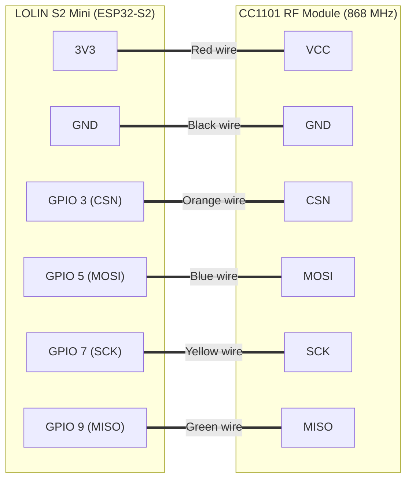
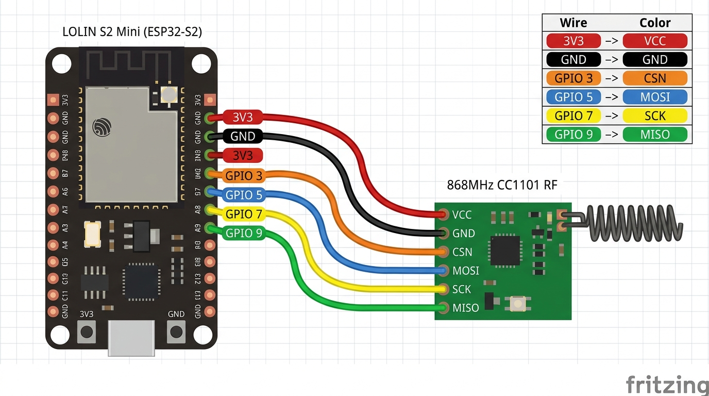
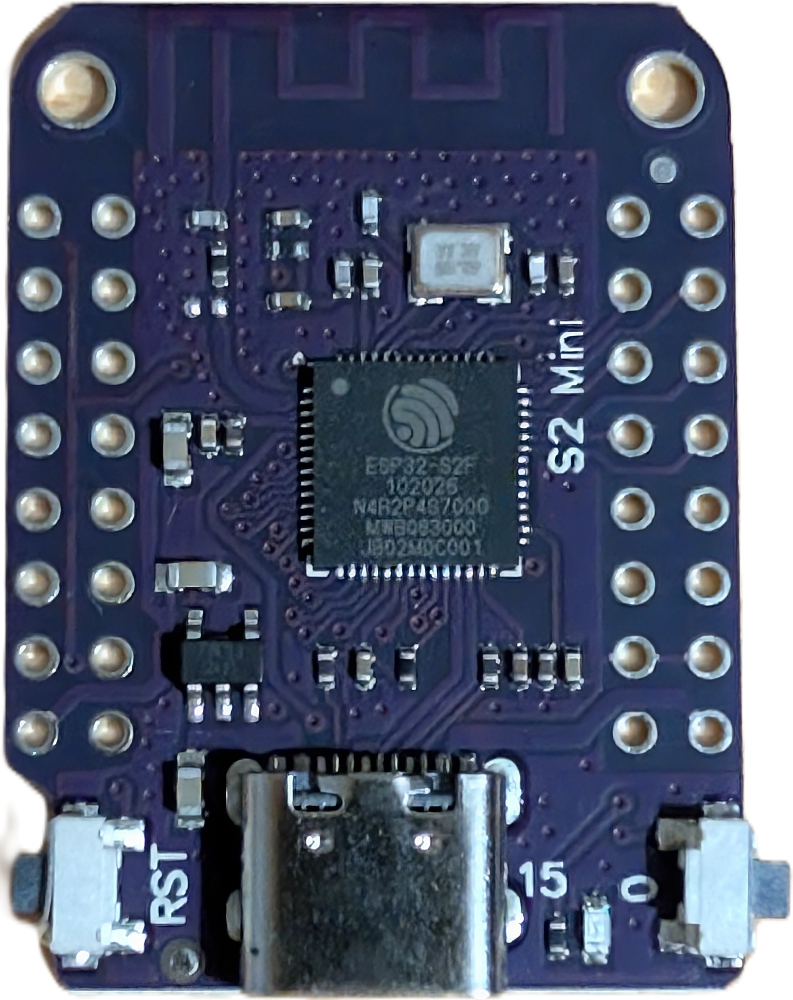
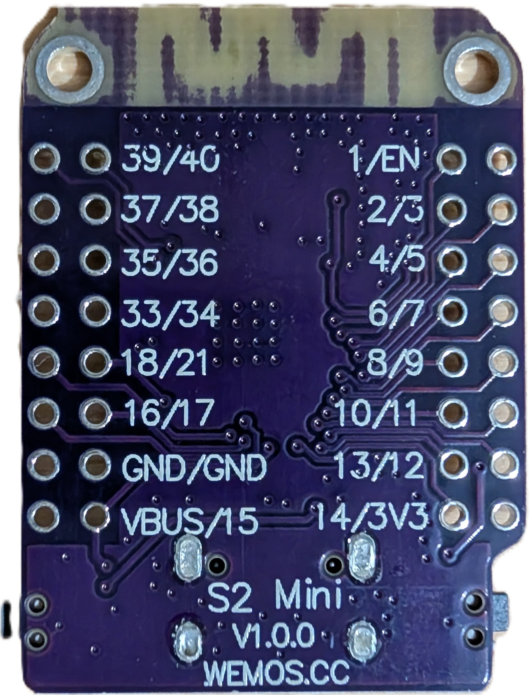
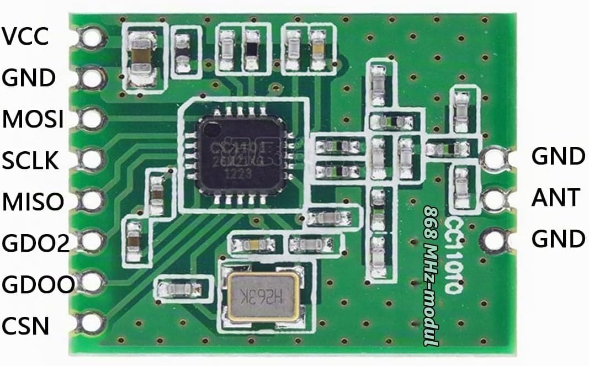

# Gateway Hardware & Wiring: LOLIN S2 Mini to CC1101

This document describes the complete hardware connection between the **WEMOS LOLIN S2 Mini (ESP32-S2)** microcontroller and the **CC1101 Sub-1GHz RF module (868 MHz)**, including the critical silicon analysis of ADC1 vs ADC2 and Wi-Fi stability.

---

## 📌 Wiring Schematic & Pinout Table

| CC1101 Pin | LOLIN S2 Mini Pin | ESP32-S2 GPIO | Type / Function | Description |
| :---: | :---: | :---: | :---: | :--- |
| **VCC** | **3V3** | 3.3V Rail | Power Supply | Regulated 3.3V power from the ESP32-S2 LDO |
| **GND** | **GND** | Ground | System Ground | Common reference ground |
| **CSN (SS)** | **GPIO 3** | `GPIO 3` (ADC1_CH2) | Output | Chip Select (active low) |
| **SCK** | **GPIO 7** | `GPIO 7` (ADC1_CH6) | Output | SPI Clock |
| **MOSI** | **GPIO 5** | `GPIO 5` (ADC1_CH4) | Output | SPI Master Out Slave In |
| **MISO (GDO1)**| **GPIO 9** | `GPIO 9` (ADC1_CH8) | Input | SPI Master In Slave Out |
| **GDO0** | *(Unused)* | – | – | Optional hardware interrupt (polled via SPI) |
| **GDO2** | *(Unused)* | – | – | Optional interrupt (polled via SPI status) |



### 🖼️ Illustrated Wiring Diagram


### 📷 The parts

| LOLIN S2 Mini, front | LOLIN S2 Mini, back (pin labels) | CC1101 module pinout |
| :---: | :---: | :---: |
|  |  |  |

---

## 📡 Antenna and Frequency Correction

* **Antenna:** the helical spring that comes with these CC1101 modules was the weak link. A
  quarter-wave wire (22 AWG hookup wire, ~8.0 cm with its insulation, 8.2 cm bare) soldered in
  `ANT` instead, standing straight up and away from the ESP32 board and the USB cable, raised the
  camera's packets at its mounting place from -84..-86 dBm to -56..-58 dBm (2026-11-17). The `GND`
  pads next to `ANT` are for a coax shield (SMA antenna); a second 8 cm wire in `GND`, pointing the
  other way, turns the wire into a simple dipole.
* **Frequency offset:** this module's 26 MHz crystal runs ~69 ppm low, so the sensors arrived
  ~+60 kHz off channel, beyond the frequency loop's +-50 kHz; weak packets then failed their CRC.
  A frequency offset of 38 (FSCTRL0, 1.587 kHz per step, RX and TX) corrects it. The offset is a
  gateway setting (default 0, stored in NVS): `freqoffset <n>` on the serial console, or
  `DEFAULT_FREQ_OFFSET` in `secrets.h`. Each received packet logs its `Freq. error`; with another
  module, adjust the offset until it stays near 0.
* **Result at the camera's mounting place, on batteries:** every poll received; 320x240 and
  640x480 pictures complete with no missing chunks; with every 7th chunk dropped on purpose the
  resend completed them in 8 and 18 rounds (1.2 s and 2.8 s).

---

## 🔬 Silicon Analysis: ADC1 vs ADC2 and Wi-Fi Stability on ESP32-S2

A key hardware insight discovered during this project was identifying and resolving a silicon-level conflict that caused the gateway to fail Wi-Fi authentication (throwing `AUTH_EXPIRE / Reason 2`).

### The Problem with Default SPI Pins (GPIO 11 & GPIO 12)
In the Espressif ESP32-S2 Technical Reference Manual, GPIO pins are divided into two distinct analog/digital domains:
* **ADC2 Pins (`GPIO 11`–`GPIO 20`):** Shared **internally on the silicon die with the Wi-Fi baseband radio and SAR ADC2**.
* **ADC1 Pins (`GPIO 1`–`GPIO 10`):** Completely independent domain that **has no physical multiplexing or interference with the Wi-Fi subsystem**.

When high-frequency digital clock signals (SPI SCK at several MHz) and data lines were routed through **GPIO 11 and 12**:
1. High-frequency transients from the SPI bus coupled directly into the ESP32-S2 sensitive Wi-Fi RX front-end.
2. The baseband processor missed frames during the 4-way WPA2 key exchange handshake with the router.
3. The router timed out and rejected the gateway with error code `WIFI_REASON_AUTH_EXPIRE (Reason 2)`.

### The Solution: Dedicated ADC1 Pin Mapping
By moving the entire SPI bus to **GPIO 3, 5, 7, and 9** (all within the ADC1 domain):
* The Wi-Fi radio and SPI bus are fully isolated inside the chip.
* Wi-Fi connections establish in under 1.5 seconds with zero packet drops or reconnections.

---

## 🛠️ Source Code Pin Definitions ([`hardware_pins.h`](../868Receiver/src/hardware_pins.h))

```cpp
#pragma once

// ESP32-S2 Wi-Fi Safe SPI Pins (ADC1 Domain)
#define CC1101_PIN_SCK   7  // GPIO 7 (ADC1_CH6)
#define CC1101_PIN_MISO  9  // GPIO 9 (ADC1_CH8)
#define CC1101_PIN_MOSI  5  // GPIO 5 (ADC1_CH4)
#define CC1101_PIN_CS    3  // GPIO 3 (ADC1_CH2)
```

---

## ⚡ USB-CDC and Flashing Instructions for LOLIN S2 Mini
The LOLIN S2 Mini features native on-chip USB-OTG/CDC.
* **Normal Operation:** The serial port appears in Windows as e.g. `COM9` (115200 baud).
* **Bootloader / DFU Mode:** If the microcontroller does not respond during upload:
  1. Press and hold the **0 (BOOT)** button on the board.
  2. Click the **RST (Reset)** button once.
  3. Release **0 (BOOT)**.
  4. The device appears in ROM DFU mode (e.g. `COM8`) and can be flashed directly via PlatformIO.
