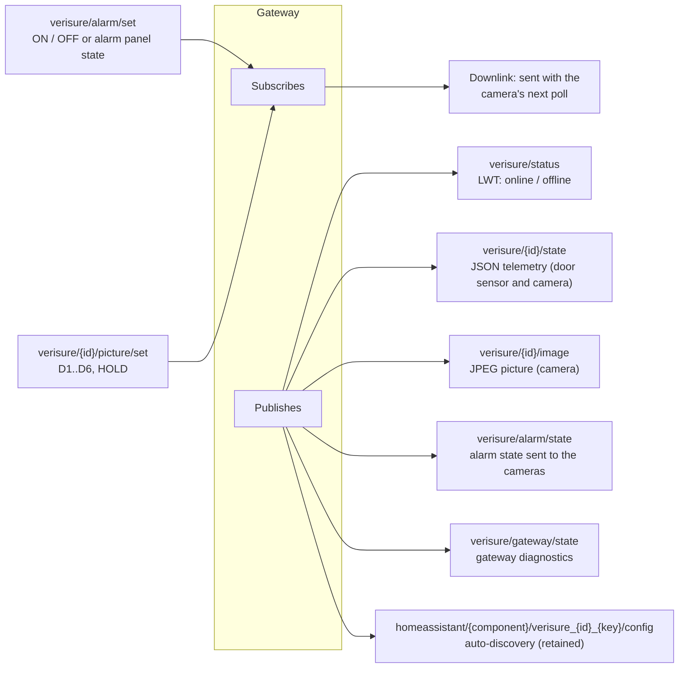

# Home Assistant & MQTT Integration

This document details how the gateway integrates the Verisure Sub-1GHz door/window sensors and motion cameras into **Home Assistant** via MQTT Auto-Discovery, as well as the Gateway Web Dashboard's REST API.

---

## 📡 MQTT Topic Architecture

`verisure` is the default topic prefix (set in the gateway's web portal).



```text
verisure/
  status                     <-- LWT (birth "online", last will "offline")
  <deviceId>/
    state                    <-- JSON telemetry, published on each packet
    image                    <-- JPEG picture (camera only)
    picture/set              <-- picture command to a camera (D1..D6, HOLD)
  alarm/
    set                      <-- alarm on/off for the cameras
    state                    <-- current alarm state
  gateway/
    state                    <-- gateway diagnostics
homeassistant/
  binary_sensor/verisure_<deviceId>_<key>/config   <-- contact, vibration, motion, button (tamper)
  sensor/verisure_<deviceId>_<key>/config          <-- battery, voltage, rssi
  camera/verisure_<deviceId>_camera/config         <-- camera picture (camera only)
  button/verisure_<deviceId>_picture*/config       <-- picture buttons (camera only)
  switch/verisure_gateway_alarm/config             <-- "Alarm (cameras)" switch
  sensor/verisure_gateway_<key>/config             <-- gateway diagnostics
```

---

## 🎯 Entity Configuration in Home Assistant

The gateway picks the entity set from the device ID: IDs starting with `2NCE` are motion cameras,
all others are door/window sensors.

### Door/window sensor (6 entities)

| Entity | Platform | Device Class (`device_class`) | Unit | Payload / Template | Description |
| :--- | :---: | :---: | :---: | :---: | :--- |
| **Contact** | `binary_sensor` | `door` | – | `{{ value_json.contact }}`<br>(`OPEN` / `CLOSED`) | Door/window contact (renders door icon with Open/Closed state) |
| **Vibration** | `binary_sensor` | `vibration` | – | `{{ value_json.vibration }}`<br>(`ON` / `OFF`) | Shock and vibration detection |
| **Tamper** | `binary_sensor` | `tamper` | – | `{{ value_json.button }}`<br>(`ON` / `OFF`) | Tamper switch (reports Tamper/Open if cover is removed) |
| **Battery** | `sensor` | `battery` | `%` | `{{ value_json.battery_pct }}` | Battery percentage (0–100%) |
| **Battery Voltage** | `sensor` | `voltage` | `mV` | `{{ value_json.battery_mv }}` | Accurate battery terminal voltage in millivolts |
| **Signal Strength** | `sensor` | `signal_strength` | `dBm` | `{{ value_json.rssi }}` | RF reception signal strength from sensor to gateway |

### Motion camera (8 entities)

| Entity | Platform | Device Class / Topic | Description |
| :--- | :---: | :---: | :--- |
| **Motion** | `binary_sensor` | `motion` | PIR motion (`contact` field: `OPEN` = motion) |
| **Tamper** | `binary_sensor` | `tamper` | Tamper switch (`button` field) |
| **Battery**, **Battery Voltage**, **Signal Strength** | `sensor` | as for the door sensor | |
| **Camera** | `camera` | `verisure/<id>/image` | Latest picture (alarm picture or on request) |
| **Take 640x480 picture** | `button` | `picture/set` = `D2` | Picture on request, sent with the camera's next poll |
| **Take flash picture** | `button` | `picture/set` = `D4` | Grayscale picture lit by the IR flash |

### Gateway

| Entity | Platform | Description |
| :--- | :---: | :--- |
| **Alarm (cameras)** | `switch` | Alarm state the cameras get (`alarm/set`; also takes alarm panel states such as `armed_away`, `disarmed`) |
| **Radio Noise Floor**, **Packets Received**, **Active Sensors** | `sensor` | Diagnostics from `verisure/gateway/state` |

The picture commands and the camera protocol are described in
[MD_CAM/README.md](../MD_CAM/README.md) and [MD_CAM/docs/Camera_protocol.md](../MD_CAM/docs/Camera_protocol.md).

### Example Telemetry JSON (`verisure/2JHL2MVN/state`)
```json
{
  "contact": "CLOSED",
  "vibration": "OFF",
  "button": "OFF",
  "power_on": "OFF",
  "battery_pct": 100,
  "battery_mv": 3370,
  "low_battery": "OFF",
  "rssi": -49,
  "lqi": 127,
  "seq": 28
}
```

---

## 🌐 Gateway Web Dashboard & REST API

The gateway hosts an embedded web server on port 80 ([http://192.168.0.142](http://192.168.0.142)). It provides a dark-mode responsive interface for monitoring sensor telemetry and configuring network parameters.

### REST API Endpoints:
* **`GET /api/status`:** Returns real-time JSON status for Wi-Fi, radio noise floor, MQTT broker link, and all registered sensors.
* **`GET /api/replay?id=<ID>`:** The last accepted persistent packet counter of a sensor (`{"id","known","counter"}`); the door sensor's build script starts a reflashed sensor above it.
* **`GET /api/scan`:** Performs an asynchronous Wi-Fi scan and returns available networks with RSSI and encryption flags.
* **`POST /api/save`:** Persists Wi-Fi SSID, password, MQTT broker host, port, credentials, topic prefix, and Master Key into ESP32-S2 NVS (Non-Volatile Storage).
* **`POST /api/reboot`:** Triggers a software restart of the gateway.
* **`POST /api/reset`:** Resets NVS parameters to compiled defaults.
