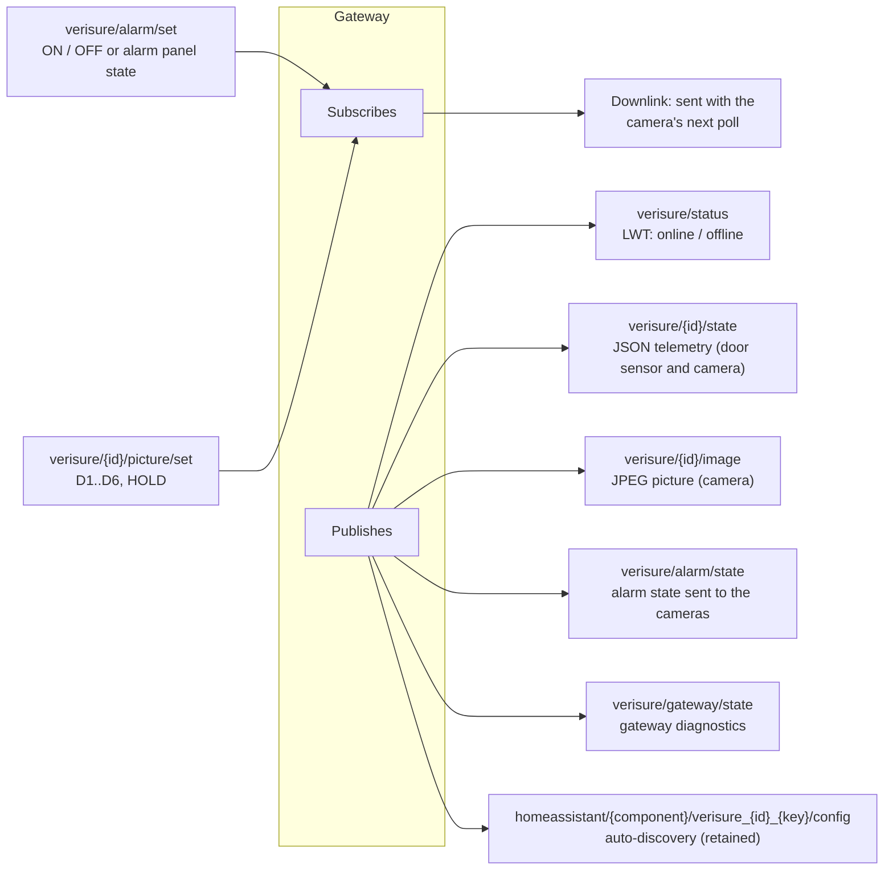

# Home Assistant & MQTT Integration

This document details how the gateway integrates the Verisure Sub-1GHz door/window sensors and motion cameras into **Home Assistant** via MQTT Auto-Discovery, as well as the Gateway Web Dashboard's REST API.

---

## 📡 MQTT Topic Architecture

`verisure` is the default topic prefix (set in the gateway's web portal).



```text
verisure/
  status                     <-- LWT (birth "online", last will "offline")
  <deviceId>/
    state                    <-- JSON telemetry, published on each packet
    image                    <-- JPEG picture (camera only)
    picture/set              <-- picture command to a camera (D1..D6, HOLD)
  alarm/
    set                      <-- alarm on/off for the cameras
    state                    <-- current alarm state
  gateway/
    state                    <-- gateway diagnostics
homeassistant/
  binary_sensor/verisure_<deviceId>_<key>/config   <-- contact, vibration, motion, button (tamper)
  sensor/verisure_<deviceId>_<key>/config          <-- battery, voltage, rssi
  camera/verisure_<deviceId>_camera/config         <-- camera picture (camera only)
  button/verisure_<deviceId>_picture*/config       <-- picture buttons (camera only)
  switch/verisure_gateway_alarm/config             <-- "Alarm (cameras)" switch
  sensor/verisure_gateway_<key>/config             <-- gateway diagnostics
```

---

## 🎯 Entity Configuration in Home Assistant

The gateway picks the entity set from the device ID: IDs starting with `2NCE` are motion cameras,
all others are door/window sensors.

### Door/window sensor (6 entities)

| Entity | Platform | Device Class (`device_class`) | Unit | Payload / Template | Description |
| :--- | :---: | :---: | :---: | :---: | :--- |
| **Contact** | `binary_sensor` | `door` | – | `{{ value_json.contact }}`<br>(`OPEN` / `CLOSED`) | Door/window contact (renders door icon with Open/Closed state) |
| **Vibration** | `binary_sensor` | `vibration` | – | `{{ value_json.vibration }}`<br>(`ON` / `OFF`) | Shock and vibration detection |
| **Tamper** | `binary_sensor` | `tamper` | – | `{{ value_json.button }}`<br>(`ON` / `OFF`) | Tamper switch (reports Tamper/Open if cover is removed) |
| **Battery** | `sensor` | `battery` | `%` | `{{ value_json.battery_pct }}` | Battery percentage (0–100%) |
| **Battery Voltage** | `sensor` | `voltage` | `mV` | `{{ value_json.battery_mv }}` | Accurate battery terminal voltage in millivolts |
| **Signal Strength** | `sensor` | `signal_strength` | `dBm` | `{{ value_json.rssi }}` | RF reception signal strength from sensor to gateway |

### Motion camera (10 entities)

| Entity | Platform | Device Class / Topic | Description |
| :--- | :---: | :---: | :--- |
| **Motion** | `binary_sensor` | `motion` | PIR motion (`contact` field: `OPEN` = motion) |
| **Tamper** | `binary_sensor` | `tamper` | Tamper switch SW3 (`button` field: `ON` = camera off the wall) |
| **Battery**, **Battery Voltage**, **Signal Strength** | `sensor` | as for the door sensor | Battery % also takes the voltage under load into account |
| **Battery Voltage Under Load** | `sensor` | `voltage` (mV) | Lowest VBAT while the Blackfin was last on (`battery_load_mv`, only in camera states once known) |
| **Low Battery** | `binary_sensor` | `battery` | Low-battery flag (`low_battery`): idle < 2.7 V or under load < 2.6 V |
| **Camera** | `camera` | `verisure/<id>/image` | Latest picture (alarm picture or on request) |
| **Take 640x480 picture** | `button` | `picture/set` = `D2` | Picture on request, sent with the camera's next poll |
| **Take flash picture** | `button` | `picture/set` = `D4` | Grayscale picture lit by the IR flash |

The camera's sensor entities have `expire_after` 600 s: without a packet for 10 minutes (it polls
every ~30 s, every ~2 minutes when disarmed) they turn unavailable instead of keeping old values.
The door sensor's entities have `expire_after` 9000 s (2.5 h; it sends a heartbeat about every hour).

### Gateway

| Entity | Platform | Description |
| :--- | :---: | :--- |
| **Alarm (cameras)** | `switch` | Alarm state the cameras get (`alarm/set`; also takes alarm panel states such as `armed_away`, `disarmed`) |
| **Radio Noise Floor**, **Packets Received**, **Active Sensors** | `sensor` | Diagnostics from `verisure/gateway/state` |

The picture commands and the camera protocol are described in
[MD_CAM/README.md](../MD_CAM/README.md) and [MD_CAM/docs/Camera_protocol.md](../MD_CAM/docs/Camera_protocol.md).

### Example Telemetry JSON (`verisure/2JHL2MVN/state`)
```json
{
  "contact": "CLOSED",
  "motion": "OFF",
  "vibration": "OFF",
  "button": "OFF",
  "power_on": "OFF",
  "battery_pct": 100,
  "battery_mv": 3370,
  "low_battery": "OFF",
  "rssi": -49,
  "lqi": 127,
  "seq": 1792
}
```

`seq` is the full 32-bit persistent packet counter (door sensor and camera). `motion`
mirrors `contact` and is what the camera's Motion entity uses.

---

## 🌐 Gateway Web Dashboard & REST API

The gateway hosts an embedded web server on port 80 (`http://verisure-gateway.local` or `http://<gateway-ip>`). It provides a dark-mode responsive interface for monitoring sensor telemetry and configuring network parameters.

Access: every endpoint except `GET /api/replay` needs the web portal password (HTTP Basic auth, any user name; set in the setup access point on the first save, with the serial command `portalpass <password>`, or with `DEFAULT_PORTAL_PASS` in `secrets.h`). Without a password the API only answers in the setup access point. Every `POST` needs the header `X-Gateway: 1` and no foreign `Origin` (CSRF protection), every request a `Host` that names the gateway (its IP or `verisure-gateway[.local]`), and 5 wrong passwords from one client within 10 minutes lock that client out for 30 s. Basic auth over plain HTTP can be read by anyone on the same network (see `SECURITY.md`).

### REST API Endpoints:
* **`GET /api/status`:** Returns real-time JSON status for Wi-Fi, radio noise floor, MQTT broker link, and all registered sensors.
* **`GET /api/replay?id=<ID>`:** (no password) The last accepted persistent packet counter of a device (`{"id","known","counter"}`); the build scripts start a reflashed device above it and check afterwards that the gateway accepts its new counter.
* **`GET /api/radio`:** CC1101 chip version, part number and MARCSTATE (radio check).
* **`GET /api/camera.jpg`, `GET /api/camera_large.jpg`:** The last camera picture (320x240) and the last 640x480 picture; 404 until one has arrived.
* **`POST /api/camera_test?id=<ID>`:** (`id` required) Publishes a tiny test JPEG on the camera's MQTT image topic (checks the Home Assistant camera entity without the camera).
* **`GET /api/scan`:** Wi-Fi scan in the background: answers `202 {"scanning":true}` until it is done, then the networks with RSSI and encryption flags (ask again until a list comes back).
* **`POST /api/picture?id=<ID>&cmd=D1..D6`:** Queues a picture request for a camera, like `picture/set` over MQTT (the camera's card on the web page uses it).
* **`POST /api/save`:** Persists Wi-Fi SSID, password, MQTT broker host, port, credentials, topic prefix, and Master Key into ESP32-S2 NVS (Non-Volatile Storage). An empty password or key field keeps the saved value (they are never sent to the browser), except that a new MQTT host with an empty MQTT password drops the stored one (it is never sent to another broker); a new SSID with an empty password is an open network. `portal_pass` (8-64 characters) sets the web portal password; it is required on the first save in the setup access point.
* **`POST /api/reboot`:** Triggers a software restart of the gateway.
* **`POST /api/reset`:** Resets NVS parameters to compiled defaults (Wi-Fi, MQTT, master key and the portal password; the replay counters stay).
