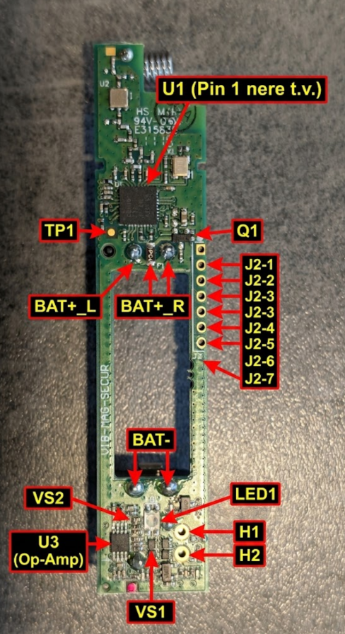
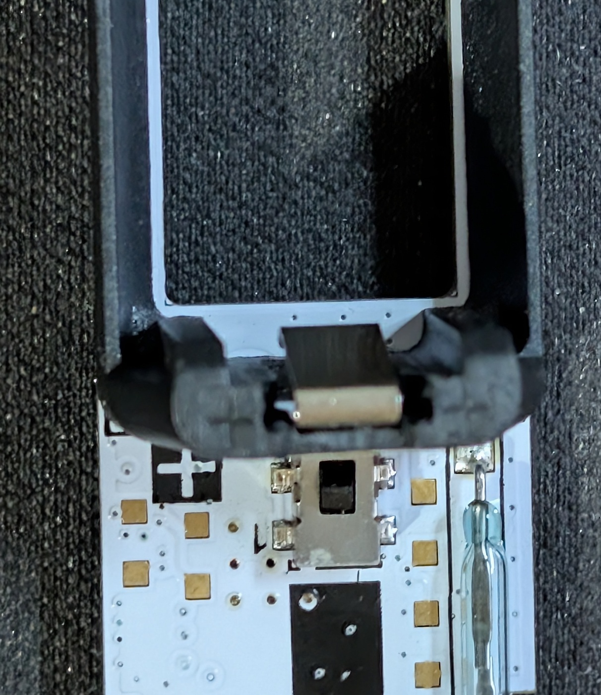
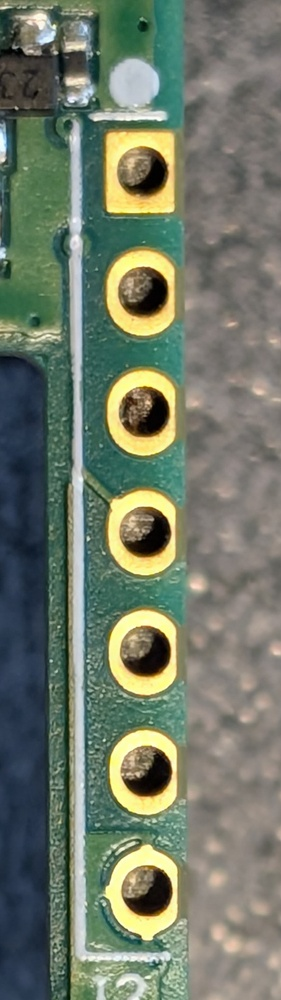
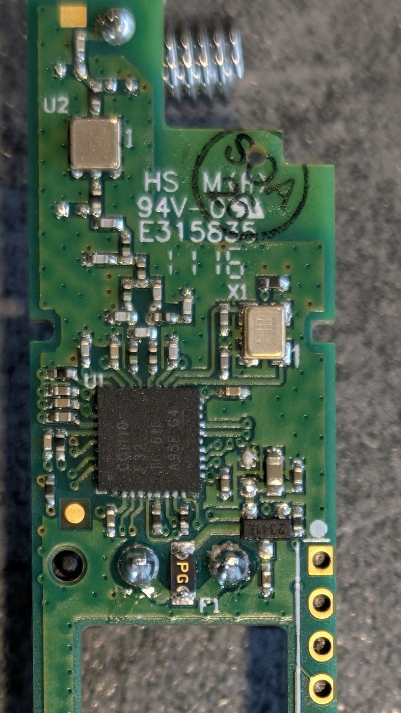

# Verisure Sensor PCB: Hardware Mapping & Silicon Analysis (TI CC1110F32)

This document provides the complete physical and logical hardware mapping of the Verisure wireless door and window sensor (Model: **`GW-MC-SHOCK`**), based on the Texas Instruments **CC1110F32** (SoC featuring an 8051 core and integrated Sub-1GHz radio). It is the single reference for the sensor's pinout, the `J2` programming header and the radio register settings; the firmware is [VerisureDoorSensor/main.c](../VerisureDoorSensor/main.c) and the packet format is in [cryptography_and_protocol.md](cryptography_and_protocol.md).



---

## 🧩 Board Overview

The board is marked **`VIB-MAG-SECUR`** on the silkscreen (Securitas / Verisure P/N `N3302409`). It
detects a door or window opening (reed switch), shock and vibration (piezo elements through an
op-amp), and the cover being removed (tamper switch); `SW1` is a reset button, and two LEDs show
the state.

| Component | Marking | Part | Function |
| :--- | :--- | :--- | :--- |
| **U1** | `CC1110 F32 TI` | TI CC1110F32 (QFN-36) | 8051 MCU + Sub-1 GHz radio |
| **X1** | `27.000` | 27.000 MHz crystal | System and radio clock (not TI's usual 26 MHz) |
| **U2** | `3716` | EPCOS / TDK B3716 SAW filter | 868–870 MHz bandpass |
| **U3** | `4542I` / `602853` | Low-power op-amp | Conditions the shock/piezo signal into `P1_2` |
| **VS1, VS2** | | Piezo / spring vibration elements | Shock transducers |
| **SW1** | | Tactile switch | Reset button on `RESET_N`, under the battery clip; not the tamper switch |
| **Reed** | Glass capsule | Reed contact | Closes with the frame magnet within ~15 mm |
| **LEDs** | `LD1` | Red (`P0_2`) and green (`P0_4`) | Alarm and transmit indicators |
| **J2** | `J2` | 7-pad header (unpopulated) | Debug / programming interface |
| **Antenna** | Helical coil | 868 MHz spring monopole | |

After a reset by `SW1` (or `J2-6`) the firmware flashes both LEDs twice; every packet carries the
reset cause, and the first packet after a boot is sent at once.

---

## 📌 GPIO and Peripheral Mapping

Pin numbers are for the CC1110 QFN-36 package (verified against the board).

| Component / Sensor | CC1110 Pin | I/O Direction | Register Configuration | Behavior & Polarity |
| :--- | :---: | :---: | :--- | :--- |
| **Reed Switch** (Magnet) | **`P1_7`** (Pin 32) | Input | `P1SEL &= ~0x80; P1DIR &= ~0x80; P1INP &= ~0x80;` | Internal pull-up.<br>• **`0` = Magnet nearby** (Door closed / Secure)<br>• **`1` = Magnet removed** (Door open / Alarm) |
| **Shock Sensor** (Piezo/Vib) | **`P1_2`** (Pin 1) | Input | `P1SEL &= ~0x04; P1DIR &= ~0x04; P1INP &= ~0x04;` | Digital pulse input from the `U3` op-amp that toggles on physical shock/vibration. |
| **Tamper Switch** (Cover) | **`P0_1`** (Pin 6) | Input | `P0SEL &= ~0x02; P0DIR &= ~0x02; P0INP &= ~0x02;` | Internal pull-up.<br>• **`0` = Cover ON** (button depressed to GND via 100 $\Omega$ ➔ Secure)<br>• **`1` = Cover OFF** (button released / open ➔ TAMPER) |
| **Red LED** (`LED_RED`) | **`P0_2`** (Pin 7) | Output | `P0SEL &= ~0x04; P0DIR \|= 0x04;` | Active high (`1` = ON, `0` = OFF). Illuminates during alarm events (door open, shock, tamper). |
| **Green LED** (`LED_GREEN`) | **`P0_4`** (Pin 9) | Output | `P0SEL &= ~0x10; P0DIR \|= 0x10;` | Active high (`1` = ON, `0` = OFF). Pulses on heartbeats and on the return to the safe state. |
| **Debug Data (`DD`)** | **`P2_1`** (Pin 15) | I/O / Output | `P2SEL &= ~0x02; P2DIR \|= 0x02;` | `J2-4`. In the firmware it toggles on each transmitted packet as a test point for an oscilloscope/logic analyzer. |
| **Debug Clock (`DC`)** | **`P2_2`** (Pin 16) | Input / Output | `P2SEL &= ~0x04; P2DIR \|= 0x04;` | `J2-5`. In the firmware it is driven high (`1`) once a packet has left the transmitter. |
| **Reset button `SW1`** | **`RESET_N`** (Pin 31) | Input (Reset) | Hardware reset, no GPIO | Tactile switch under the positive battery clip, to GND via a 100 $\Omega$ resistor; also on `J2-6`. Pressing it resets the chip; the firmware sees it at boot as `SLEEP.RST[1:0] = 01`. It is **not** the tamper switch (that is `P0_1`). |

### Reset cause (`SLEEP.RST`, bits 4:3 of SFR `SLEEP`)

| `SLEEP.RST` | Cause |
| :---: | :--- |
| `00` | Power-on reset (battery inserted) |
| `01` | External reset: `RESET_N` (button `SW1` or `J2-6`) |
| `10` | Watchdog reset |
| `11` | Clock loss reset |

The firmware copies this value into flag bits 7:6 of every packet (see [cryptography_and_protocol.md](cryptography_and_protocol.md)).



---

## 🔌 Programming Header `J2`

`J2` is an unpopulated 7-pad header along the edge of the battery cutout on the bottom side. **Pin 1 is the square pad with a white silkscreen dot.** Multimeter measurements against the CC1110 and the supply rails (DD/DC verified 2026-11-17 on sensor 2JHL2KMX: DD is `J2-4` and DC is `J2-5`, the reverse of earlier notes):

| J2 Pin | Measured Node | Function |
| :---: | :--- | :--- |
| **`J2-1`** | CC1110 pin 3, `P1_1` (not verified) | Square pad (white dot). Aux / UART / GPIO. |
| **`J2-2`** | CC1110 pin 2 (as measured) | Round pad. Aux. |
| **`J2-3`** | **VCC** | Target supply. Connected to the battery positive terminal via fuse `F1` / `BAT+_R`. |
| **`J2-4`** | **`P2_1`** (pin 15) | **`DD`** (Debug Data) |
| **`J2-5`** | **`P2_2`** (pin 16) | **`DC`** (Debug Clock) |
| **`J2-6`** | **`RESET_N`** (pin 31) | Reset for the debug interface (shared with button `SW1`) |
| **`J2-7`** | **GND** | Ground plane |

For flashing, connect `J2-4` (DD), `J2-5` (DC), `J2-6` (RESET_N) and `J2-7` (GND), plus `J2-3` (VCC) only if the board is not powered by its battery. The flasher's GPIO numbers are in [VerisureDoorSensor/README.md](../VerisureDoorSensor/README.md#programming-header-j2).



---

## 🔍 Tamper Button (`P0_1`): Discovery and Verification

By transmitting real-time port diagnostic telemetry (`P0`, `P1`, `P2`) to the gateway serial monitor, the exact circuit layout of the tamper switch was determined:
1. **Resting State (Cover removed, button open):**
   ```text
   Pins : P0=0xEB P1=0x7F P2=0x1D
   ```
   `0xEB = 1110 1011`$_2$ ➔ Bit 1 (`P0_1`) is `1`.
2. **Button Depressed (Cover installed and secured):**
   ```text
   Pins : P0=0xE9 P1=0x7F P2=0x1D
   ```
   `0xE9 = 1110 1001`$_2$ ➔ Bit 1 (`P0_1`) is pulled to `0` (GND via 100 $\Omega$).
3. **Conclusion:** Tamper alarm is asserted when `P0_1 == 1` (cover removed), and cleared when `P0_1 == 0` (cover closed).

---

## 📡 RF Hardware, SAW Filter, and Crystal Calculations



### 1. The 27.000 MHz Crystal Oscillator (`X1`)
Unlike standard Texas Instruments reference designs which utilize 26.000 MHz crystals, crystal `X1` (on CC1110 pins 20/21) is laser-engraved with **`27.000`** (see `door_crystal_x1_closeup.jpg` and `door_crystal_x1_crop.jpg` in [VerisureDoorSensor/docs](../VerisureDoorSensor/docs/)). Applying 26 MHz formulas shifts the synthesized carrier by ~33 MHz, preventing reception.

Formula for carrier frequency synthesis with $f_{\text{xosc}} = 27.000\text{ MHz}$ and target $f_{\text{carrier}} = 868.950\text{ MHz}$:
$$\text{FREQ} = \frac{f_{\text{carrier}} \times 2^{16}}{f_{\text{xosc}}} = \frac{868.950 \times 10^6 \times 65536}{27.000 \times 10^6} = 2\,109\,167 = \text{0x202EEF}$$

* **`FREQ2`** = `0x20`
* **`FREQ1`** = `0x2E`
* **`FREQ0`** = `0xEF` (Yields 868.950027 MHz, an error of only +27 Hz / 0.03 ppm!)

Formula for the symbol rate (`DRATE_E = 10`, `DRATE_M = 117`; the gateway's CC1101 uses `MDMCFG3 = 0x83` with its 26 MHz crystal, 38 383 Baud, 0.09 % apart):
$$R_{\text{data}} = \frac{(256 + 117) \times 2^{10}}{2^{28}} \times 27.000\text{ MHz} = 38\,417.8\text{ Baud}$$
* **`MDMCFG4`** = `0x8A`
* **`MDMCFG3`** = `0x75`

Deviation: `DEVIATN = 0x35` gives $\frac{27\text{ MHz}}{2^{17}} \times (8 + 5) \times 2^3 \approx 21.4\text{ kHz}$.

### 2. Radio Register Settings (`radio_init()` in main.c)

Addresses are the CC1110 XDATA addresses from SDCC's `<cc1110.h>` (they do **not** follow the CC1101 SPI address offsets; see the trap below).

| Register | XDATA address | Value | Meaning |
| :--- | :---: | :---: | :--- |
| `SYNC1` / `SYNC0` | `0xDF00` / `0xDF01` | `0xD3` / `0x91` | Sync word (30/32 bits must match) |
| `PKTLEN` | `0xDF02` | `24` | Fixed packet length: 8-byte ID + 16-byte AES block |
| `PKTCTRL1` | `0xDF03` | `0x04` | Append status (RSSI, LQI/CRC) |
| `PKTCTRL0` | `0xDF04` | `0x04` | Fixed length, CRC enabled |
| `CHANNR` | `0xDF06` | `0x00` | Channel 0 |
| `FSCTRL1` / `FSCTRL0` | `0xDF07` / `0xDF08` | `0x06` / `0x00` | IF frequency, no frequency offset |
| `FREQ2..0` | `0xDF09..0xDF0B` | `0x20 0x2E 0xEF` | 868.950 MHz at 27 MHz |
| `MDMCFG4` / `MDMCFG3` | `0xDF0C` / `0xDF0D` | `0x8A` / `0x75` | 38.418 kBaud |
| `MDMCFG2` | `0xDF0E` | `0x03` | 2-FSK, 30/32 sync bits |
| `MDMCFG1` / `MDMCFG0` | `0xDF0F` / `0xDF10` | `0x22` / `0xF8` | 4 bytes preamble, channel spacing |
| `DEVIATN` | `0xDF11` | `0x35` | ~21.4 kHz deviation |
| `MCSM2` / `MCSM1` / `MCSM0` | `0xDF12..0xDF14` | `0x07` / `0x00` / `0x18` | IDLE after TX, calibrate on IDLE → TX |
| `FOCCFG` / `BSCFG` | `0xDF15` / `0xDF16` | `0x16` / `0x6C` | Frequency offset and bit sync |
| `AGCCTRL2..0` | `0xDF17..0xDF19` | `0x43 0x40 0x91` | AGC |
| `FREND1` / `FREND0` | `0xDF1A` / `0xDF1B` | `0x56` / `0x10` | Front end; TX uses `PA_TABLE0` |
| `FSCAL3..0` | `0xDF1C..0xDF1F` | `0xE9 0x2A 0x00 0x1F` | Synthesizer calibration |
| `TEST2..0` | `0xDF23..0xDF25` | `0x81 0x35 0x09` | Test settings (lost in PM2: `radio_init()` runs again after sleep) |
| `PA_TABLE7..0` | `0xDF27..0xDF2E` | `0xC2` | +10 dBm (also lost in PM2) |

### 3. RF Path and Surface Acoustic Wave (SAW) Filter (`U2`, marked `3716`)
The differential outputs `RF_P` / `RF_N` (CC1110 pins 23/24) pass through a passive LC balun network into `U2`, an RF SAW bandpass filter: **EPCOS/TDK B3716** (B39871B3716U410), center frequency **869.00 MHz**, passband **868.00–870.00 MHz**. It attenuates harmonics and blocks out-of-band interference outside the 868 MHz European ISM band. Microscope photos: `door_saw_filter_u2_1.jpeg` and `door_saw_filter_u2_2.jpeg` in [VerisureDoorSensor/docs](../VerisureDoorSensor/docs/).

---

## ⚠️ Critical Silicon Traps & Solutions

### Trap 1: CC1101 register offsets are not CC1110 XDATA offsets (`0xDF26`, `FSCAL0`, `PA_TABLE0`)
On the CC1101, `FSCAL0` is SPI register `0x26`, so adding `0xDF00` gives `0xDF26`. On the CC1110 that is wrong: the XDATA map is shifted, `FSCAL0` is at **`0xDF1F`**, `0xDF26` is **reserved**, and `PA_TABLE0` is at **`0xDF2E`** (`PA_TABLE7..1` at `0xDF27..0xDF2D`). Early notes on this project believed `0xDF26` was `FSCAL0` and that SDCC's header mapped `PA_TABLE0` to `0xDF26`; the SDCC `<cc1110.h>` used for the build maps `FSCAL0` to `0xDF1F` and `PA_TABLE0` to `0xDF2E`, matching TI's table.
* **Rule:** write the radio registers through the `<cc1110.h>` names as `radio_init()` does (`FSCAL0 = 0x1F; PA_TABLE0 = 0xC2;`), never through raw addresses copied from CC1101 code. A `0xC2` (PA value) written to the synthesizer calibration instead of the PA table breaks PLL lock and the chip sends nothing usable.

### Trap 2: TX FIFO Underflow and DMA Trigger 19
Unlike the discrete CC1101 transceiver, the CC1110 SoC **does not feature a 64-byte hardware FIFO**. The RF data register `RFD` (`0xDFD9`) is **only 1 byte deep**. If the 8051 CPU fails to load each byte before the modulator shifts it out, the radio faults with `MARCSTATE = 0x16` (`TXFIFO_UNDERFLOW`).
* **Solution:** Transmission is governed by **DMA Channel 0** using **Trigger 19 (`DMA_TRIG_RADIO`)**, length 24 (`PACKET_LEN`):
  ```c
  dma_desc.cfg0 = 0x13; // Trigger 19: RADIO
  dma_desc.cfg1 = 0x4A; // High priority, SRCINC=1, DESTINC=0
  ```
  The internal DMA engine feeds `RFD` synchronously to the radio symbol clock with zero CPU jitter. Details: [cc1110_quirks_dma_toolchain.md](../VerisureDoorSensor/docs/cc1110_quirks_dma_toolchain.md).
